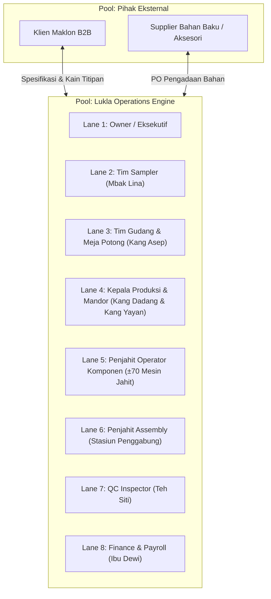
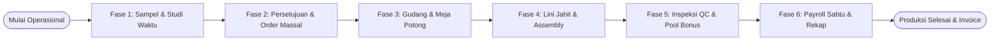
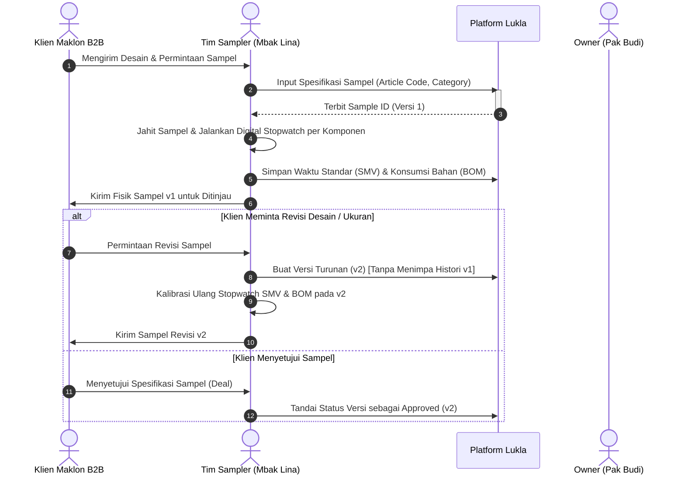
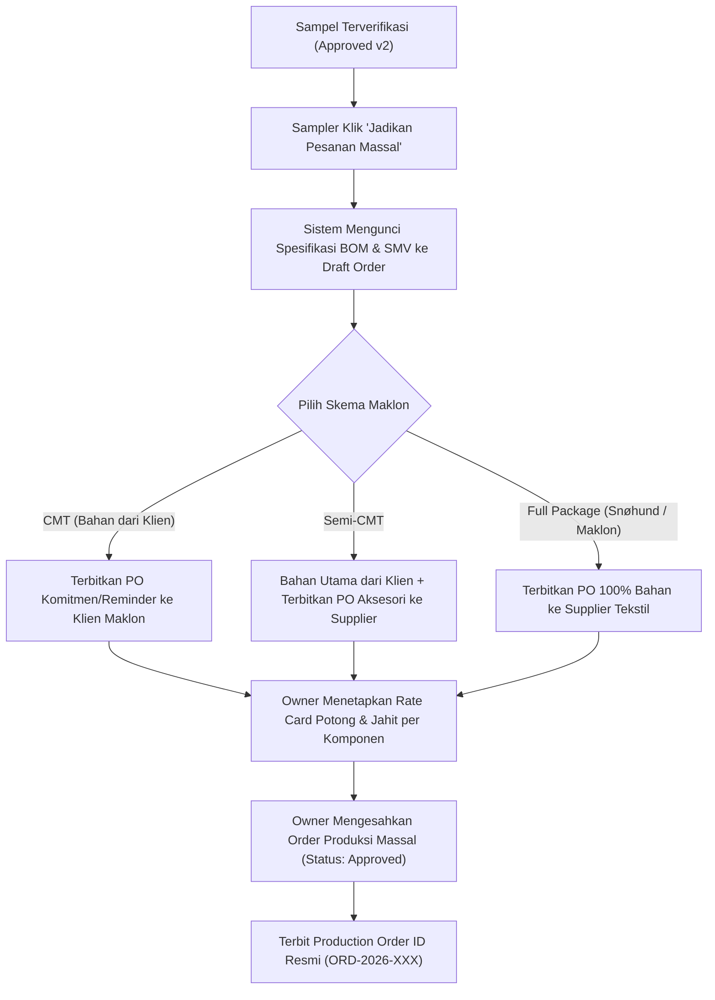
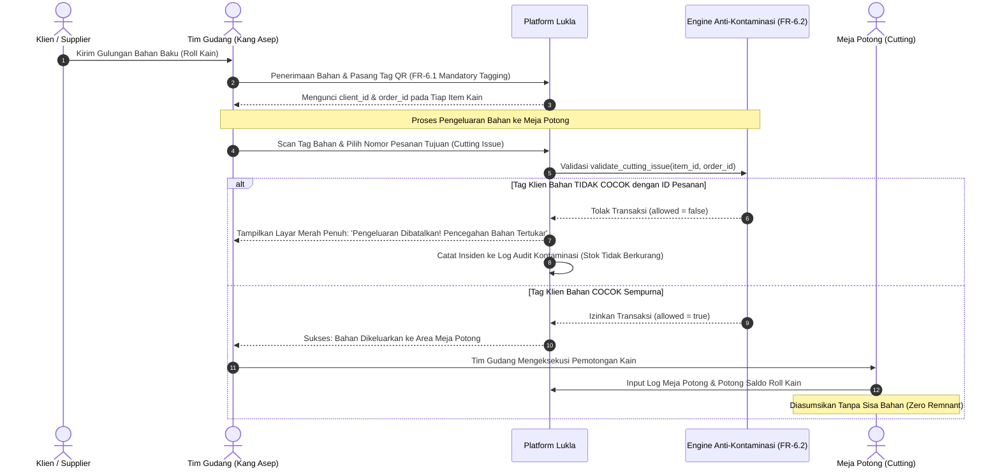
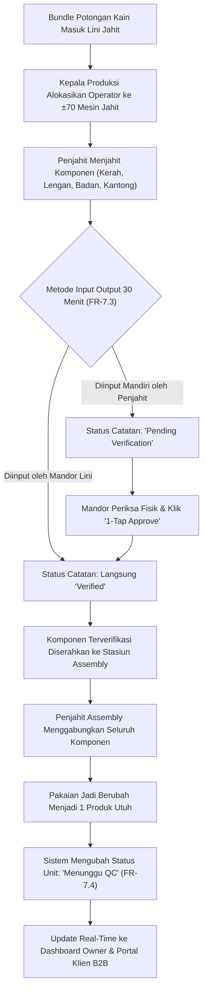
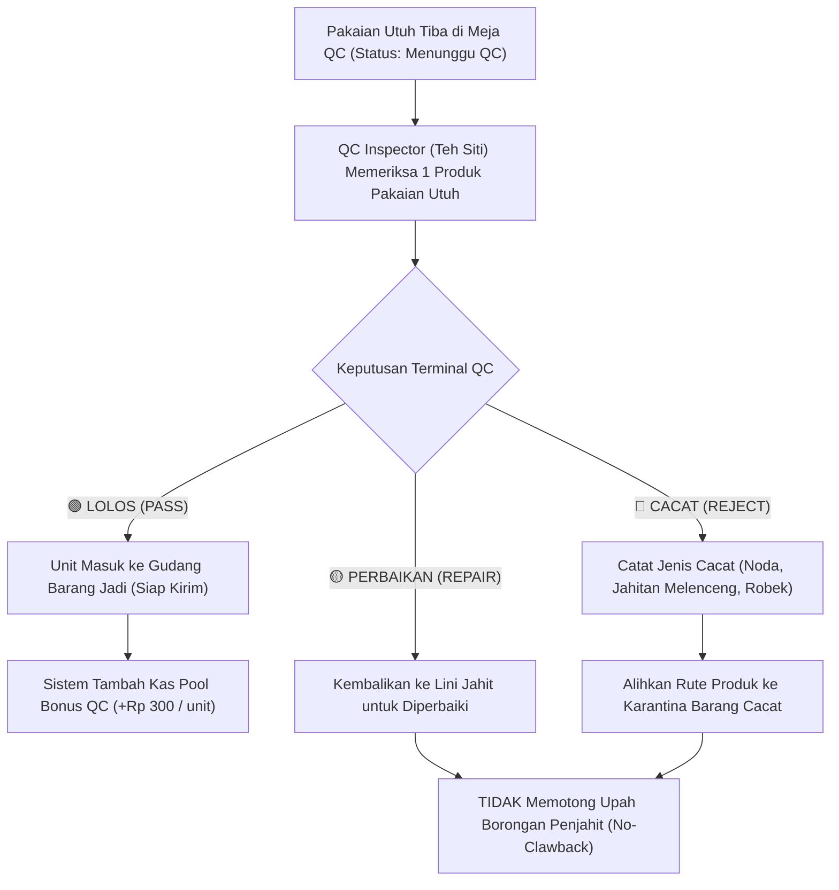
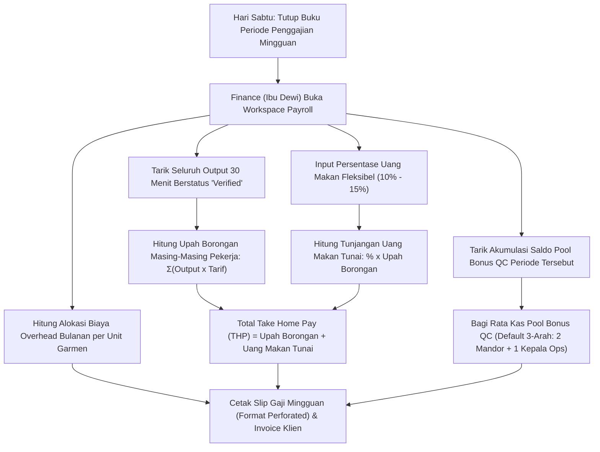

# Spesifikasi Alur Kerja BPMN 2.0 — Versi 2.0 Final
## Lukla Operations Engine

| Atribut Dokumen | Rincian |
|---|---|
| **Nama Dokumen** | Standar Proses Bisnis Manufaktur BPMN 2.0 |
| **Sistem Terkait** | Lukla Operations Engine (Pabrik Garmen Ciwidey & Snøhund) |
| **Versi Dokumen** | **2.0 Final (Diselaraskan Penuh dengan Master BRD & PRD v2.0)** |
| **Notasi Pemodelan** | Business Process Model and Notation (BPMN 2.0) |
| **Penyusun** | Tim Kelompok 6 — Alkademi Offline Phase 3 |
| **Tanggal Efektif** | 15 Oktober 2026 |
| **Status Dokumen** | **Disetujui & Terkunci (Locked Master BPMN Document)** |

---

## 1. Arsitektur Kolam & Jalur Renang (Pool & Swimlanes)

Proses operasional end-to-end dimodelkan dalam 1 Pool Utama (**Lukla Manufacturing & Snøhund**) yang berinteraksi dengan Pool Eksternal (**Klien Maklon B2B & Supplier**), terbagi ke dalam **8 Jalur Renang (Swimlanes)**:

---

## 2. Diagram Alur Proses Global 6 Fase Operasional (BPMN 2.0)

Alur kerja manufaktur garmen Lukla berjalan melintasi 6 fase berurutan tanpa celah kontaminasi:

---

## 3. Rincian Alur Kerja per Fase (Swimlane Activity Breakdown)

### 3.1 Fase 1: Sampel & Studi Waktu (Sample Intake, SMV & BOM Versioning)

**Aturan BPMN Fase 1**:
- *Task 1.1*: Tim Sampler adalah personil resmi yang melakukan intake pendaftaran klaim sampel klien.
- *Task 1.2*: Stopwatch digital interaktif wajib mencatat SMV per komponen garmen (kerah, lengan, badan depan, risleting).
- *Task 1.3*: Sistem wajib menjaga *version immutability* (`v1` tidak boleh terhapus saat `v2` dibuat).

---

### 3.2 Fase 2: Persetujuan & Penerbitan Pesanan Massal (Mass Order & Maklon Schemes)

**Aturan BPMN Fase 2**:
- *Task 2.1*: Sampler mengeksekusi konversi dari versi sampel yang disetujui ke Pesanan Massal.
- *Task 2.2*: Pada skema CMT, PO diterbitkan langsung ke Klien Maklon sebagai surat komitmen legal pengiriman bahan titipan.
- *Task 2.3*: Owner menetapkan Rate Card (ongkos potong & jahit) serta parameter variabel (% uang makan dan tarif bonus QC).

---

### 3.3 Fase 3: Gudang, Validasi Anti-Kontaminasi & Meja Potong (Cutting Station)

**Aturan BPMN Fase 3**:
- *Task 3.1 (FR-6.1)*: Setiap roll kain yang masuk gudang wajib memiliki `client_id` dan `order_id`.
- *Task 3.2 (FR-6.2)*: Engine Anti-Kontaminasi memblokir pengeluaran jika `client_id` bahan berbeda dengan pesanan tujuan.
- *Task 3.3*: Pemotongan kain (*Cutting*) dilakukan langsung oleh personil Tim Gudang, dan sisa bahan diasumsikan nol (*zero remnant*).

---

### 3.4 Fase 4: Lini Produksi ±70 Mesin, Input 30 Menit Dual-Mode & Assembly

**Aturan BPMN Fase 4**:
- *Task 4.1*: Alokasi penjahit lintas lini bersifat cair hingga ±70 mesin aktif tanpa batasan slot kaku.
- *Task 4.2*: Dual-Mode input menjamin fleksibilitas (Mandor = langsung verified; Penjahit = pending verifikasi mandor).
- *Task 4.3*: Penjahit Assembly menggabungkan komponen menjadi satu produk utuh sebelum dikirim ke meja QC.

---

### 3.5 Fase 5: Quality Control (QC 1 Produk Utuh & Pool Bonus QC)

**Aturan BPMN Fase 5**:
- *Task 5.1*: Objek inspeksi HANYA berupa 1 produk pakaian utuh, bukan potongan komponen lepas.
- *Task 5.2*: Upah borongan penjahit tidak terpengaruh hasil QC (*no clawback*). Penjahit tetap menerima upah dari output 30 menit yang telah `Verified`.
- *Task 5.3*: Setiap 1 unit pakaian utuh berstatus `LOLOS` menambah saldo Pool Bonus QC sebesar Rp 300.

---

### 3.6 Fase 6: Penggajian Borongan Sabtu, Uang Makan Tunai & Rekapitulasi Keuangan

**Aturan BPMN Fase 6**:
- *Task 6.1*: Gaji borongan dihitung setiap Sabtu dari akumulasi output terverifikasi mandor dikalikan tarif Rate Card.
- *Task 6.2*: Uang makan fleksibel (10–15%) dicairkan sebagai uang tunai langsung ke dalam slip gaji mingguan.
- *Task 6.3*: Pool Bonus QC dibagi rata kepada 2 Mandor dan 1 Kepala Operasional (masing-masing 33,33%), dengan pengaturan dinamis jika mandor bertambah.
- *Task 6.4*: Overhead bulanan (listrik, air, internet) dibagi rata per unit garmen yang diproduksi.

---

## 4. Matriks Data Stores & Entitas Basis Data

| ID Data Store | Nama Tabel Database | Fungsi dalam Alur BPMN | Relasi Kunci |
|---|---|---|---|
| **DS-01** | `clients` | Master data tenant merek Snøhund & Klien B2B | `id`, `client_code`, `thread_color_hex` |
| **DS-02** | `samples` & `sample_versions` | Histori intake sampel, BOM, SMV stopwatch, dan versioning | `sample_id`, `version_number`, `is_approved` |
| **DS-03** | `production_orders` | Master order produksi massal turunan sampel yang disetujui | `order_number`, `client_id`, `sample_version_id` |
| **DS-04** | `inventory_items` | Master stok bahan baku dengan tag anti-kontaminasi | `client_id`, `order_id`, `stock_qty` |
| **DS-05** | `cutting_logs` | Catatan riwayat meja potong dan konversi roll kain | `batch_id`, `inventory_item_id`, `qty_cut_sets` |
| **DS-06** | `production_logs_30min` | Catatan output interval 30 menit lantai jahit | `machine_number`, `tailor_id`, `is_verified` |
| **DS-07** | `qc_inspections` | Catatan hasil inspeksi pakaian utuh (Pass/Repair/Reject) | `order_id`, `result`, `defect_type` |
| **DS-08** | `qc_bonus_pool` | Saldo kas akumulasi bonus pengawas mutu | `order_id`, `pool_amount`, `split_ratio` |
| **DS-09** | `payroll_items` | Rekapitulasi slip gaji mingguan hari Sabtu | `worker_id`, `piece_rate_wage`, `meal_allowance` |
| **DS-10** | `contamination_audit_logs` | Audit trail insiden percobaan pengeluaran bahan tertukar | `item_id`, `attempted_order_id`, `timestamp` |

---

## 5. Ringkasan Kepatuhan & Jaminan Integritas Alur

Dengan implementasi spesifikasi BPMN 2.0 ini:
1. **Zero Contamination**: Tidak ada celah bagi kain Klien A terpotong untuk pesanan Klien B berkat validasi otomatis FR-6.2.
2. **Zero Payroll Dispute**: Tidak ada sengketa pemotongan gaji buruh karena upah borongan 100% terkunci pada verifikasi output 30 menit mandor (*no clawback*).
3. **Transparent Quality Bonus**: Mutu pakaian tetap terjamin di tingkat tertinggi karena bonus mandor dan kepala operasional terikat langsung pada kuantitas unit yang lolos QC.
4. **Seamless Traceability**: Klien B2B dapat memantau setiap detik pergerakan kain titipannya dari meja potong hingga siap kirim secara mandiri melalui portal.
