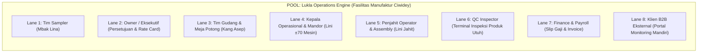

# BPMN 2.0 Process Specification — Versi 2.1 Final
## Lukla Operations Engine — 6 Fase Operasional Manufaktur

| Atribut Dokumen | Rincian |
|---|---|
| **Nama Dokumen** | BPMN 2.0 Process Architecture & End-to-End Operational Flow |
| **Model Operasional** | Multi-Tenant Manufaktur Tas & Ransel Taktikal Outdoor (±70 Mesin Jahit) |
| **Versi Dokumen** | **2.1 Final (Pembaruan QA Tahap 1: Pak Harry & Mbak Rini)** |
| **Penyusun** | Tim Kelompok 6 — Alkademi Offline Phase 3 |
| **Tanggal Efektif** | 15 Oktober 2026 |
| **Status Dokumen** | **Disetujui & Terkunci untuk Alur Eksekusi Sistem (v2.1)** |

---

## 1. Arsitektur Pool & Swimlanes BPMN 2.0 (BPMN-01 & BPMN-02)

Alur proses operasional manufaktur terbagi ke dalam **1 Pool Utama (Lukla Operations Engine)** dengan **8 Swimlanes Fungsional**:

> **Catatan Swimlane (BPMN-02)**: Penjahit Operator (jahit komponen) dan Penjahit Assembly (perakitan ransel utuh) berada dalam satu role sistem `TAILOR_OPERATOR` dengan jenis penugasan dinamis yang ditetapkan oleh Mandor/Kepala Operasional melalui Matriks Alokasi Mesin.

---

## 2. Alur 6 Fase Operasional End-to-End (BPMN-03 s/d BPMN-14)

### Fase 1: Intake Sampel, Studi Waktu & Versioning (`Approved vN`) (BPMN-04)
1. **Intake Spesifikasi**: Tim Sampler mendaftarkan klaim spesifikasi tas ransel dari klien (*Snøhund Tactical Backpack 35L*).
2. **Studi Waktu (Digital Stopwatch)**: Menguji waktu baku jahit (*Standard Minute Value* / SMV) per komponen: Panel Depan, Panel Belakang, Tali Bahu, Saku Organizer, Webbing Molle, dan Assembly Ransel Utuh.
3. **Penyusunan BOM Sampel**: Mencatat konsumsi bahan per unit (misal: 1,45 meter Cordura 1000D / pcs).
4. **Versioning Revisi**: Mendukung siklus revisi (`v1 -> v2 -> vN`) tanpa menimpa histori versi lama.
5. **Gateway Persetujuan Sampel**: Saat klien dan pabrik mencapai kesepakatan pada versi `Approved vN`, spesifikasi dikunci sebagai dasar pesanan massal.

---

### Fase 2: Persetujuan Owner & Penerbitan Production Order (BPMN-05 & BPMN-06)
1. **Penyusunan Draft Pesanan Massal**: Tim Sampler menyusun draft pesanan massal dari versi sampel `Approved vN`.
2. **Antrean Persetujuan Owner (Owner Approval Gate)**:
   - Draft pesanan otomatis masuk ke antrean **"🚨 Antrean Persetujuan Pesanan Massal (Wewenang Owner)"** di Dashboard.
   - Owner memverifikasi kelayakan komersial dan menyetujui (`[✅ Setujui & Kunci Pesanan]`).
3. **Penguncian Rate Card**:
   - Persetujuan Owner otomatis mengunci harga komersial jasa klien dan tarif borongan komponen internal.
4. **Penerbitan Production Order Resmi (SPK)**:
   - Sistem menerbitkan Production Order resmi dengan nomor unik (`ORD-YYYY-XXX`).
5. **Penerbitan Dokumen Pengadaan Sesuai Skema**:
   - **Skema CMT**: Menerbitkan **Surat Komitmen / Reminder CMT** ke Klien Maklon untuk jadwal pengiriman bahan titipan.
   - **Skema Semi-CMT**: Menerbitkan **PO Supplier** untuk bahan pendukung (benang nilon, ritsleting YKK, buckle asetal) + Surat Komitmen bahan utama ke klien.
   - **Skema Full Package**: Menerbitkan **PO Pengadaan Bahan Lengkap** ke vendor supplier.

---

### Fase 3: Gudang, Validasi Anti-Kontaminasi & Cutting (BPMN-08 & BPMN-09)
1. **Penerimaan Bahan Baku**: Bahan masuk ditandai dengan QR label wajib (*Mandatory Client Tagging FR-6.1*): memuat `client_id`, `order_id`, dan nomor roll.
2. **Pintu Meja Potong (Cutting Station Gate)**:
   - Tim Gudang memindai QR roll bahan dan memilih pesanan target.
3. **Validasi Anti-Kontaminasi Keras (FR-6.2)**:
   - Sistem memeriksa kecocokan `client_id` pemilik bahan dengan pesanan target.
   - **Jika TIDAK COCOK**: Sistem **MENOLAK SEKETIKA (HTTP 403 Forbidden)**, layar modal merah berbunyi, dan insiden dicatat ke audit log kontaminasi.
   - **Jika COCOK**: Transaksi disetujui, personil Gudang melakukan pemotongan pola komponen ransel (*Cutting*).
4. **Asumsi Sisa Bahan (Zero Remnant)**: Bahan yang dipotong diasumsikan pas terkonversi sesuai target kuantitas pesanan massal.

---

### Fase 4: Lini Produksi, Matriks Alokasi & Input 30 Menit (BPMN-10)
1. **Matriks Alokasi Penjahit (±70 Mesin)**:
   - Mandor / Kepala Operasional memetakan penjahit aktif ke nomor mesin (#1 s/d #70), pesanan target, dan komponen spesifik.
2. **Pencatatan Output 30 Menit (Dual-Mode)**:
   - **Mode Mandor**: Mandor berkeliling membawa tablet, menginput output -> Status langsung **`VERIFIED`**.
   - **Mode Penjahit**: Penjahit menginput via kiosk numpad sentuh -> Status **`PENDING VERIFICATION`** (garis putus-putus *basting stitch*). Mandor mengeklik *1-Tap Verify* untuk mengesahkan output.
3. **Antrean FIFO Perakitan (Assembly Queue)**:
   - Komponen terverifikasi dikumpulkan ke meja assembly. Penjahit assembly merakit komponen menjadi 1 produk tas ransel utuh. Output assembly dicatat dan masuk ke perhitungan upah borongan.
4. **Pemicu Real-Time ke QC**:
   - Tas ransel utuh yang selesai dirakit otomatis dialihkan ke antrean Terminal QC dan status pesanan terpancar ke Dashboard Owner & Portal B2B.

---

### Fase 5: Terminal QC Produk Utuh, Bonus Pool & Siklus Repair (BPMN-11 & BPMN-12)
1. **Antrean FIFO Inspeksi QC**:
   - Tas ransel utuh masuk ke daftar antrean inspeksi QC berdasarkan urutan kedatangan.
2. **Inspeksi 1 Produk Ransel Utuh**:
   - QC Inspector menginspeksi produk ransel utuh pada meja QC dan mengambil salah satu dari 3 keputusan:
     - **`LOLOS (PASS)`**: Unit memenuhi standar mutu. Status berubah jadi Barang Jadi.
       - *Jika unit baru*: Menambah saldo **Pool Bonus QC** (+Rp 300/unit).
       - *Jika unit hasil perbaikan (re-inspection)*: Dialihkan ke Barang Jadi **TANPA menambah bonus ganda (+Rp 0)**.
     - **`PERBAIKAN (REPAIR)`**: Ditemukan cacat minor (misal: ritsleting macet, jahitan melompat). Unit dikembalikan ke lini jahit untuk diperbaiki. **Upah penjahit TIDAK dipotong (*No Clawback*)**.
     - **`CACAT (REJECT)`**: Ditemukan cacat fatal (misal: kain sobek, cacat tenun). Kategori cacat dicatat, rute barang dialihkan. **Upah penjahit TIDAK dipotong**.

---

### Fase 6: Penggajian Mingguan, Overhead Bulanan & Penagihan (BPMN-13 & BPMN-14)
1. **Penggajian Borongan Mingguan (Sabtu Pagi)**:
   - Akumulasi seluruh output 30 menit berstatus `Verified` dikalikan tarif jahit komponen internal.
   - Mendukung penambahan penjahit baru di tengah minggu tanpa merusak formula hitung.
2. **Pencairan Uang Makan Tunai**:
   - Persentase variabel uang makan (10–15%) dihitung dari total upah borongan dan ditambahkan langsung ke slip gaji:
     $$\text{Take Home Pay (THP)} = \text{Upah Borongan} + \text{Uang Makan Tunai}$$
3. **Penyaluran Pool Bonus QC 3-Arah (MVP)**:
   - Total akumulasi saldo Pool Bonus QC dibagi rata ($\frac{1}{3}$) kepada 3 pengawas tetap: **2 Mandor** dan **1 Kepala Operasional**.
4. **Alokasi Biaya Overhead Bulanan**:
   - Total pengeluaran operasional bulanan (listrik, air, internet) dibagi total tas yang diproduksi pada bulan tersebut untuk menghitung beban overhead per unit.
5. **Penerbitan Invoice Termin Klien B2B**:
   - Diterbitkan sesuai skema pembayaran (misal: DP 50% di awal dan Pelunasan 50% setelah QC barang jadi lolos).

---

## 3. Matriks Entitas Data Basis Data (BPMN-15 & BPMN-16)

| Nama Tabel / Entitas | Kunci Utama & Relasi | Peran dalam Alur Operasional BPMN |
|---|---|---|
| `clients` | `id` (UUID), `client_code` (Unique) | Identitas penyewa multi-tenant (Snøhund & Klien B2B). |
| `sample_specifications` | `id`, `client_id`, `version_number` | Master data sampel, riwayat revisi `v1 -> vN`, dan hasil uji stopwatch SMV/BOM. |
| `orders` | `id`, `client_id`, `sample_id`, `order_number` | Production Order resmi hasil persetujuan Owner. |
| `raw_materials` | `id`, `client_id`, `order_id`, `qr_code_tag` | Stok kain Cordura/Ripstop di gudang dengan penandaan FR-6.1. |
| `machine_allocations` | `machine_number` (1-70), `user_id`, `order_id` | Matriks penugasan penjahit Mandor/Kepala Ops. |
| `output_logs_30min` | `id`, `machine_number`, `user_id`, `order_id` | Log output 30 menit (`PENDING` vs `VERIFIED`). |
| `qc_inspections` | `id`, `order_id`, `product_serial_tag`, `decision` | Keputusan inspeksi QC (`PASS`, `REPAIR`, `REJECT`), riwayat re-inspeksi. |
| `qc_bonus_ledger` | `id`, `order_id`, `inspection_id`, `amount` | Akumulasi saldo bonus QC per unit lolos baru (+Rp 300). |
| `payroll_periods` & `payroll_slips` | `period_id`, `worker_id`, `thp_amount` | Rekapitulasi slip gaji borongan mingguan hari Sabtu. |
| `client_invoices` | `id`, `client_id`, `order_id`, `total_amount` | Penagihan komersial ke klien B2B. |
