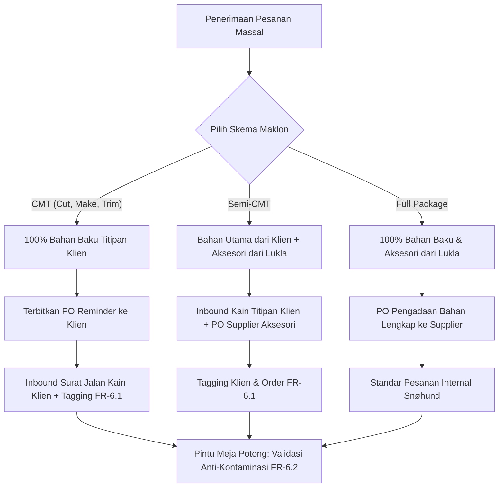

# Business Requirement Document (BRD) — Versi 2.0 Final
## Lukla Operations Engine

| Atribut Dokumen | Rincian |
|---|---|
| **Nama Proyek** | Lukla Operations Engine |
| **Organisasi & Fasilitas** | Lukla Manufacturing (Ciwidey, Kab. Bandung) & Merek Internal **Snøhund** |
| **Kapasitas Operasional** | ±70 Mesin Jahit Aktif (Alokasi Dinamis Lintas Lini) |
| **Model Bisnis** | Multi-Tenant (Merek Internal Snøhund Made-to-Order & Klien Maklon B2B Eksternal) |
| **Versi Dokumen** | **2.0 Final (Diselaraskan Penuh dengan Implementasi Sistem & 10 Aturan Resmi)** |
| **Penyusun** | Tim Kelompok 6 — Alkademi Offline Phase 3 |
| **Tanggal Efektif** | 15 Oktober 2026 |
| **Status Dokumen** | **Disetujui & Terkunci (Locked Master Document)** |

---

## 1. Ringkasan Eksekutif & Latar Belakang Bisnis

**Lukla Manufacturing** mengoperasikan pabrik garmen semi-padat karya di kawasan Ciwidey, Kabupaten Bandung, dengan lantai produksi dinamis berkapasitas hingga **±70 mesin jahit aktif**. Pabrik ini menjalankan dua pilar model bisnis manufaktur secara simultan (*multi-tenant*):
1. **Merek Internal Snøhund**: Lini pakaian outdoor premium dengan model produksi *made-to-order* menggunakan skema *Full Package*.
2. **Klien Maklon B2B Eksternal**: Penyedia jasa potong, jahit, dan finishing garmen untuk berbagai jenama pakaian dan korporasi pihak ketiga menggunakan skema *CMT*, *Semi-CMT*, maupun *Full Package*.

Sebelum digitalisasi melalui **Lukla Operations Engine**, lantai pabrik menghadapi 4 titik rawan operasional (*operational pain points*):
- **Risiko Kontaminasi Silang Stok (Cross-Contamination Risk)**: Tercampurnya kain gulungan titipan klien eksternal dengan kain milik klien lain atau merek Snøhund saat proses pengeluaran ke meja potong (*Cutting*).
- **Friksi Penggajian Borongan Mingguan**: Fluktuasi jumlah penjahit harian, lambatnya rekap kertas pencatatan output per 30 menit, perdebatan pemotongan upah akibat barang cacat QC, dan perhitungan uang makan.
- **Ketiadaan Versioning Sampel & Riwayat Studi Waktu**: Hilangnya riwayat revisi spesifikasi sampel (`v1` ke `v2`) dan tidak akuratnya estimasi waktu baku (*Standard Minute Value* / SMV) serta konsumsi bahan (*Bill of Materials* / BOM).
- **Keterbatasan Visibilitas Real-Time Klien Maklon**: Klien B2B tidak memiliki akses mandiri untuk memantau status pengerjaan pesanan dan saldo kain titipannya.

**Lukla Operations Engine** hadir sebagai sistem operasi manufaktur garmen terpadu yang memadukan keandalan validasi stok fisik, fleksibilitas terminal input lantai produksi, transparansi slip gaji mingguan, isolasi data multi-tenant ketat, serta asisten pengetahuan operasional berbasis kecerdasan buatan (*AI Knowledge Assistant*).

---

## 2. 10 Asumsi & Aturan Bisnis Resmi (Locked Presentation Rules)

Berdasarkan kesepakatan resmi arsitektur dan materi pembelaan sidang proyek (merujuk pada `docs/Catatan_Asumsi_dan_Aturan_Bisnis_Presentasi.md`), sistem mengunci 10 aturan bisnis berikut:

| No | Topik / Area | Aturan Bisnis Terkunci | Justifikasi Bisnis & Operasional Lantai Pabrik |
| :-: | :--- | :--- | :--- |
| **1** | **Gaji Borongan vs Status QC** | **Gaji borongan penjahit TIDAK terpengaruh oleh status barang QC (*No Clawback*).** | Penjahit dibayar penuh berdasarkan akumulasi output komponen 30 menit yang telah disahkan (`Verified`) oleh Mandor. Unit pakaian yang dinyatakan *Repair* atau *Cacat/Reject* di QC tidak memotong upah penjahit. Ini mencegah perselisihan kerja dan menjaga moral buruh di lantai pabrik semi-padat karya. |
| **2** | **Fungsi Terminal QC** | **Hasil QC HANYA berpengaruh terhadap Pool Bonus QC.** | Terminal QC murni berfungsi sebagai pintu penjaminan mutu barang jadi (*Quality Gate*). Setiap 1 unit pakaian utuh yang dinyatakan **`LOLOS (PASS)`** menambah saldo kas **Pool Bonus QC** (+Rp 300/unit) yang dialokasikan bagi pengawas produksi. |
| **3** | **Uang Makan Fleksibel (10–15%)** | **Uang makan (10–15%) dicairkan sebagai uang tunai dan masuk langsung ke Slip Gaji penjahit.** | Persentase uang makan (10% hingga 15% dari total upah borongan periode terkait) dihitung sebagai tunjangan tunai transparan di slip gaji mingguan hari Sabtu: $\text{Take Home Pay (THP)} = \text{Upah Borongan} + \text{Uang Makan Tunai}$. |
| **4** | **Bentuk Fisik Objek di Meja QC** | **Inspeksi QC dilakukan HANYA pada 1 produk pakaian utuh (Barang Jadi).** | QC Inspector tidak memeriksa per komponen lepasan (seperti kerah/saku/lengan saja), melainkan produk utuh pakaian jadi hasil penggabungan stasiun perakitan (*Assembly/Finishing*). |
| **5** | **Alur PO pada Skema CMT Murni** | **Skema CMT Murni TETAP menerbitkan PO, tetapi ditujukan langsung kepada Klien Maklon.** | Berbeda dengan PO pengadaan supplier, PO pada CMT berfungsi sebagai **Surat Perjanjian Komitmen Produksi & Instrumen Tracking Pengingat (*Reminder*)** pengiriman bahan titipan dari klien ke gudang Lukla. |
| **6** | **Hirarki & Struktur Mandor vs Kepala Produksi** | **Hak akses menu platform setara, namun secara struktural Kepala Produksi di atas Mandor. Default bonus: 2 Mandor + 1 Kepala Ops (3-Arah), dengan pengaturan dinamis bila Mandor > 2.** | Menu produksi sama-sama mencakup alokasi mesin dan verifikasi output. Default pembagian Pool Bonus QC adalah dibagi rata $\frac{1}{3}$ bagian kepada 2 Mandor dan 1 Kepala Operasional, dilengkapi pengaturan dinamis di halaman Owner jika kelak jumlah mandor bertambah. |
| **7** | **Dual-Mode Input Output 30 Menit** | **Input oleh Mandor -> Langsung `Verified`. Input oleh Penjahit -> Berstatus `Pending Verification` (Wajib disahkan Mandor).** | Mendukung fleksibilitas pabrik Ciwidey: Mandor dapat berkeliling membawa tablet (langsung sah), atau penjahit menginput mandiri via kiosk terminal lantai (memerlukan tombol *1-Tap Approve* Mandor sebelum masuk rekap gaji). |
| **8** | **Operasional Pemotongan Kain (Cutting)** | **Pemotongan kain dilakukan langsung oleh Personil Tim Gudang.** | Setelah bahan baku lolos validasi anti-kontaminasi FR-6.2 di pintu gudang, proses pemotongan pola kain (*Cutting*) dilakukan langsung oleh personil Tim Gudang sebelum bundle potongan diserahkan ke penjahit lini. |
| **9** | **Toleransi Sisa Bahan Titipan** | **Diasumsikan TIDAK ADA sisa bahan titipan (*Zero Remnant / Zero Shortage*).** | Seluruh bahan baku/titipan yang dikeluarkan ke cutting diasumsikan terkonversi pas sesuai kuantitas pesanan massal (*zero remnant assumption*). |
| **10** | **Wewenang Tim Sampler & Multi-Role Adaptif** | **Sampler adalah personel pendaftaran klaim/spesifikasi klien & penerbit order produksi massal. Semua 8 role adaptif di Mobile & PC.** | Tim Sampler memegang wewenang intake spesifikasi sampel, uji stopwatch SMV & BOM, serta penerbitan Order Produksi Massal ketika versi sampel disetujui (`Approved v2`). Seluruh 8 role wajib adaptif di layar Mobile (`390x844`), Tablet (`768x1024`), dan PC (`1440x900`). |

---

## 3. Cakupan Model Bisnis & 3 Skema Maklon

Sistem wajib mengakomodasi 3 skema manufaktur garmen pada setiap pesanan:

1. **CMT (Cut, Make, Trim)**:
   - Klien maklon menyediakan 100% bahan baku utama dan pendukung.
   - Lukla menyediakan jasa tenaga kerja potong, jahit, perakitan, dan finishing.
   - Sistem menerbitkan PO Komitmen/Reminder langsung ke Klien Maklon, kemudian menerima Surat Jalan Titipan Klien di gudang.
2. **Semi-CMT**:
   - Bahan baku utama kain dititipkan oleh klien maklon.
   - Bahan pendukung, kancing, ritsleting, dan aksesori diadakan oleh Lukla melalui PO Supplier resmi.
3. **Full Package (CMT + Bahan)**:
   - Lukla bertanggung jawab atas 100% pengadaan kain, benang, aksesori, hingga proses produksi pakaian jadi utuh.
   - Menjadi skema standar mutlak untuk seluruh lini produk internal **Snøhund**.

---

## 4. Matriks 8 Peran Pengguna (RBAC) & Akses Multi-Device

Platform dirancang untuk 8 peran pengguna dengan batasan hak akses ketat dan kompatibilitas lintas perangkat:

| ID | Peran (Role) | Target Perangkat Utama | Wewenang & Izin Operasional Utama | Batasan Ketat & Keamanan Data |
| :-: | :--- | :--- | :--- | :--- |
| **R1** | **Owner / Eksekutif** | 💻 Desktop PC & 📲 Mobile | Melihat dashboard eksekutif KPI real-time (±70 mesin, output, lolos QC), menetapkan Rate Card tarif komponen, mengonfigurasi variabel sistem (% Uang Makan, Rate Bonus QC, Daftar Mandor penerima bonus), serta akses penuh asisten AI. | Tidak dapat mengubah transaksi produksi yang telah dikunci (*locked audit log*). |
| **R2** | **Tim Sampler (Mbak Lina)** | 📲 Mobile/Tablet & 💻 PC | Mendaftarkan spesifikasi awal sampel klien, mencatat pemakaian bahan (Sample BOM), mengoperasikan Digital Stopwatch SMV per komponen, membuat revisi (`v1 -> v2`), dan menerbitkan Order Produksi Massal saat sampel disetujui. | Tidak dapat melakukan verifikasi output jahitan atau mengubah master tarif gaji. |
| **R3** | **Gudang (Kang Asep)** | 📲 Mobile (QR Scanner) & 💻 PC | Menerima bahan baku (PO Supplier / Surat Jalan Titipan Klien), menerbitkan dan menempelkan `Tag ID Klien` + `ID Pesanan` (FR-6.1), memotong kain di meja potong (*Cutting Station*), mencatat pemakaian roll kain, dan ekspor CSV riwayat potong. | **Diblokir mutlak oleh sistem (FR-6.2)** jika mencoba mengeluarkan bahan dengan tag klien yang tidak cocok dengan ID pesanan tujuan. |
| **R4** | **Kepala Produksi & Mandor** | 📱 Tablet Lini & 💻 PC | Mengalokasikan penjahit ke ±70 mesin jahit, menginput output 30 menit (langsung berstatus `Verified`), memverifikasi output inputan operator via *1-Tap Verify*, dan memantau antrean *Assembly*. | Secara struktural Kepala Produksi di atas Mandor, namun menu platform setara. Tidak dapat mengubah hasil keputusan QC atau rumus payroll. |
| **R5A** | **Penjahit Operator (Lini Jahit)** | 📱 Touch Terminal Numpad / Mobile | Melihat tugas jahitan komponen baju, menginput hasil jahit per interval 30 menit menggunakan numpad layar sentuh besar (berstatus `Pending Verification` hingga diverifikasi Mandor). | Tidak dapat mengesahkan output sendiri dan tidak memiliki akses ke data keuangan/klien lain. |
| **R5B** | **Penjahit Assembly (Stasiun Gabung)** | 📱 Touch Terminal / Tablet | Menggabungkan komponen-komponen lepasan (badan, lengan, kerah) dari operator menjadi **1 produk utuh pakaian jadi**, mengubah status unit menjadi **`Menunggu QC`**. | Diperlakukan setara dengan operator penjahit di bawah pengawasan Mandor; tidak dapat mengubah data inspeksi QC. |
| **R6** | **QC Inspector (Teh Siti)** | 📱 Tablet QC / Mobile Touch | Memeriksa 1 produk utuh di meja QC, memilih 3 keputusan instan (**`LOLOS`**, **`PERBAIKAN`**, **`CACAT`**), memilih kode jenis cacat, dan memantau pertambahan saldo Pool Bonus QC. | Tidak dapat memotong upah borongan penjahit (*no clawback*); hasil inspeksi hanya memengaruhi bonus pengawas. |
| **R7** | **Finance & Payroll (Ibu Dewi)** | 💻 Desktop PC Workspace | Menyetujui PO pembelian bahan, menghitung payroll mingguan hari Sabtu (Borongan + Uang Makan 10-15% tunai), mengkalkulasi pembagian Pool Bonus QC 3-Arah, menghitung alokasi overhead bulanan per unit, serta mencetak Slip Gaji & Invoice. | Tidak memiliki hak mengubah fisik stok gudang atau data verifikasi output 30 menit. |
| **R8** | **Klien Maklon B2B (External Portal)** | 💻 Desktop PC & 📲 Mobile | Portal eksternal terisolasi untuk melihat timeline progres pesanan massal, status persetujuan sampel, dan sisa saldo kain titipan miliknya di gudang Lukla. | **Terisolasi mutlak (Multi-Tenant RLS)**: Tidak dapat melihat data pesanan, kain, atau nama klien lain maupun data internal pabrik Lukla. |

---

## 5. Rincian 6 Fase Operasional BPMN 2.0

### Fase 1: Sampel & Studi Waktu (Sample & Time Study)
- **FR-1.1 Pendaftaran Klaim & Spesifikasi Sampel**: Tim Sampler menerima intake desain dan membuat rekam spesifikasi sampel baru di sistem.
- **FR-1.2 Pencatatan Konsumsi Bahan (Sample BOM)**: Sampler mendokumentasikan rincian bahan utama, kain furing, rib, kancing, benang, dan aksesori per unit sampel.
- **FR-1.3 Digital Stopwatch SMV per Komponen**: Sampler mengukur waktu standar kerja (*Standard Minute Value*) per komponen pakaian (misal: kerah, badan depan, lengan, ritsleting) menggunakan fitur stopwatch digital interaktif terintegrasi.
- **FR-1.4 Versioning Revisi Sampel (`v1 -> v2 -> vN`)**: Jika klien meminta modifikasi desain atau ukuran, sistem membuat versi turunan baru tanpa menimpa histori versi lama.

### Fase 2: Persetujuan & Pesanan Massal (Mass Order Conversion)
- **FR-2.1 Penerbitan Order Produksi Massal**: Saat versi sampel disetujui klien (`Approved v2`), Tim Sampler mengeksekusi konversi ke Order Produksi Massal, mengunci seluruh data spesifikasi BOM dan waktu standar SMV.
- **FR-2.2 Pemilihan Skema Maklon & Penerbitan Dokumen**: Sistem menetapkan skema (`CMT`, `SEMI_CMT`, `FULL_PACKAGE`). Pada skema CMT, sistem otomatis menerbitkan PO Komitmen/Reminder ke Klien Maklon.
- **FR-2.3 Penetapan Rate Card**: Owner menetapkan tarif potong dan jahit per komponen serta parameter variabel operasional (% uang makan dan tarif bonus QC per unit).

### Fase 3: Gudang, Validasi Anti-Kontaminasi & Meja Potong
- **FR-3.1 Mandatory Client & Order Tagging (FR-6.1)**: Setiap gulung kain atau aksesori yang masuk ke gudang wajib diikat dengan metadata `client_id` (*Tag ID Klien*) dan `order_id` (*ID Pesanan*).
- **FR-3.2 Blokir Otomatis Anti-Kontaminasi (FR-6.2)**: Saat pengeluaran bahan ke meja potong, sistem memvalidasi kecocokan Tag Klien dan ID Pesanan. Jika bahan milik Klien A dicoba dikeluarkan untuk pesanan Klien B, transaksi ditolak seketika (layar merah peringatan) dan tercatat di audit log.
- **FR-3.3 Stasiun Meja Potong (Cutting Station) & Pelacakan Roll**: Tim gudang mengeksekusi pemotongan kain menjadi set komponen, memotong sisa roll kain secara proporsional, dan dapat mengunduh rekap riwayat meja potong ke format CSV.

### Fase 4: Lini Produksi ±70 Mesin & Pelacakan 30 Menit
- **FR-4.1 Alokasi Dinamis ±70 Mesin Jahit (FR-7.1)**: Kepala Produksi mengalokasikan penjahit operator secara fleksibel ke nomor mesin jahit aktif tanpa batasan kaku.
- **FR-4.2 Input Output 30 Menit Dual-Mode (FR-7.3)**:
  - Input oleh Mandor: Status catatan output langsung **`Verified`**.
  - Input oleh Penjahit Operator: Status catatan output **`Pending Verification`** (wajib diverifikasi Mandor melalui *1-Tap Approve*).
- **FR-4.3 Stasiun Perakitan (Assembly) & Pengubahan Status (FR-7.4)**: Penjahit Assembly menggabungkan komponen-komponen terverifikasi menjadi satu produk utuh pakaian jadi. Sistem mengubah status unit menjadi **`Menunggu QC`** dan memperbarui data real-time ke Dashboard Owner serta Portal B2B.

### Fase 5: Quality Control (QC) & Akumulasi Bonus
- **FR-5.1 Terminal QC Produk Utuh**: QC Inspector menginspeksi pakaian utuh dengan 3 tombol raksasa sentuh: **`LOLOS (PASS)`**, **`PERBAIKAN (REPAIR)`**, dan **`CACAT (REJECT)`**.
- **FR-5.2 Akumulasi Pool Bonus QC**: Setiap 1 unit pakaian utuh yang dinyatakan `LOLOS` menambah saldo kas Pool Bonus QC (+Rp 300).
- **FR-5.3 Perlindungan Upah Borongan (*No Clawback*)**: Unit berstatus `Repair` atau `Cacat` tidak memotong upah penjahit yang sudah terverifikasi di stasiun 30 menit.

### Fase 6: Penggajian Borongan, Uang Makan & Rekap Keuangan
- **FR-6.1 Perhitungan Borongan Mingguan Hari Sabtu (FR-10.1)**: Akumulasi seluruh output komponen berstatus `Verified` dikalikan dengan tarif Rate Card komponen:
  $$\text{Upah Borongan} = \sum (\text{Output Verified Komponen } i \times \text{Tarif Komponen } i)$$
- **FR-6.2 Uang Makan Tunai 10–15% (FR-10.2)**: Persentase variabel uang makan dihitung dari total upah borongan dan langsung dicairkan ke slip gaji masing-masing pekerja:
  $$\text{Uang Makan Tunai} = \%\text{Uang Makan} \times \text{Upah Borongan}$$
  $$\text{Total THP Slip Gaji} = \text{Upah Borongan} + \text{Uang Makan Tunai}$$
- **FR-6.3 Pembagian Pool Bonus QC 3-Arah (FR-10.3)**: Total saldo Pool Bonus QC dibagi rata kepada 2 Mandor dan 1 Kepala Operasional (masing-masing 33,33%), dengan dukungan konfigurasi dinamis jika mandor bertambah.
- **FR-6.4 Alokasi Biaya Overhead Bulanan per Unit (FR-10.4)**: Total beban utilitas bulanan (listrik, air, internet) dibagi total unit garmen yang diproduksi pada bulan tersebut:
  $$\text{Overhead per Unit} = \frac{\text{Total Biaya Operasional Bulanan}}{\text{Total Unit Diproduksi}}$$
- **FR-6.5 Ekspor Laporan & Slip Gaji**: Fasilitas unduh Slip Gaji karyawan mingguan dan ekspor CSV rekap payroll untuk keperluan audit pembukuan.

---

## 6. Spesifikasi Asisten AI (`lukla-rag-service` — Pure Manual RAG)

Untuk menjamin kedaulatan data, kepatuhan hackathon, kecepatan *latency*, dan efisiensi biaya:
- **Arsitektur RAG**: *Pure Manual RAG* (Cross-Region AWS Bedrock + Supabase PostgreSQL `pgvector`).
- **Embedding Model**: `amazon.titan-embed-text-v2:0` (Region `us-east-1` — 1024 dimensi normalized).
- **LLM Generator Model**: `amazon.nova-lite-v1:0` (Region `ap-southeast-1` — penalaran cepat & cerdas).
- **Basis Pengetahuan**: Seluruh file master markdown (`BRD`, `PRD`, `DESIGN_SYSTEM.md`, `Catatan_Asumsi_dan_Aturan_Bisnis_Presentasi.md`).
- **Endpoint API**:
  - `POST /ask`: Tanya-jawab operasional dengan sitasi rujukan dokumen resmi.
  - `GET /health`: Health-check koneksi Bedrock dan Supabase vector store.
- **Karakter Bahasa**: Bahasa Indonesia operasional pabrik yang natural, santun, lugas, dan bebas dari jargon AI slop.

---

## 7. Kriteria Penerimaan & Jaminan Mutu (UAT Suite)

Sistem diwajibkan lulus 100% pada seluruh skenario pengujian Playwright E2E pada 3 viewport (Desktop `1440x900`, Tablet `768x1024`, Mobile `390x844`):
- **UAT-01 (FR-6.1 & FR-6.2)**: Blokir otomatis pengeluaran bahan jika Tag Klien tidak cocok dengan ID Pesanan.
- **UAT-02 (FR-7.1, FR-7.3, FR-10.1)**: Fleksibilitas penambahan penjahit baru di tengah minggu dan akurasi rekap gaji Sabtu.
- **UAT-03 (FR-10.3)**: Simulasi 3.000 unit lolos QC mengakumulasi Pool Bonus Rp 900.000 dan dibagi tepat Rp 300.000 ke 3 pengawas.
- **UAT-04**: Alur revisi sampel `v1 -> v2` mewariskan BOM dan SMV ke pesanan massal Semi-CMT.
- **UAT-05**: Respons asisten AI mengembalikan jawaban berbasis rujukan dokumen resmi dengan sitasi valid.
