# Lukla Operations Engine — Database Schema & Data Dictionary

**Versi dokumen:** 0.2 — Review Proposal  
**Tanggal:** 16 Oktober 2026  
**Status:** Usulan untuk review; belum menjadi kontrak implementasi  
**Dokumen sumber yang dipertahankan:** `Lukla_Database_Schema_v0.1_Working_Draft.md` (tidak diubah)

> Dokumen ini merupakan rancangan terpisah yang merangkum diskusi bisnis, aturan akses AI, dan review struktur schema. Tabel/kolom baru yang diusulkan tidak berarti sudah tersedia di database Supabase. Jangan menjalankan migrasi hanya berdasarkan dokumen ini sebelum dicocokkan dengan schema aktual dan disetujui tim.

## 1. Tujuan dan cara membaca dokumen

Dokumen ini menjabarkan fungsi tabel, kolom, tipe data, PK/FK, constraint, relasi, dan kontrol akses. Istilah **Dikonfirmasi** berarti aturan bisnis disebut jelas dalam diskusi; **Usulan DBA** berarti rekomendasi model data yang masih harus direview; **Terbuka** berarti keputusan bisnis/implementasi belum final.

Tipe uang menggunakan `NUMERIC`, kuantitas menggunakan `NUMERIC` dengan presisi yang sesuai satuan, tanggal/waktu memakai `DATE`/`TIMESTAMPTZ`, dan identitas internal memakai UUID. Kode yang dibaca manusia (misalnya `order_number`) dipisahkan dari primary key.

### 1.1 Aturan bisnis yang dikunci dari diskusi

- Produk prototipe adalah tas/ransel, bukan pakaian.
- Prospek/lead dan klien merupakan entitas berbeda. Riwayat lead dan sampel tetap ada walaupun prospek menolak sampel atau tidak melanjutkan order.
- Akun portal klien tidak dibuat hanya karena ada lead atau sample. Akun klien dibuat setelah Production Order resmi diterbitkan.
- Sampler membuat draft Production Order; Owner melakukan approve/reject; setelah approval, sistem menerbitkan Production Order resmi.
- Production Order, PO pemasok Lukla, dan komitmen/reminder material dari klien adalah dokumen berbeda.
- Skema CMT: material dari klien; Semi-CMT: material utama dari klien dan aksesori/material pendukung dibeli Lukla; Full Package: material disediakan Lukla.
- Gudang menerima bahan, mencatat kuantitas aktual, dan melakukan cutting. Kedatangan dapat parsial; kurang/lebih dari perkiraan harus tetap dapat dicatat.
- Material selalu ditelusuri dengan identitas klien dan order pada alur yang sedang dibahas. Pengeluaran ke cutting wajib mencegah ketidakcocokan klien/order.
- Sampler mendefinisikan komponen/tugas dan spesifikasi tas. Mandor memilih tugas yang sudah didefinisikan; tidak membuat komponen dari nol.
- Stopwatch wajib digunakan pada fase Sample/Time Study untuk mengukur waktu per komponen dan assembly sebagai dasar penetapan SMV. Setiap hasil pengukuran yang disimpan harus terhubung ke versi sampel dan komponen/tugas terkait. Yang dihapus hanya stopwatch pada proses produksi: output tetap dilaporkan tiap 30 menit dan diverifikasi tanpa kontrol start/pause/stop.
- Output produksi tetap dilaporkan dalam interval 30 menit. Input oleh pekerja berstatus pending verifikasi; input langsung oleh Mandor/Kepala Produksi setelah pemeriksaan fisik dapat langsung berstatus verified.
- Payroll borongan hanya menghitung output verified. QC REPAIR tidak membatalkan upah yang sudah diverifikasi; tidak ada clawback.
- QC memeriksa tas utuh per unit. Untuk MVP hanya PASS dan REPAIR; REJECT dikeluarkan dari scope.
- Tas PASS masuk persediaan barang jadi dan menambah bonus pool satu kali menurut aturan bonus yang nanti ditetapkan. Nilai Rp300 hanya contoh, bukan nominal final.
- Harga komersial klien dipisahkan dari rate card internal pekerja. Invoice ringkas dihitung dari harga per tas × kuantitas order dan dibuat setelah barang diserahkan serta penerimaan klien dikonfirmasi.
- Metode pemenuhan dapat berupa pengiriman atau pickup. Biaya pengiriman material dan barang jadi ditanggung klien. Pelacakan metode pembayaran tidak masuk MVP.
- Overhead dicatat manual oleh Finance per bulan dan overhead per unit dihitung dari total overhead bulanan dibagi jumlah unit produksi yang didefinisikan tim.
- AI mengikuti identitas/role tepercaya dan scope tabel/data yang disetujui; role dan client_id dari prompt/request bukan sumber otorisasi.

### 1.2 Keputusan yang tetap terbuka

- **Wewenang rate card:** diskusi operasional menyebut Mandor menentukan rate per tugas, sedangkan BRD v2.0 menempatkan pengaturan Rate Card pada Owner. Rancangan menyimpan pembuat/persetuju, tetapi kewenangan final harus dikonfirmasi.
- **Daftar role:** matriks AI menyebut `operator` dan `production_head`, sedangkan alur operasional memerlukan Mandor terpisah. Rancangan memasukkan `mandor` sebagai role tersendiri sehingga jumlah role perlu direkonsiliasi dengan PRD lama yang menyebut delapan role.
- **Bonus QC:** jumlah penerima MVP disebut dua Mandor dan satu Kepala Produksi/Operasional; nilai per unit, periode akumulasi, waktu payout, dan bukti pembayaran belum final.
- **Pengiriman parsial:** rancangan mendukung satu fulfillment per order sebagai asumsi MVP. Bila satu order boleh dikirim beberapa kali, constraint perlu dilonggarkan dan invoice logic diubah.
- **Notifikasi output 30 menit:** interval pelaporan dipertahankan tanpa stopwatch produksi. Apakah pengingat wajib dan tenggang input 1,5 menit tetap dipakai bersama interval laporan 30 menit belum dipastikan; rancangan ini belum menyimpan queue notifikasi/deadline tersebut. Stopwatch tetap wajib untuk Time Study pada fase Sample.
- **Finalisasi SMV dari time study:** data pengukuran stopwatch harus tersimpan per komponen/assembly. Jumlah observasi yang dibutuhkan dan rumus finalisasi SMV (misalnya penggunaan rata-rata atau allowance) perlu ditetapkan sebelum implementasi final; jangan menganggap stopwatch opsional.
- **Sisa roll/remnant:** belum diputuskan apakah sisa material dicatat sebagai saldo yang dapat digunakan kembali atau dianggap di luar MVP.
- **Definisi unit produksi overhead:** perlu dipastikan apakah unit berarti tas yang selesai dirakit atau ukuran lain; jangan membagi dengan jumlah komponen jahit.
- **Persetujuan sample:** keputusan klien menerima/menolak sample dipisahkan dari status proses internal. Jika workflow final memerlukan pihak lain untuk validasi spesifikasi, itu perlu didefinisikan terpisah.
- **Akun portal:** bisnis menyampaikan akses klien dapat digunakan beberapa orang; rancangan mengizinkan beberapa akun untuk satu klien. Penggunaan satu akun bersama atau banyak akun terpisah perlu diputuskan secara operasional.
- **Katalog:** diasumsikan master produk/material dipakai internal, sedangkan snapshot katalog produk per order dibuat saat Production Order resmi diterbitkan.
- **Skema aktual:** seluruh nama/kolom harus dicocokkan dengan implementasi database dan service AI yang benar-benar ada sebelum migration.

## 2. Konvensi dan pola integritas

- PK memakai UUID dan FK mengarah ke PK satu domain yang spesifik. Jangan membandingkan UUID `client_id` dengan `order_id`.
- Kode bisnis unik dibuat oleh fungsi database/backend yang aman terhadap konkurensi; jangan hanya mengandalkan pengecekan UI.
- Revisi sample, hasil inspeksi, transaksi stok, dan output koreksi disimpan sebagai histori. Hindari overwrite atau delete untuk memperbaiki transaksi final.
- Snapshot menyimpan spesifikasi/harga/kuantitas yang berlaku ketika order resmi terbit atau transaksi finansial dikunci.
- Nilai stok ledger dan saldo harus diperbarui secara atomik di transaksi database; proses posting perlu aman terhadap double-submit.
- Status sebaiknya mewakili satu dimensi. Jangan mencampur status approval PO dengan status barang sudah dibeli/diterima.
- Tabel supporting yang tidak berada di whitelist AI tidak dapat dibaca langsung oleh AI. Jika dibutuhkan untuk action, gunakan fungsi aplikasi terotorisasi.
- Nama kolom dalam dokumen ini merupakan proposal. Migration hanya dilakukan setelah nama, nullability, constraint, RLS, trigger/RPC, dan semua FK disetujui.

## 3. Daftar tabel dan tier akses AI

| Tier | Tabel yang diizinkan dalam matriks AI | Batas akses |
|---|---|---|
| Tier 1 — client-safe | `clients`, `orders`, `product_catalog`, `samples`, `time_study_entries`, `sample_material_requirements`, `products`, `product_components`, `product_material_requirements`, `qc_inspections`, `inventory_items`, `inventory_transactions`, `invoices` | Internal boleh sesuai role. B2B client hanya baris milik `client_id` sendiri; akses kolom juga harus difilter. |
| Tier 2 — internal-only | `production_lines`, `worker_allocations`, `output_entries`, `material_purchase_orders`, `rate_cards`, `qc_bonus_pool`, `raw_materials` | Internal role sesuai action permissions. B2B client tidak dapat mengakses. |
| Tier 3 — Owner + Finance | `payroll_records`, `overhead_entries` | Hanya `owner` dan `finance`, termasuk detail terkait yang dibuka melalui fungsi khusus dengan guard yang sama. |

`operator` hanya menggunakan `POST /ask` untuk dokumen yang boleh diakses. Role internal lainnya menggunakan `/ask-agent` untuk data tier yang diizinkan. `b2b_client` menggunakan `/ask-agent` dengan pembatasan tenant. Nama tabel dari matriks diperlakukan sebagai nama kanonis pada rancangan ini; tabel fisik pendukung tetap berada di balik fungsi backend bila tidak termasuk whitelist.

### 3.1 Pemetaan nama draft v0.1 ke nama kanonis proposal

| Draft v0.1 | Proposal v0.2 | Catatan |
|---|---|---|
| `clients.id` | `clients.client_id` | PK memakai nama domain yang eksplisit; `email` dipertahankan, `thread_color_hex` dihapus. |
| `samples.id` / `sample_code` | `samples.sample_id` | Kode sample bisnis dihapus sebagai ID pengganti; ID internal menjadi identitas record. |
| `sample_versions.id` | `sample_versions.version_id` | Nomor versi tetap unik per `sample_id`. |
| `sample_components.id` | `sample_components.component_id` | Komponen melekat ke `version_id`. |
| `production_orders` | `orders` | Nama `orders` mengikuti whitelist Tier 1 AI; order bisnis diberi `order_id`. |
| `materials` | `raw_materials` | Nama mengikuti whitelist Tier 2 AI. |
| `purchase_orders` + `purchase_order_items` | `material_purchase_orders` + `material_purchase_order_items` | Approval PO dipisahkan dari transaksi penerimaan barang. |
| `component_work_rates` | `rate_cards` | Rate card internal, terpisah dari harga komersial klien. |
| `production_assignments` | `worker_allocations` | Mencakup pekerja, task, quantity, line, machine, dan snapshot rate. |
| `production_logs_30min` | `output_entries` | Output interval 30 menit dan proses verifikasinya. |
| `qc_bonus_entries` | `qc_bonus_pool` | Ledger accrual bonus yang dipicu PASS; payout tetap tabel pendukung. |
| `payroll_periods` + `payroll_items` | `payroll_records` | Header per pekerja/periode; rincian sumber perhitungan ada di tabel pendukung dengan guard Tier 3. |
| `overhead_periods` + `overhead_expenses` | `overhead_entries` | Baris biaya bulanan; ringkasan per unit dibuat dari aggregate/fungsi. |
| `client_material_commitments.id` | `commit1_id` | Nama PK sesuai keputusan diskusi. |
| `client_material_commitment_items.id` | `commit2_id` | Nama PK sesuai keputusan diskusi. |

## 4. Data dictionary

Kunci: `PK` = primary key, `FK` = foreign key, `UQ` = unique, `NN` = not null. `CHECK` menunjukkan aturan nilai yang direkomendasikan. Status table ditulis sebagai TEXT + CHECK/ENUM konseptual; jenis final perlu disamakan dengan convention repository/database.

### `roles` — master role aplikasi
**Status:** Usulan DBA

| Kolom | Tipe PostgreSQL | Kunci / nullability | Fungsi |
|---|---|---|---|
| `role_id` | `uuid` | PK, NN | Identitas role. |
| `role_code` | `text` | UQ, NN | Kode otoritatif, misalnya owner, finance, sampler, warehouse, mandor, production_head, qc_inspector, operator, b2b_client. |
| `role_name` | `text` | NN | Nama role untuk UI. |
| `description` | `text` | NULL | Deskripsi tanggung jawab. |
| `is_active` | `boolean` | NN, default true | Role tersedia atau tidak. |
| `created_at` | `timestamptz` | NN | Waktu dibuat. |

**Aturan/constraint tambahan:**
- `role_code` harus divalidasi oleh backend; jangan menerima role bebas dari request. Rancangan memasukkan `mandor` terpisah sebagai keputusan desain yang perlu diselaraskan dengan PRD delapan role.

### `clients` — master klien/tenant termasuk brand internal
**Status:** Usulan  
**Akses AI:** Tier 1

| Kolom | Tipe PostgreSQL | Kunci / nullability | Fungsi |
|---|---|---|---|
| `client_id` | `uuid` | PK | Identitas tenant. |
| `client_code` | `text` | UQ, NN | Kode klien stabil. |
| `client_type` | `text` | NN, CHECK/ENUM | `INTERNAL` atau `B2B`. |
| `display_name` | `text` | NN | Nama yang ditampilkan. |
| `company_name` | `text` | NULL | Nama legal/perusahaan. |
| `contact_person_name` | `text` | NULL | Nama kontak. |
| `email` | `text` | NULL | Email; dipertahankan sesuai keputusan. |
| `whatsapp_number` | `text` | NULL | Nomor WhatsApp. |
| `telegram_username` | `text` | NULL | Username Telegram. |
| `company_address` | `text` | NULL | Alamat perusahaan. |
| `is_active` | `boolean` | NN, default true | Status tenant tanpa menghapus histori. |
| `created_at` | `timestamptz` | NN | Waktu dibuat. |
| `updated_at` | `timestamptz` | NN | Waktu diperbarui. |

**Aturan/constraint tambahan:**
- `thread_color_hex` sengaja tidak disertakan sesuai keputusan pengguna.

### `leads` — calon klien/prospek sebelum menjadi klien resmi
**Status:** Usulan diterima dalam diskusi

| Kolom | Tipe PostgreSQL | Kunci / nullability | Fungsi |
|---|---|---|---|
| `id` | `uuid` | PK | Identitas lead; mempertahankan bentuk PK yang ditunjukkan dalam rancangan lead. |
| `lead_code` | `text` | UQ, NN | Kode bisnis seperti LD-0001. |
| `contact_name` | `text` | NN | Nama kontak prospek. |
| `company_name` | `text` | NULL | Nama perusahaan prospek. |
| `whatsapp_number` | `text` | NULL | Nomor WhatsApp. |
| `telegram_username` | `text` | NULL | Username Telegram. |
| `first_contact_at` | `timestamptz` | NN | Waktu kontak pertama. |
| `last_contact_at` | `timestamptz` | NULL | Waktu kontak terakhir. |
| `lead_status` | `text` | NN, CHECK/ENUM | Status lead; mis. NEW, CONTACTED, SAMPLE_IN_PROGRESS, CONVERTED, NOT_CONTINUING, CLOSED. |
| `notes` | `text` | NULL | Catatan interaksi. |
| `converted_client_id` | `uuid` | FK → clients.client_id, NULL | Klien yang terbentuk dari lead. |
| `created_at` | `timestamptz` | NN | Waktu dibuat. |
| `updated_at` | `timestamptz` | NN | Waktu diperbarui. |

**Aturan/constraint tambahan:**
- Prospek yang menolak sample atau tidak jadi order tetap dipertahankan. Pencatatan lead tidak membuat akun portal. Tidak masuk whitelist AI langsung; akses lewat fungsi internal yang diotorisasi.

### `user_profiles` — profil pengguna terautentikasi dan hubungan role/tenant
**Status:** Usulan DBA

| Kolom | Tipe PostgreSQL | Kunci / nullability | Fungsi |
|---|---|---|---|
| `user_id` | `uuid` | PK, FK → auth.users.id | Identitas auth. |
| `username` | `text` | UQ, NULL | Username bila login username didukung. |
| `full_name` | `text` | NN | Nama pengguna. |
| `account_type` | `text` | NN, CHECK/ENUM | INTERNAL atau CLIENT. |
| `role_id` | `uuid` | FK → roles.role_id, NN | Role resmi aplikasi. |
| `client_id` | `uuid` | FK → clients.client_id, NULL | Tenant bagi akun B2B. |
| `is_active` | `boolean` | NN, default true | Status akses. |
| `created_at` | `timestamptz` | NN | Waktu dibuat. |
| `updated_at` | `timestamptz` | NN | Waktu diperbarui. |

**Aturan/constraint tambahan:**
- Akun CLIENT harus memiliki `client_id` dan role `b2b_client`; akun INTERNAL tidak menggunakan `client_id` sebagai tenant. Constraint role/type perlu ditegakkan server-side. Satu client dapat memiliki banyak profile akun.

### `suppliers` — master pemasok
**Status:** Struktur dasar dipertahankan

| Kolom | Tipe PostgreSQL | Kunci / nullability | Fungsi |
|---|---|---|---|
| `supplier_id` | `uuid` | PK | Identitas supplier. |
| `supplier_code` | `text` | UQ, NN | Kode bisnis supplier. |
| `supplier_name` | `text` | NN | Nama supplier. |
| `contact_name` | `text` | NULL | Kontak. |
| `phone` | `text` | NULL | Telepon. |
| `email` | `text` | NULL | Email supplier; tidak diubah tanpa alasan. |
| `address` | `text` | NULL | Alamat. |
| `is_active` | `boolean` | NN, default true | Status supplier. |
| `created_at` | `timestamptz` | NN | Waktu dibuat. |
| `updated_at` | `timestamptz` | NN | Waktu diperbarui. |

### `samples` — rangkaian pengembangan satu sample
**Status:** Usulan  
**Akses AI:** Tier 1 (row scope untuk client; data lead tidak ikut diekspos)

| Kolom | Tipe PostgreSQL | Kunci / nullability | Fungsi |
|---|---|---|---|
| `sample_id` | `uuid` | PK | Identitas sample. |
| `lead_id` | `uuid` | FK → leads.id, NULL | Prospek asal sample jika sample dimulai sebelum menjadi klien. |
| `client_id` | `uuid` | FK → clients.client_id, NULL | Klien jika sample diajukan oleh klien yang sudah terdaftar atau setelah lead dikonversi. |
| `article_code` | `text` | NN | Kode model/artikel tas, bukan nomor versi. |
| `product_name` | `text` | NN | Nama produk. |
| `product_type` | `text` | NN | Jenis tas/ransel. |
| `description` | `text` | NULL | Deskripsi. |
| `design_specification` | `jsonb` | NULL | Spesifikasi/bentuk desain tingkat produk. |
| `sample_status` | `text` | NN, CHECK/ENUM | Status ringkasan sample. |
| `created_by` | `uuid` | FK → user_profiles.user_id, NN | Sampler pembuat. |
| `created_at` | `timestamptz` | NN | Waktu dibuat. |
| `updated_at` | `timestamptz` | NN | Waktu diperbarui. |

**Aturan/constraint tambahan:**
- Setidaknya satu dari `lead_id` atau `client_id` wajib terisi. Jika lead dikonversi, kedua relasi boleh dipertahankan untuk menjaga provenance. Tidak ada `sample_code` sebagai pengganti `sample_id`.

### `sample_versions` — versi spesifikasi sample yang tidak saling menimpa
**Status:** Usulan berdasarkan diskusi

| Kolom | Tipe PostgreSQL | Kunci / nullability | Fungsi |
|---|---|---|---|
| `version_id` | `uuid` | PK | Identitas versi. |
| `sample_id` | `uuid` | FK → samples.sample_id, NN | Sample induk. |
| `version_number` | `integer` | NN | Nomor versi per sample. |
| `revision_note` | `text` | NULL | Penjelasan revisi. |
| `design_specification_snapshot` | `jsonb` | NULL | Snapshot bentuk/desain dan pola komponen untuk versi ini supaya revisi tidak menimpa versi lama. |
| `sample_status` | `text` | NN, CHECK/ENUM | Tahap kerja sample, terpisah dari keputusan klien. |
| `client_decision` | `text` | NN, default PENDING | PENDING, ACCEPTED, REJECTED. |
| `client_decision_at` | `timestamptz` | NULL | Waktu keputusan klien. |
| `client_decision_note` | `text` | NULL | Catatan keputusan klien. |
| `presented_at` | `timestamptz` | NULL | Waktu sample dipresentasikan. |
| `created_at` | `timestamptz` | NN | Waktu dibuat. |
| `updated_at` | `timestamptz` | NN | Waktu diperbarui. |

**Aturan/constraint tambahan:**
- `UNIQUE(sample_id, version_number)`. Sample version lama tetap disimpan. `internal_approved_by` tidak digunakan; penerimaan sample adalah keputusan klien.

### `sample_components` — daftar komponen dan task yang ditentukan Sampler per versi
**Status:** Usulan berdasarkan diskusi

| Kolom | Tipe PostgreSQL | Kunci / nullability | Fungsi |
|---|---|---|---|
| `component_id` | `uuid` | PK | Identitas komponen/task sample. |
| `version_id` | `uuid` | FK → sample_versions.version_id, NN | Versi sample induk. |
| `component_code` | `text` | NN | Kode komponen per versi. |
| `component_name` | `text` | NN | Nama komponen atau pekerjaan. |
| `component_type` | `text` | NN, CHECK/ENUM | COMPONENT atau ASSEMBLY. |
| `unit_of_measure` | `text` | NN | Satuan output. |
| `standard_qty_per_bag` | `numeric(12,3)` | NN, CHECK >= 0 | Jumlah komponen per satu tas. |
| `smv_minutes` | `numeric(10,2)` | NULL, CHECK >= 0 | Nilai SMV final per unit yang ditetapkan dari hasil Time Study komponen ini; NULL sebelum studi waktu difinalisasi. Bukan timer produksi. |
| `sequence_no` | `integer` | NULL | Urutan kerja jika relevan. |
| `notes` | `text` | NULL | Keterangan. |
| `created_at` | `timestamptz` | NN | Waktu dibuat. |

**Aturan/constraint tambahan:**
- `UNIQUE(version_id, component_code)`. Mandor hanya memilih task yang telah didefinisikan. Estimasi waktu assembly juga dapat menjadi task tersendiri.

### `time_study_entries` — catatan hasil pengukuran stopwatch per komponen/assembly
**Status:** Usulan wajib untuk mendukung Time Study pada fase Sample  
**Akses AI:** Tier 1

Satu baris mewakili satu observasi stopwatch yang berhasil disimpan. Beberapa observasi dapat direkam untuk komponen/tugas yang sama. Stopwatch ini hanya digunakan pada fase Sample/Time Study; tidak digunakan pada terminal produksi.

| Kolom | Tipe PostgreSQL | Kunci / nullability | Fungsi |
|---|---|---|---|
| `time_study_entry_id` | `uuid` | PK | Identitas satu observasi time study. |
| `version_id` | `uuid` | FK → `sample_versions.version_id`, NN | Versi sampel yang sedang diuji. |
| `component_id` | `uuid` | FK → `sample_components.component_id`, NN | Komponen/assembly yang diukur. |
| `observation_no` | `integer` | NN, CHECK > 0 | Nomor observasi untuk komponen dalam versi tersebut. |
| `measured_seconds` | `integer` | NN, CHECK > 0 | Durasi aktif stopwatch yang benar-benar tercatat pada observasi ini, dalam detik. |
| `started_at` | `timestamptz` | NN | Waktu stopwatch mulai untuk observasi ini. |
| `stopped_at` | `timestamptz` | NN | Waktu stopwatch dihentikan dan hasil siap disimpan; dapat berbeda dari durasi aktif jika stopwatch sempat dijeda. |
| `recorded_by` | `uuid` | FK → `user_profiles.user_id`, NN | Sampler yang melakukan pengukuran. |
| `recorded_at` | `timestamptz` | NN | Waktu hasil observasi disimpan. |
| `notes` | `text` | NULL | Catatan kondisi/kejanggalan observasi. |

**Aturan/constraint tambahan:**
- `UNIQUE(component_id, observation_no)`; `measured_seconds > 0`; `stopped_at >= started_at`; `component_id` harus terkait dengan `version_id` yang sama.
- Tombol Simpan harus benar-benar menyimpan observasi ke database/API, bukan hanya menampilkan alert. Jika penyimpanan gagal, UI harus menyatakan gagal dan tidak menandai observasi sebagai tersimpan.
- `sample_components.smv_minutes` menyimpan nilai SMV final per unit setelah hasil observasi diproses sesuai aturan perhitungan yang disepakati. Jumlah observasi minimum dan formula finalisasi SMV/allowance masih perlu ditetapkan; hal itu tidak menjadikan penggunaan stopwatch opsional.
- AI boleh membaca data Time Study melalui Tier 1 dengan penyaringan role/tenant sesuai hak akses.

### `raw_materials` — master katalog bahan/aksesori
**Status:** Usulan  
**Akses AI:** Tier 2

| Kolom | Tipe PostgreSQL | Kunci / nullability | Fungsi |
|---|---|---|---|
| `raw_material_id` | `uuid` | PK | Identitas material. |
| `material_code` | `text` | UQ, NN | Kode material/SKU. |
| `material_name` | `text` | NN | Nama material. |
| `category` | `text` | NN | Kategori material. |
| `unit_of_measure` | `text` | NN | Satuan dasar. |
| `description` | `text` | NULL | Deskripsi/spesifikasi. |
| `is_active` | `boolean` | NN, default true | Status material. |
| `created_at` | `timestamptz` | NN | Waktu dibuat. |
| `updated_at` | `timestamptz` | NN | Waktu diperbarui. |

**Aturan/constraint tambahan:**
- Katalog material master bersifat internal; klien B2B tidak mendapat akses ke tabel ini. Snapshot material yang terkait order disimpan pada kebutuhan order/inventory.

### `sample_material_requirements` — estimasi kebutuhan material per satu tas pada versi sample
**Status:** Usulan  
**Akses AI:** Tier 1

| Kolom | Tipe PostgreSQL | Kunci / nullability | Fungsi |
|---|---|---|---|
| `sample_material_req_id` | `uuid` | PK | Identitas baris estimasi. |
| `version_id` | `uuid` | FK → sample_versions.version_id, NN | Versi sample. |
| `raw_material_id` | `uuid` | FK → raw_materials.raw_material_id, NN | Material. |
| `material_name_snapshot` | `text` | NN | Nama material saat estimasi dibuat. |
| `estimated_qty_per_bag` | `numeric(14,3)` | NN, CHECK >= 0 | Konsumsi material per satu tas utuh. |
| `unit_of_measure` | `text` | NN | Satuan material. |
| `waste_allowance_pct` | `numeric(5,2)` | NULL, CHECK 0..100 | Allowance jika telah ditetapkan. |
| `notes` | `text` | NULL | Asumsi/keterangan. |
| `created_at` | `timestamptz` | NN | Waktu dibuat. |

**Aturan/constraint tambahan:**
- Ini adalah estimasi per satu produk utuh, bukan material aktual yang diterima/dipakai untuk seluruh order.

### `products` — master model produk hasil spesifikasi sample yang diterima
**Status:** Usulan  
**Akses AI:** Tier 1

| Kolom | Tipe PostgreSQL | Kunci / nullability | Fungsi |
|---|---|---|---|
| `product_id` | `uuid` | PK | Identitas produk. |
| `client_id` | `uuid` | FK → clients.client_id, NN | Pemilik produk. |
| `source_version_id` | `uuid` | FK → sample_versions.version_id, NN | Versi sample sumber yang diterima. |
| `article_code` | `text` | NN | Kode model artikel. |
| `product_name` | `text` | NN | Nama produk. |
| `product_type` | `text` | NN | Jenis tas. |
| `description` | `text` | NULL | Deskripsi. |
| `design_specification` | `jsonb` | NULL | Snapshot desain yang disetujui. |
| `product_status` | `text` | NN, CHECK/ENUM | Status produk master. |
| `created_at` | `timestamptz` | NN | Waktu dibuat. |
| `updated_at` | `timestamptz` | NN | Waktu diperbarui. |

**Aturan/constraint tambahan:**
- Kode artikel perlu memiliki aturan uniqueness yang disepakati, minimal sesuai tenant/model. Master produk tidak boleh mengubah snapshot order lama.

### `product_components` — snapshot komponen/task untuk produk yang telah diterima
**Status:** Usulan  
**Akses AI:** Tier 1

| Kolom | Tipe PostgreSQL | Kunci / nullability | Fungsi |
|---|---|---|---|
| `product_component_id` | `uuid` | PK | Identitas komponen produk. |
| `product_id` | `uuid` | FK → products.product_id, NN | Produk induk. |
| `source_component_id` | `uuid` | FK → sample_components.component_id, NULL | Komponen sample asal. |
| `component_code` | `text` | NN | Kode komponen. |
| `component_name` | `text` | NN | Nama komponen/tugas. |
| `component_type` | `text` | NN, CHECK/ENUM | COMPONENT atau ASSEMBLY. |
| `unit_of_measure` | `text` | NN | Satuan output. |
| `standard_qty_per_bag` | `numeric(12,3)` | NN, CHECK >= 0 | Jumlah per tas. |
| `smv_minutes` | `numeric(10,2)` | NULL, CHECK >= 0 | Snapshot estimasi waktu standar. |
| `sequence_no` | `integer` | NULL | Urutan kerja. |
| `created_at` | `timestamptz` | NN | Waktu dibuat. |

**Aturan/constraint tambahan:**
- Komponen dibuat dari sample version yang diterima. Setelah dipakai order resmi, jangan mengubah spesifikasi historis secara diam-diam.

### `product_material_requirements` — BOM material per satu tas yang disetujui
**Status:** Usulan  
**Akses AI:** Tier 1

| Kolom | Tipe PostgreSQL | Kunci / nullability | Fungsi |
|---|---|---|---|
| `product_material_req_id` | `uuid` | PK | Identitas baris BOM. |
| `product_id` | `uuid` | FK → products.product_id, NN | Produk. |
| `raw_material_id` | `uuid` | FK → raw_materials.raw_material_id, NN | Material. |
| `material_code_snapshot` | `text` | NN | Snapshot kode material. |
| `material_name_snapshot` | `text` | NN | Snapshot nama material. |
| `qty_per_bag` | `numeric(14,3)` | NN, CHECK >= 0 | Konsumsi material per tas. |
| `unit_of_measure` | `text` | NN | Satuan. |
| `provision_source` | `text` | NN, CHECK/ENUM | CLIENT atau LUKLA. |
| `waste_allowance_pct` | `numeric(5,2)` | NULL, CHECK 0..100 | Allowance yang telah ditetapkan. |
| `created_at` | `timestamptz` | NN | Waktu dibuat. |

**Aturan/constraint tambahan:**
- Satu produk dapat memakai kombinasi material CLIENT/LUKLA pada Semi-CMT. Nilai snapshot menjadi acuan order yang dirilis.

### `product_catalog` — snapshot katalog produk per Production Order resmi
**Status:** Usulan  
**Akses AI:** Tier 1

| Kolom | Tipe PostgreSQL | Kunci / nullability | Fungsi |
|---|---|---|---|
| `catalog_id` | `uuid` | PK | Identitas snapshot katalog. |
| `order_id` | `uuid` | FK → orders.order_id, NN | Order resmi terkait. |
| `client_id` | `uuid` | FK → clients.client_id, NN | Tenant pemilik data. |
| `product_id` | `uuid` | FK → products.product_id, NN | Master produk sumber. |
| `source_version_id` | `uuid` | FK → sample_versions.version_id, NN | Versi sample sumber. |
| `article_code` | `text` | NN | Snapshot kode artikel. |
| `product_name` | `text` | NN | Snapshot nama. |
| `specification_snapshot` | `jsonb` | NN | Snapshot spesifikasi produk/komponen yang disetujui. |
| `released_at` | `timestamptz` | NN | Waktu katalog diterbitkan. |
| `status` | `text` | NN, CHECK/ENUM | Status snapshot katalog. |

**Aturan/constraint tambahan:**
- Dibuat ketika Production Order resmi diterbitkan. `UNIQUE(order_id)` pada model satu produk/order. Client hanya melihat snapshot milik tenant sendiri.

### `orders` — Production Order draft sampai resmi diterbitkan
**Status:** Usulan  
**Akses AI:** Tier 1

| Kolom | Tipe PostgreSQL | Kunci / nullability | Fungsi |
|---|---|---|---|
| `order_id` | `uuid` | PK | Identitas order. |
| `order_number` | `text` | UQ, NULL sebelum terbit | Nomor PO produksi resmi. |
| `lead_id` | `uuid` | FK → leads.id, NULL | Lead asal jika order berawal dari prospect. |
| `client_id` | `uuid` | FK → clients.client_id, NULL pada draft awal | Tenant pemilik; wajib saat order resmi diterbitkan. |
| `sample_version_id` | `uuid` | FK → sample_versions.version_id, NN | Versi sample yang diterima klien. |
| `product_id` | `uuid` | FK → products.product_id, NULL sebelum product dibuat | Master produk hasil konversi sample. |
| `scheme` | `text` | NN, CHECK/ENUM | CMT, SEMI_CMT, FULL_PACKAGE. |
| `order_quantity` | `integer` | NN, CHECK > 0 | Jumlah tas yang dipesan. |
| `requested_fulfillment_date` | `date` | NULL | Target pemenuhan; lebih umum dari delivery date karena dapat pickup. |
| `fulfillment_method` | `text` | NULL, CHECK/ENUM | SHIPPING atau PICKUP. |
| `order_status` | `text` | NN, CHECK/ENUM | DRAFT, PENDING_OWNER_APPROVAL, RETURNED_FOR_REVISION, CANCELLED, ISSUED, AWAITING_MATERIALS, IN_CUTTING, IN_PRODUCTION, WAITING_QC, QC_REPAIR, READY_FOR_FULFILLMENT, FULFILLED. |
| `owner_decision_note` | `text` | NULL | Catatan approval/penolakan. |
| `created_by` | `uuid` | FK → user_profiles.user_id, NN | Sampler pembuat draft. |
| `owner_approved_by` | `uuid` | FK → user_profiles.user_id, NULL | Owner penyetuju. |
| `owner_approved_at` | `timestamptz` | NULL | Waktu approval. |
| `issued_at` | `timestamptz` | NULL | Waktu sistem menerbitkan order resmi. |
| `created_at` | `timestamptz` | NN | Waktu dibuat. |
| `updated_at` | `timestamptz` | NN | Waktu diperbarui. |

**Aturan/constraint tambahan:**
- Order resmi wajib memiliki `client_id`, `order_number`, `owner_approved_by`, `owner_approved_at`, `issued_at`, `product_id` dan snapshot katalog. Draft tidak boleh dipakai untuk proses operasional final.

### `order_commercial_terms` — harga komersial yang disepakati untuk order
**Status:** Usulan berdasarkan diskusi

| Kolom | Tipe PostgreSQL | Kunci / nullability | Fungsi |
|---|---|---|---|
| `commercial_id` | `uuid` | PK | Identitas ketentuan. |
| `order_id` | `uuid` | FK → orders.order_id, UQ, NN | Satu set harga per order dalam MVP. |
| `customer_unit_price` | `numeric(14,2)` | NN, CHECK >= 0 | Harga komersial per tas. |
| `agreed_total_price` | `numeric(14,2)` | NN, CHECK >= 0 | Total yang disepakati/snapshot; dihitung dari unit price × qty kecuali ada aturan eksplisit lain. |
| `currency_code` | `char(3)` | NN, default IDR | Mata uang. |
| `payment_terms` | `text` | NULL | Ketentuan pembayaran jika perlu. |
| `agreed_at` | `timestamptz` | NULL | Waktu harga disepakati. |
| `agreed_by` | `uuid` | FK → user_profiles.user_id, NULL | Pencatat kesepakatan. |
| `created_at` | `timestamptz` | NN | Waktu dibuat. |
| `updated_at` | `timestamptz` | NN | Waktu diperbarui. |

**Aturan/constraint tambahan:**
- Terpisah dari `rate_cards`; jangan tampilkan rate internal kepada klien. Jika matriks tier tidak memberi akses langsung ke tabel ini, AI memakai fungsi komersial yang membatasi kolom sesuai role.

### `client_material_commitments` — header komitmen/reminder material yang dipasok klien
**Status:** Usulan

| Kolom | Tipe PostgreSQL | Kunci / nullability | Fungsi |
|---|---|---|---|
| `commit1_id` | `uuid` | PK | Identitas header; nama sesuai keputusan diskusi. |
| `commitment_number` | `text` | UQ, NN | Nomor dokumen reminder; bukan PO supplier. |
| `order_id` | `uuid` | FK → orders.order_id, NN | Order yang membutuhkan material klien. |
| `expected_delivery_date` | `date` | NULL | Target kedatangan. |
| `status` | `text` | NN, CHECK/ENUM | DRAFT, SENT, PARTIALLY_RECEIVED, RECEIVED, CANCELLED. |
| `created_by` | `uuid` | FK → user_profiles.user_id, NN | Pembuat. |
| `created_at` | `timestamptz` | NN | Waktu dibuat. |
| `updated_at` | `timestamptz` | NN | Waktu diperbarui. |

**Aturan/constraint tambahan:**
- Digunakan untuk CMT dan material yang menjadi tanggung jawab klien di Semi-CMT. Ini bukan dokumen pembelian ke supplier.

### `client_material_commitment_items` — baris material dalam reminder klien
**Status:** Usulan

| Kolom | Tipe PostgreSQL | Kunci / nullability | Fungsi |
|---|---|---|---|
| `commit2_id` | `uuid` | PK | Identitas baris; nama sesuai keputusan diskusi. |
| `commit1_id` | `uuid` | FK → client_material_commitments.commit1_id, NN | Header komitmen. |
| `raw_material_id` | `uuid` | FK → raw_materials.raw_material_id, NN | Material yang diharapkan. |
| `expected_qty` | `numeric(14,3)` | NN, CHECK > 0 | Jumlah yang diharapkan; bukan teks deskripsi. |
| `unit_of_measure` | `text` | NN | Satuan seperti ROLL, METER, PCS, KG. |
| `notes` | `text` | NULL | Catatan warna/lot/spesifikasi. |

**Aturan/constraint tambahan:**
- Jumlah material aktual diterima ditentukan oleh `goods_receipt_items`; jangan menyamakan expected_qty dengan received_qty.

### `order_material_requirements` — snapshot kebutuhan material total setiap order
**Status:** Usulan

| Kolom | Tipe PostgreSQL | Kunci / nullability | Fungsi |
|---|---|---|---|
| `order_material_req_id` | `uuid` | PK | Identitas kebutuhan order. |
| `order_id` | `uuid` | FK → orders.order_id, NN | Order. |
| `product_material_req_id` | `uuid` | FK → product_material_requirements.product_material_req_id, NULL | Baris BOM sumber. |
| `raw_material_id` | `uuid` | FK → raw_materials.raw_material_id, NN | Material. |
| `material_name_snapshot` | `text` | NN | Nama saat order diterbitkan. |
| `required_qty` | `numeric(14,3)` | NN, CHECK >= 0 | Kebutuhan untuk total quantity order. |
| `unit_of_measure` | `text` | NN | Satuan. |
| `provision_source` | `text` | NN, CHECK/ENUM | CLIENT atau LUKLA. |
| `created_at` | `timestamptz` | NN | Waktu snapshot dibuat. |

**Aturan/constraint tambahan:**
- Kebutuhan disnapshot pada penerbitan order. Kekurangan, surplus, status PO, dan sisa stok dihitung dari kebutuhan plus receipt/ledger; hindari menyimpan banyak nilai agregat yang dapat saling tidak sinkron.

### `material_purchase_orders` — draft PO pembelian bahan oleh Lukla
**Status:** Usulan  
**Akses AI:** Tier 2

| Kolom | Tipe PostgreSQL | Kunci / nullability | Fungsi |
|---|---|---|---|
| `material_purchase_order_id` | `uuid` | PK | Identitas PO. |
| `po_number` | `text` | UQ, NULL sampai diterbitkan | Nomor PO. |
| `order_id` | `uuid` | FK → orders.order_id, NN | Order terkait. |
| `supplier_id` | `uuid` | FK → suppliers.supplier_id, NN | Supplier. |
| `approval_status` | `text` | NN, CHECK/ENUM | DRAFT, PENDING_APPROVAL, APPROVED, REJECTED, CANCELLED. |
| `rejection_reason` | `text` | NULL | Alasan Finance menolak. |
| `created_by` | `uuid` | FK → user_profiles.user_id, NN | Pembuat draft; dapat berupa proses sistem, Mandor, atau Kepala Produksi sesuai alur. |
| `submitted_at` | `timestamptz` | NULL | Waktu diajukan ke Finance. |
| `approved_by` | `uuid` | FK → user_profiles.user_id, NULL | Finance penyetuju. |
| `approved_at` | `timestamptz` | NULL | Waktu disetujui. |
| `rejected_by` | `uuid` | FK → user_profiles.user_id, NULL | Finance penolak. |
| `rejected_at` | `timestamptz` | NULL | Waktu ditolak. |
| `created_at` | `timestamptz` | NN | Waktu dibuat. |
| `updated_at` | `timestamptz` | NN | Waktu diperbarui. |

**Aturan/constraint tambahan:**
- Draft PO Lukla dibuat saat order resmi terbit untuk kebutuhan material yang disediakan Lukla. Tabel ini menyimpan approval saja, bukan status pembelian/realisasi. Bila ditolak, proses berikutnya adalah draft baru sesuai alur bisnis.

### `material_purchase_order_items` — rincian item PO material
**Status:** Usulan

| Kolom | Tipe PostgreSQL | Kunci / nullability | Fungsi |
|---|---|---|---|
| `po_item_id` | `uuid` | PK | Identitas baris PO. |
| `material_purchase_order_id` | `uuid` | FK → material_purchase_orders.material_purchase_order_id, NN | PO induk. |
| `raw_material_id` | `uuid` | FK → raw_materials.raw_material_id, NN | Material. |
| `ordered_qty` | `numeric(14,3)` | NN, CHECK > 0 | Jumlah yang diminta. |
| `unit_of_measure` | `text` | NN | Satuan. |
| `unit_price` | `numeric(14,2)` | NULL, CHECK >= 0 | Harga beli jika diperlukan Finance. |

**Aturan/constraint tambahan:**
- Baris ini mendukung pembelian multi-material; tidak mencatat status material sudah dibeli.

### `goods_receipts` — header penerimaan material fisik
**Status:** Usulan

| Kolom | Tipe PostgreSQL | Kunci / nullability | Fungsi |
|---|---|---|---|
| `goods_receipt_id` | `uuid` | PK | Identitas penerimaan. |
| `receipt_number` | `text` | UQ, NN | Nomor bukti penerimaan. |
| `material_purchase_order_id` | `uuid` | FK → material_purchase_orders.material_purchase_order_id, NULL | PO supplier asal. |
| `commit1_id` | `uuid` | FK → client_material_commitments.commit1_id, NULL | Komitmen klien asal. |
| `client_id` | `uuid` | FK → clients.client_id, NN | Pemilik material. |
| `order_id` | `uuid` | FK → orders.order_id, NN | Order tujuan. |
| `received_at` | `timestamptz` | NN | Waktu barang diterima. |
| `received_by` | `uuid` | FK → user_profiles.user_id, NN | Petugas Gudang. |
| `status` | `text` | NN, CHECK/ENUM | DRAFT, POSTED, CANCELLED. |
| `notes` | `text` | NULL | Catatan. |
| `created_at` | `timestamptz` | NN | Waktu dibuat. |

**Aturan/constraint tambahan:**
- Tepat satu sumber header harus terisi: PO pemasok atau komitmen material klien. Penerimaan parsial diizinkan melalui beberapa goods receipts.

### `goods_receipt_items` — rincian barang aktual yang diterima
**Status:** Usulan

| Kolom | Tipe PostgreSQL | Kunci / nullability | Fungsi |
|---|---|---|---|
| `goods_receipt_item_id` | `uuid` | PK | Identitas baris penerimaan. |
| `goods_receipt_id` | `uuid` | FK → goods_receipts.goods_receipt_id, NN | Header penerimaan. |
| `raw_material_id` | `uuid` | FK → raw_materials.raw_material_id, NN | Material. |
| `received_qty` | `numeric(14,3)` | NN, CHECK > 0 | Kuantitas aktual diterima. |
| `unit_of_measure` | `text` | NN | Satuan. |
| `lot_code` | `text` | NULL | Kode lot/roll. |
| `quality_status` | `text` | NN, CHECK/ENUM | PENDING_CHECK, ACCEPTED, REJECTED. |
| `notes` | `text` | NULL | Catatan. |

**Aturan/constraint tambahan:**
- Kuantitas kurang/lebih dari expected diperbolehkan untuk dicatat. Total receipt dihitung dari baris penerimaan yang sudah POSTED.

### `inventory_items` — stok/lot bertag untuk material maupun barang jadi
**Status:** Usulan  
**Akses AI:** Tier 1; B2B hanya baris milik tenant dan field yang diperbolehkan

| Kolom | Tipe PostgreSQL | Kunci / nullability | Fungsi |
|---|---|---|---|
| `inventory_item_id` | `uuid` | PK | Identitas inventory lot/batch. |
| `inventory_code` | `text` | UQ, NN | Kode tag/QR. |
| `inventory_type` | `text` | NN, CHECK/ENUM | RAW_MATERIAL atau FINISHED_GOODS. |
| `goods_receipt_item_id` | `uuid` | FK → goods_receipt_items.goods_receipt_item_id, NULL | Sumber penerimaan bahan baku. |
| `raw_material_id` | `uuid` | FK → raw_materials.raw_material_id, NULL | Terisi untuk stok bahan baku. |
| `product_id` | `uuid` | FK → products.product_id, NULL | Terisi untuk stok barang jadi. |
| `client_id` | `uuid` | FK → clients.client_id, NN | Pemilik barang. |
| `order_id` | `uuid` | FK → orders.order_id, NN | Order yang dituju. |
| `initial_qty` | `numeric(14,3)` | NN, CHECK >= 0 | Saldo awal batch. |
| `balance_qty` | `numeric(14,3)` | NN, CHECK >= 0 | Saldo terkini. |
| `unit_of_measure` | `text` | NN | Satuan. |
| `storage_location` | `text` | NULL | Lokasi gudang/barang jadi. |
| `status` | `text` | NN, CHECK/ENUM | AVAILABLE, RESERVED, ISSUED, QUARANTINED, CLOSED. |
| `created_at` | `timestamptz` | NN | Waktu dibuat. |
| `updated_at` | `timestamptz` | NN | Waktu diperbarui. |

**Aturan/constraint tambahan:**
- Constraint: jika RAW_MATERIAL maka `raw_material_id` terisi dan `product_id` NULL; jika FINISHED_GOODS maka `product_id` terisi dan `raw_material_id` NULL. `client_id` dan `order_id` harus konsisten dengan order asal. Penerimaan material dan tas PASS menambah inventory secara transaksional.

### `inventory_transactions` — ledger pergerakan stok bahan dan barang jadi
**Status:** Usulan  
**Akses AI:** Tier 1; B2B hanya mutasi milik tenant sendiri

| Kolom | Tipe PostgreSQL | Kunci / nullability | Fungsi |
|---|---|---|---|
| `inventory_transaction_id` | `uuid` | PK | Identitas mutasi. |
| `inventory_item_id` | `uuid` | FK → inventory_items.inventory_item_id, NN | Batch inventory yang berubah. |
| `client_id` | `uuid` | FK → clients.client_id, NN | Pemilik. |
| `order_id` | `uuid` | FK → orders.order_id, NN | Order. |
| `transaction_type` | `text` | NN, CHECK/ENUM | RECEIPT, ISSUE_TO_CUTTING, RETURN, ADJUSTMENT, REVERSAL, RECEIVE_FINISHED, SHIP, PICKUP. |
| `quantity_delta` | `numeric(14,3)` | NN, CHECK <> 0 | Perubahan stok bertanda positif/negatif. |
| `reference_type` | `text` | NN | Jenis dokumen sumber. |
| `reference_id` | `uuid` | NN | ID sumber; validasi dilakukan oleh fungsi/constraint yang relevan. |
| `performed_by` | `uuid` | FK → user_profiles.user_id, NN | Pengguna atau service actor. |
| `notes` | `text` | NULL | Catatan. |
| `created_at` | `timestamptz` | NN | Waktu mutasi. |

**Aturan/constraint tambahan:**
- Validasi pengeluaran bahan wajib memeriksa kecocokan client dan order. Posting ledger, update saldo, dan audit harus atomik; transaksi yang diposting tidak diedit langsung tetapi dibalik melalui reversal.

### `cutting_batches` — status batch dan progres proses cutting oleh Gudang
**Status:** Tambahan dari review proses

| Kolom | Tipe PostgreSQL | Kunci / nullability | Fungsi |
|---|---|---|---|
| `cutting_batch_id` | `uuid` | PK | Identitas batch cutting. |
| `batch_code` | `text` | UQ, NN | Kode batch. |
| `order_id` | `uuid` | FK → orders.order_id, NN | Order. |
| `cutting_status` | `text` | NN, CHECK/ENUM | NOT_STARTED, IN_PROGRESS, COMPLETED, CANCELLED. |
| `started_at` | `timestamptz` | NULL | Waktu mulai. |
| `completed_at` | `timestamptz` | NULL | Waktu selesai. |
| `created_by` | `uuid` | FK → user_profiles.user_id, NN | Petugas Gudang. |
| `notes` | `text` | NULL | Catatan proses. |
| `created_at` | `timestamptz` | NN | Waktu dibuat. |
| `updated_at` | `timestamptz` | NN | Waktu diperbarui. |

**Aturan/constraint tambahan:**
- Dibutuhkan agar aplikasi menunjukkan cutting sedang berjalan atau selesai; issue material saja tidak boleh menandakan cutting complete.

### `cutting_batch_materials` — material yang dikeluarkan ke setiap batch cutting
**Status:** Usulan

| Kolom | Tipe PostgreSQL | Kunci / nullability | Fungsi |
|---|---|---|---|
| `cutting_material_id` | `uuid` | PK | Identitas baris material batch. |
| `cutting_batch_id` | `uuid` | FK → cutting_batches.cutting_batch_id, NN | Batch cutting. |
| `inventory_item_id` | `uuid` | FK → inventory_items.inventory_item_id, NN | Roll/lot yang digunakan. |
| `qty_issued` | `numeric(14,3)` | NN, CHECK > 0 | Jumlah yang dikeluarkan ke cutting. |
| `qty_used` | `numeric(14,3)` | NULL, CHECK >= 0 | Jumlah yang benar-benar digunakan jika dicatat. |
| `unit_of_measure` | `text` | NN | Satuan material. |
| `notes` | `text` | NULL | Catatan. |

**Aturan/constraint tambahan:**
- `qty_issued` berarti dikeluarkan dari gudang, bukan bahwa kuantitas itu seluruhnya telah dikonsumsi. Aturan remnant masih terbuka.

### `cutting_batch_outputs` — hasil potong/WIP yang diserahkan ke produksi
**Status:** Tambahan dari review proses

| Kolom | Tipe PostgreSQL | Kunci / nullability | Fungsi |
|---|---|---|---|
| `cutting_output_id` | `uuid` | PK | Identitas output cutting. |
| `cutting_batch_id` | `uuid` | FK → cutting_batches.cutting_batch_id, NN | Batch cutting. |
| `product_component_id` | `uuid` | FK → product_components.product_component_id, NN | Komponen hasil potong. |
| `bundle_code` | `text` | NULL | Kode bundel komponen. |
| `qty_cut` | `numeric(14,3)` | NN, CHECK >= 0 | Kuantitas hasil cutting. |
| `qty_transferred` | `numeric(14,3)` | NN, default 0, CHECK >= 0 | Jumlah yang sudah diserahkan ke lantai produksi. |
| `unit_of_measure` | `text` | NN | Satuan output. |
| `status` | `text` | NN, CHECK/ENUM | CUT, READY_FOR_TRANSFER, TRANSFERRED. |
| `transferred_at` | `timestamptz` | NULL | Waktu diserahkan. |
| `notes` | `text` | NULL | Catatan. |

**Aturan/constraint tambahan:**
- Jumlah yang dipindahkan tidak boleh melebihi hasil potong. `client_id` diturunkan melalui order dan harus konsisten.

### `production_lines` — master lini produksi
**Status:** Usulan  
**Akses AI:** Tier 2

| Kolom | Tipe PostgreSQL | Kunci / nullability | Fungsi |
|---|---|---|---|
| `production_line_id` | `uuid` | PK | Identitas lini. |
| `line_code` | `text` | UQ, NN | Kode lini. |
| `line_name` | `text` | NN | Nama lini. |
| `status` | `text` | NN, CHECK/ENUM | ACTIVE atau INACTIVE. |
| `created_at` | `timestamptz` | NN | Waktu dibuat. |
| `updated_at` | `timestamptz` | NN | Waktu diperbarui. |

**Aturan/constraint tambahan:**
- Tabel ini ada dalam Tier 2 AI; dibutuhkan karena Mandor/Kepala Produksi memilih line.

### `machines` — master mesin jahit dan status ketersediaannya
**Status:** Tabel pendukung

| Kolom | Tipe PostgreSQL | Kunci / nullability | Fungsi |
|---|---|---|---|
| `machine_id` | `uuid` | PK | Identitas mesin. |
| `machine_code` | `text` | UQ, NN | Nomor/kode mesin. |
| `production_line_id` | `uuid` | FK → production_lines.production_line_id, NN | Lini tempat mesin berada. |
| `machine_type` | `text` | NULL | Jenis mesin jika relevan. |
| `machine_status` | `text` | NN, CHECK/ENUM | ACTIVE, MAINTENANCE, INACTIVE. |
| `created_at` | `timestamptz` | NN | Waktu dibuat. |
| `updated_at` | `timestamptz` | NN | Waktu diperbarui. |

**Aturan/constraint tambahan:**
- Jadwal/alokasi aktif perlu mencegah satu mesin dipakai dua worker pada slot waktu yang tumpang tindih.

### `rate_cards` — tarif borongan internal per task dan masa berlaku
**Status:** Usulan  
**Akses AI:** Tier 2

| Kolom | Tipe PostgreSQL | Kunci / nullability | Fungsi |
|---|---|---|---|
| `rate_card_id` | `uuid` | PK | Identitas tarif. |
| `product_component_id` | `uuid` | FK → product_components.product_component_id, NN | Task/komponen yang dikenai tarif. |
| `order_id` | `uuid` | FK → orders.order_id, NULL | Diisi jika tarif ditetapkan spesifik untuk suatu order. |
| `task_type` | `text` | NN, CHECK/ENUM | COMPONENT, ASSEMBLY, REPAIR, atau jenis kerja lain yang disetujui. |
| `rate_per_unit` | `numeric(14,2)` | NN, CHECK >= 0 | Tarif borongan per satuan verified. |
| `unit_of_measure` | `text` | NN | Satuan tarif. |
| `effective_from` | `date` | NN | Tanggal mulai berlaku. |
| `effective_to` | `date` | NULL | Akhir masa berlaku. |
| `rate_status` | `text` | NN, CHECK/ENUM | DRAFT, ACTIVE, RETIRED. |
| `created_by` | `uuid` | FK → user_profiles.user_id, NN | Pencatat tarif. |
| `approved_by` | `uuid` | FK → user_profiles.user_id, NULL | Penyetuju sesuai aturan final. |
| `approved_at` | `timestamptz` | NULL | Waktu approval. |
| `created_at` | `timestamptz` | NN | Waktu dibuat. |

**Aturan/constraint tambahan:**
- Snapshot tarif wajib disimpan pada alokasi/payroll. Otoritas final antara Mandor dan Owner masih terbuka karena perbedaan alur diskusi dan BRD.

### `worker_allocations` — penugasan worker ke order/task, kuantitas, line dan mesin
**Status:** Usulan  
**Akses AI:** Tier 2

| Kolom | Tipe PostgreSQL | Kunci / nullability | Fungsi |
|---|---|---|---|
| `allocation_id` | `uuid` | PK | Identitas alokasi. |
| `order_id` | `uuid` | FK → orders.order_id, NN | Order yang dikerjakan. |
| `product_component_id` | `uuid` | FK → product_components.product_component_id, NN | Task/komponen yang ditetapkan Sampler. |
| `worker_id` | `uuid` | FK → user_profiles.user_id, NN | Penjahit/worker yang ditugaskan. |
| `assigned_by` | `uuid` | FK → user_profiles.user_id, NN | Mandor/Kepala Produksi yang menugaskan. |
| `production_line_id` | `uuid` | FK → production_lines.production_line_id, NN | Lini. |
| `machine_id` | `uuid` | FK → machines.machine_id, NULL | Mesin yang dipakai. |
| `rate_card_id` | `uuid` | FK → rate_cards.rate_card_id, NN | Rate card yang dipilih. |
| `task_type` | `text` | NN, CHECK/ENUM | COMPONENT, ASSEMBLY, REPAIR. |
| `assigned_qty` | `numeric(14,3)` | NN, CHECK > 0 | Target kuantitas worker. |
| `rate_snapshot` | `numeric(14,2)` | NN, CHECK >= 0 | Tarif yang dikunci saat alokasi dibuat. |
| `allocation_status` | `text` | NN, CHECK/ENUM | ASSIGNED, IN_PROGRESS, COMPLETED, CANCELLED. |
| `assigned_at` | `timestamptz` | NN | Waktu penugasan. |
| `completed_at` | `timestamptz` | NULL | Waktu selesai. |

**Aturan/constraint tambahan:**
- Total kuantitas alokasi tidak boleh melebihi target task/order tanpa perubahan target yang sah. Worker tidak boleh berpindah task sebelum tugas aktif selesai sesuai aturan bisnis. Perlu exclusion/transaction guard agar mesin tidak double-booked.

### `output_entries` — output per interval 30 menit dan status verifikasi
**Status:** Usulan  
**Akses AI:** Tier 2

| Kolom | Tipe PostgreSQL | Kunci / nullability | Fungsi |
|---|---|---|---|
| `output_entry_id` | `uuid` | PK | Identitas catatan output. |
| `allocation_id` | `uuid` | FK → worker_allocations.allocation_id, NN | Penugasan sumber. |
| `order_id` | `uuid` | FK → orders.order_id, NN | Order; harus konsisten dengan allocation. |
| `worker_id` | `uuid` | FK → user_profiles.user_id, NN | Worker yang outputnya dicatat. |
| `interval_start` | `timestamptz` | NN | Awal slot 30 menit. |
| `interval_end` | `timestamptz` | NN | Akhir slot; harus lebih besar daripada mulai. |
| `quantity_reported` | `numeric(14,3)` | NN, CHECK >= 0 | Output yang dilaporkan. |
| `verified_quantity` | `numeric(14,3)` | NULL, CHECK >= 0 | Kuantitas final yang diverifikasi. |
| `unit_of_measure` | `text` | NN | Satuan output. |
| `entry_source` | `text` | NN, CHECK/ENUM | WORKER_INPUT atau SUPERVISOR_INPUT. |
| `verification_status` | `text` | NN, CHECK/ENUM | PENDING_VERIFICATION, VERIFIED, REQUIRES_CORRECTION. |
| `entered_by` | `uuid` | FK → user_profiles.user_id, NN | Pengguna yang memasukkan. |
| `verified_by` | `uuid` | FK → user_profiles.user_id, NULL | Mandor/Kepala Produksi verifikator. |
| `verified_at` | `timestamptz` | NULL | Waktu verifikasi. |
| `verification_note` | `text` | NULL | Catatan koreksi. |
| `created_at` | `timestamptz` | NN | Waktu dibuat. |
| `updated_at` | `timestamptz` | NN | Waktu diperbarui. |

**Aturan/constraint tambahan:**
- Jika worker input, default PENDING_VERIFICATION. Jika Mandor/Kepala Produksi memasukkan setelah cek fisik, dapat dibuat VERIFIED. Payroll hanya menggunakan verified_quantity pada VERIFIED. Tidak ada kolom/fitur stopwatch produksi. Pada fase Sample, stopwatch Time Study wajib merekam observasi per komponen/assembly secara persisten; SMV final bersumber dari catatan pengukuran tersebut. Koreksi final harus berjejak audit.

### `finished_products` — identitas unit tas utuh hasil assembly
**Status:** Usulan DBA — cocok dengan QC per tas

| Kolom | Tipe PostgreSQL | Kunci / nullability | Fungsi |
|---|---|---|---|
| `finished_product_id` | `uuid` | PK | Identitas unit tas jadi; model per unit direkomendasikan karena QC satu tas tiap pemeriksaan. |
| `product_code` | `text` | UQ, NN | Kode unik unit tas. |
| `order_id` | `uuid` | FK → orders.order_id, NN | Order asal. |
| `product_id` | `uuid` | FK → products.product_id, NN | Model produk. |
| `inventory_item_id` | `uuid` | FK → inventory_items.inventory_item_id, NULL | Batch inventory barang jadi tempat unit tersimpan setelah PASS. |
| `assembly_completed_at` | `timestamptz` | NN | Waktu assembly terverifikasi selesai. |
| `finished_product_status` | `text` | NN, CHECK/ENUM | WAITING_QC, REPAIR, PASS, IN_FINISHED_GOODS, FULFILLED. |
| `created_at` | `timestamptz` | NN | Waktu dibuat. |
| `updated_at` | `timestamptz` | NN | Waktu diperbarui. |

**Aturan/constraint tambahan:**
- Satu finished product mewakili satu tas. Model per unit harus tetap selaras dengan kuantitas order. Barang yang PASS harus tercatat masuk finished-goods inventory sebelum dianggap tersedia untuk fulfillment.

### `qc_inspections` — histori pemeriksaan QC atas satu tas utuh
**Status:** Usulan  
**Akses AI:** Tier 1

| Kolom | Tipe PostgreSQL | Kunci / nullability | Fungsi |
|---|---|---|---|
| `qc_inspection_id` | `uuid` | PK | Identitas inspeksi. |
| `finished_product_id` | `uuid` | FK → finished_products.finished_product_id, NN | Tas yang diperiksa. |
| `inspection_no` | `integer` | NN | Urutan inspeksi tas tersebut. |
| `result` | `text` | NN, CHECK/ENUM | PASS atau REPAIR untuk MVP; REJECT tidak masuk scope. |
| `defect_code` | `text` | NULL | Kode defect jika ada. |
| `defect_description` | `text` | NULL | Deskripsi cacat/perbaikan, wajib untuk REPAIR. |
| `inspected_by` | `uuid` | FK → user_profiles.user_id, NN | QC inspector. |
| `inspected_at` | `timestamptz` | NN | Waktu inspeksi. |
| `reinspection_of_id` | `uuid` | FK → qc_inspections.qc_inspection_id, NULL | Inspeksi sebelumnya bila inspeksi ulang. |
| `created_at` | `timestamptz` | NN | Waktu dibuat. |

**Aturan/constraint tambahan:**
- `UNIQUE(finished_product_id, inspection_no)`. Setiap reinspection dibuat sebagai baris baru. QC menginspeksi kualitas tas; Mandor memverifikasi kuantitas output, bukan hasil QC.

### `qc_repair_tasks` — penugasan perbaikan dari hasil QC REPAIR
**Status:** Usulan untuk menutup repair loop

| Kolom | Tipe PostgreSQL | Kunci / nullability | Fungsi |
|---|---|---|---|
| `qc_repair_task_id` | `uuid` | PK | Identitas pekerjaan repair. |
| `qc_inspection_id` | `uuid` | FK → qc_inspections.qc_inspection_id, NN | Inspeksi yang menghasilkan REPAIR. |
| `finished_product_id` | `uuid` | FK → finished_products.finished_product_id, NN | Tas yang diperbaiki. |
| `assigned_allocation_id` | `uuid` | FK → worker_allocations.allocation_id, NULL | Alokasi worker repair jika ditautkan ke alokasi produksi. |
| `assigned_by` | `uuid` | FK → user_profiles.user_id, NN | Mandor/Kepala Produksi. |
| `repair_description` | `text` | NN | Instruksi repair yang berasal dari temuan QC. |
| `repair_status` | `text` | NN, CHECK/ENUM | PENDING, ASSIGNED, IN_PROGRESS, READY_FOR_REINSPECTION, COMPLETED, CANCELLED. |
| `assigned_at` | `timestamptz` | NULL | Waktu ditugaskan. |
| `completed_at` | `timestamptz` | NULL | Waktu repair selesai. |
| `created_at` | `timestamptz` | NN | Waktu dibuat. |
| `updated_at` | `timestamptz` | NN | Waktu diperbarui. |

**Aturan/constraint tambahan:**
- Tabel pendukung ini bukan whitelist AI langsung. Repair selesai harus kembali ke antrean QC dan tidak menghapus histori inspeksi REPAIR.

### `qc_bonus_pool` — ledger akrual bonus yang dipicu oleh QC PASS
**Status:** Usulan  
**Akses AI:** Tier 2

| Kolom | Tipe PostgreSQL | Kunci / nullability | Fungsi |
|---|---|---|---|
| `qc_bonus_entry_id` | `uuid` | PK | Identitas akrual bonus. |
| `finished_product_id` | `uuid` | FK → finished_products.finished_product_id, UQ, NN | Satu akrual maksimum untuk unit tas yang sama. |
| `qc_inspection_id` | `uuid` | FK → qc_inspections.qc_inspection_id, UQ, NN | Inspeksi PASS pemicu bonus. |
| `bonus_amount` | `numeric(14,2)` | NN, CHECK >= 0 | Nominal yang berlaku pada saat akrual. |
| `accrued_at` | `timestamptz` | NN | Waktu bonus diakru. |
| `bonus_status` | `text` | NN, CHECK/ENUM | ACCRUED, ALLOCATED, PAID, REVERSED. |

**Aturan/constraint tambahan:**
- Nominal Rp300 hanya ilustrasi. Bonus dicatat satu kali ketika tas pertama kali memenuhi kondisi PASS; reinspection tidak membuat bonus baru. Nilai final dan periode payout masih terbuka.

### `qc_bonus_payouts` — pembagian bagian bonus kepada penerima yang ditetapkan
**Status:** Tabel pendukung

| Kolom | Tipe PostgreSQL | Kunci / nullability | Fungsi |
|---|---|---|---|
| `qc_bonus_payout_id` | `uuid` | PK | Identitas baris alokasi bonus. |
| `qc_bonus_entry_id` | `uuid` | FK → qc_bonus_pool.qc_bonus_entry_id, NN | Akrual sumber. |
| `recipient_user_id` | `uuid` | FK → user_profiles.user_id, NN | Penerima. |
| `amount` | `numeric(14,2)` | NN, CHECK >= 0 | Bagian penerima. |
| `payout_period_start` | `date` | NULL | Awal periode payout. |
| `payout_period_end` | `date` | NULL | Akhir periode payout. |
| `payroll_record_id` | `uuid` | FK → payroll_records.payroll_record_id, NULL | Payroll penerima bila bonus masuk ke slip. |
| `paid_at` | `timestamptz` | NULL | Waktu payout jika dicatat. |
| `created_at` | `timestamptz` | NN | Waktu dibuat. |

**Aturan/constraint tambahan:**
- Penerima awal MVP adalah 2 Mandor + 1 Kepala Operasional/Produksi. Payout/rekonsiliasi perlu menjaga total alokasi tidak melebihi total bonus. Tabel pendukung tidak otomatis bisa diakses semua role Tier 2.

### `payroll_records` — rekap payroll per pekerja dan periode
**Status:** Usulan  
**Akses AI:** Tier 3 — Owner + Finance

| Kolom | Tipe PostgreSQL | Kunci / nullability | Fungsi |
|---|---|---|---|
| `payroll_record_id` | `uuid` | PK | Identitas rekap/slip payroll. |
| `worker_id` | `uuid` | FK → user_profiles.user_id, NN | Penerima. |
| `period_type` | `text` | NN, CHECK/ENUM | WEEKLY atau MONTHLY. |
| `period_start` | `date` | NN | Awal periode. |
| `period_end` | `date` | NN | Akhir periode. |
| `payroll_type` | `text` | NN, CHECK/ENUM | PIECE_RATE, MONTHLY_SALARY, MONTHLY_SALARY_PLUS_BONUS. |
| `piece_rate_total` | `numeric(14,2)` | NN, default 0 | Total borongan dari output verified. |
| `monthly_salary_amount` | `numeric(14,2)` | NN, default 0 | Snapshot gaji bulanan manual dari Finance. |
| `meal_allowance_pct` | `numeric(5,2)` | NULL, CHECK 0..100 | Persentase uang makan yang dipakai untuk periode itu. |
| `meal_allowance_amount` | `numeric(14,2)` | NN, default 0 | Nominal uang makan. |
| `qc_bonus_amount` | `numeric(14,2)` | NN, default 0 | Bonus QC pada payroll jika dimasukkan ke slip. |
| `adjustment_amount` | `numeric(14,2)` | NN, default 0 | Penyesuaian tercatat. |
| `gross_earnings` | `numeric(14,2)` | NN | Total pendapatan sesuai formula yang disetujui. |
| `take_home_pay` | `numeric(14,2)` | NN | THP akhir. |
| `payroll_status` | `text` | NN, CHECK/ENUM | DRAFT, PENDING_OWNER_APPROVAL, APPROVED, PAID, CLOSED. |
| `prepared_by` | `uuid` | FK → user_profiles.user_id, NN | Finance penyusun. |
| `approved_by` | `uuid` | FK → user_profiles.user_id, NULL | Owner penyetuju. |
| `approved_at` | `timestamptz` | NULL | Waktu approval. |
| `paid_at` | `timestamptz` | NULL | Waktu pembayaran bila status pembayaran dilacak. |
| `created_at` | `timestamptz` | NN | Waktu dibuat. |
| `updated_at` | `timestamptz` | NN | Waktu diperbarui. |

**Aturan/constraint tambahan:**
- Weekly payroll untuk penjahit dibayar Sabtu dari output VERIFIED × snapshot rate. Uang makan 10–15% ditambahkan sebagai tunjangan tunai pada THP. Gaji bulanan internal dimasukkan Finance dan disetujui Owner. Detail yang terkait payroll mengikuti Tier 3 meskipun tabel detail bukan bagian whitelist AI langsung.

### `payroll_record_details` — snapshot rincian sumber penghitungan borongan
**Status:** Tabel pendukung dengan guard Tier 3

| Kolom | Tipe PostgreSQL | Kunci / nullability | Fungsi |
|---|---|---|---|
| `payroll_detail_id` | `uuid` | PK | Identitas detail payroll. |
| `payroll_record_id` | `uuid` | FK → payroll_records.payroll_record_id, NN | Payroll induk. |
| `output_entry_id` | `uuid` | FK → output_entries.output_entry_id, NULL | Log output sumber untuk borongan. |
| `quantity_snapshot` | `numeric(14,3)` | NN | Kuantitas verified yang dikunci saat hitung. |
| `rate_snapshot` | `numeric(14,2)` | NN | Tarif per unit saat hitung. |
| `amount` | `numeric(14,2)` | NN | Kuantitas × tarif. |
| `description` | `text` | NULL | Keterangan baris. |
| `created_at` | `timestamptz` | NN | Waktu hitung. |

**Aturan/constraint tambahan:**
- Output yang sama tidak boleh masuk ke dua payroll final tanpa koreksi/reversal yang tercatat. Hak akses mengikuti Tier 3; jangan expose tabel detail ini langsung kepada role Tier 2.

### `overhead_entries` — biaya overhead bulanan yang dicatat Finance
**Status:** Usulan  
**Akses AI:** Tier 3 — Owner + Finance

| Kolom | Tipe PostgreSQL | Kunci / nullability | Fungsi |
|---|---|---|---|
| `overhead_entry_id` | `uuid` | PK | Identitas biaya. |
| `period_month` | `date` | NN | Tanggal pertama bulan yang dicatat. |
| `expense_category` | `text` | NN | Kategori biaya; mis. listrik, air, internet. |
| `description` | `text` | NULL | Deskripsi biaya. |
| `amount` | `numeric(14,2)` | NN, CHECK >= 0 | Nilai biaya. |
| `entry_status` | `text` | NN, CHECK/ENUM | DRAFT, APPROVED, CLOSED. |
| `recorded_by` | `uuid` | FK → user_profiles.user_id, NN | Finance pencatat. |
| `approved_by` | `uuid` | FK → user_profiles.user_id, NULL | Owner jika approval diwajibkan. |
| `approved_at` | `timestamptz` | NULL | Waktu approval. |
| `created_at` | `timestamptz` | NN | Waktu dibuat. |
| `updated_at` | `timestamptz` | NN | Waktu diperbarui. |

**Aturan/constraint tambahan:**
- `period_month` disarankan selalu tanggal pertama dalam bulan; banyak baris overhead boleh berada dalam satu bulan. Total overhead per bulan dihitung dengan aggregate atas baris yang disetujui. Overhead per unit = total overhead bulan / jumlah tas produksi yang memenuhi definisi periode; tolak pembagian jika denominator 0.

### `order_fulfillments` — pemenuhan order dengan shipping atau pickup
**Status:** Usulan

| Kolom | Tipe PostgreSQL | Kunci / nullability | Fungsi |
|---|---|---|---|
| `fulfillment_id` | `uuid` | PK | Identitas pemenuhan. |
| `order_id` | `uuid` | FK → orders.order_id, UQ dalam asumsi satu fulfillment/order, NN | Order yang dipenuhi. |
| `fulfillment_method` | `text` | NN, CHECK/ENUM | SHIPPING atau PICKUP. |
| `scheduled_fulfillment_date` | `date` | NULL | Target serah/kirim. |
| `actual_fulfillment_at` | `timestamptz` | NULL | Waktu barang dikirim/diserahkan. |
| `shipping_address_snapshot` | `jsonb` | NULL | Alamat snapshot jika SHIPPING. |
| `shipping_provider` | `text` | NULL | Penyedia pengiriman bila ada. |
| `tracking_number` | `text` | NULL | Nomor resi bila ada. |
| `fulfillment_status` | `text` | NN, CHECK/ENUM | PLANNED, IN_TRANSIT, READY_FOR_PICKUP, HANDED_OVER, RECEIPT_CONFIRMED, CANCELLED. |
| `receipt_confirmed_by` | `uuid` | FK → user_profiles.user_id, NULL | Pengguna yang mencatat konfirmasi penerimaan klien. |
| `receipt_confirmed_at` | `timestamptz` | NULL | Waktu penerimaan dikonfirmasi. |
| `notes` | `text` | NULL | Catatan. |
| `created_at` | `timestamptz` | NN | Waktu dibuat. |
| `updated_at` | `timestamptz` | NN | Waktu diperbarui. |

**Aturan/constraint tambahan:**
- Dalam asumsi MVP, satu order memiliki satu fulfillment. Jika perlu partial shipment, hapus uniqueness order dan tambahkan kuantitas per fulfillment. Penerimaan klien harus dikonfirmasi sebelum invoice final dibuat.

### `invoices` — invoice ringkas komersial untuk klien
**Status:** Usulan  
**Akses AI:** Tier 1; B2B hanya invoice milik sendiri

| Kolom | Tipe PostgreSQL | Kunci / nullability | Fungsi |
|---|---|---|---|
| `invoice_id` | `uuid` | PK | Identitas invoice. |
| `invoice_number` | `text` | UQ, NN | Nomor invoice. |
| `client_id` | `uuid` | FK → clients.client_id, NN | Klien yang ditagih. |
| `order_id` | `uuid` | FK → orders.order_id, UQ, NN | Order yang ditagih pada model satu invoice/order. |
| `invoice_date` | `date` | NN | Tanggal invoice. |
| `quantity_snapshot` | `integer` | NN, CHECK > 0 | Kuantitas order saat invoice dibuat. |
| `unit_price_snapshot` | `numeric(14,2)` | NN, CHECK >= 0 | Harga per tas saat disepakati. |
| `subtotal` | `numeric(14,2)` | NN, CHECK >= 0 | Subtotal komersial. |
| `total_amount` | `numeric(14,2)` | NN, CHECK >= 0 | Total invoice. |
| `invoice_status` | `text` | NN, CHECK/ENUM | GENERATED, ISSUED, VOID; tidak melacak metode/status pembayaran untuk MVP. |
| `pdf_storage_path` | `text` | NULL | Lokasi PDF yang dapat dicetak. |
| `generated_at` | `timestamptz` | NULL | Waktu PDF dibuat. |
| `issued_at` | `timestamptz` | NULL | Waktu invoice diterbitkan. |
| `created_at` | `timestamptz` | NN | Waktu dibuat. |

**Aturan/constraint tambahan:**
- Invoice dibuat setelah fulfillment receipt confirmed. Nominal menggunakan snapshot komersial dan tidak berubah karena edit master produk/harga setelahnya. Tidak ada payment method tracking pada MVP.

### `invoice_items` — baris rincian invoice
**Status:** Tabel pendukung

| Kolom | Tipe PostgreSQL | Kunci / nullability | Fungsi |
|---|---|---|---|
| `invoice_item_id` | `uuid` | PK | Identitas detail invoice. |
| `invoice_id` | `uuid` | FK → invoices.invoice_id, NN | Invoice induk. |
| `description` | `text` | NN | Deskripsi produk/jasa. |
| `quantity` | `numeric(14,3)` | NN, CHECK >= 0 | Kuantitas. |
| `unit_price` | `numeric(14,2)` | NN, CHECK >= 0 | Harga komersial per unit. |
| `line_total` | `numeric(14,2)` | NN, CHECK >= 0 | Total baris. |

**Aturan/constraint tambahan:**
- MVP biasanya satu baris tas per order; tabel detail menjaga bentuk invoice tetap extensible. Tidak mencatat pembayaran.

### `audit_logs` — jejak audit perubahan transaksi dan aksi sensitif
**Status:** Disarankan

| Kolom | Tipe PostgreSQL | Kunci / nullability | Fungsi |
|---|---|---|---|
| `audit_log_id` | `uuid` | PK | Identitas audit. |
| `actor_user_id` | `uuid` | FK → user_profiles.user_id, NULL untuk system | Pelaku aksi. |
| `action` | `text` | NN | Jenis aksi. |
| `entity_type` | `text` | NN | Jenis entitas. |
| `entity_id` | `uuid` | NULL | ID entitas. |
| `before_data` | `jsonb` | NULL | Snapshot sebelum jika relevan dan aman. |
| `after_data` | `jsonb` | NULL | Snapshot sesudah jika relevan dan aman. |
| `reason` | `text` | NULL | Alasan perubahan/correction. |
| `created_at` | `timestamptz` | NN | Waktu audit. |

**Aturan/constraint tambahan:**
- Log tidak menyimpan password, token, credential atau data sensitif yang tidak diperlukan. Transaksi final diperbaiki dengan correction/reversal, bukan hard delete.

### `knowledge_documents` — metadata sumber dokumen AI/RAG
**Status:** Usulan mengikuti service RAG

| Kolom | Tipe PostgreSQL | Kunci / nullability | Fungsi |
|---|---|---|---|
| `knowledge_document_id` | `uuid` | PK | Identitas dokumen. |
| `document_title` | `text` | NN | Judul dokumen. |
| `source_path` | `text` | NN | Lokasi sumber dokumen. |
| `document_version` | `text` | NULL | Versi sumber. |
| `document_status` | `text` | NN, CHECK/ENUM | DRAFT, ACTIVE, ARCHIVED. |
| `access_scope` | `text` | NN, CHECK/ENUM | OPERATOR_SOP, INTERNAL, ROLE_SCOPED, atau klasifikasi yang disetujui. |
| `allowed_role_codes` | `text[]` | NULL | Role yang dapat mengambil dokumen bila scope berbasis role. |
| `ingested_at` | `timestamptz` | NULL | Waktu ingest. |
| `created_at` | `timestamptz` | NN | Waktu dibuat. |
| `updated_at` | `timestamptz` | NN | Waktu diperbarui. |

**Aturan/constraint tambahan:**
- Hanya dokumen ACTIVE dan berwenang dapat diambil. `/ask` untuk operator mengambil dokumen SOP yang telah diizinkan. Lindungi endpoint ingest.

### `knowledge_chunks_vector` — potongan dokumen dan embedding semantik
**Status:** Usulan; verifikasi implementasi

| Kolom | Tipe PostgreSQL | Kunci / nullability | Fungsi |
|---|---|---|---|
| `knowledge_chunk_id` | `uuid` | PK | Identitas potongan. |
| `knowledge_document_id` | `uuid` | FK → knowledge_documents.knowledge_document_id, NN | Dokumen sumber. |
| `chunk_index` | `integer` | NN | Urutan potongan dalam dokumen. |
| `chunk_text` | `text` | NN | Isi potongan teks. |
| `embedding` | `vector(1024)` | NULL sampai embedding tersedia | Embedding jika model yang aktif menggunakan 1024 dimensi. |
| `metadata` | `jsonb` | NULL | Heading, halaman, source locator, dan metadata retrieval. |
| `created_at` | `timestamptz` | NN | Waktu dibuat. |

**Aturan/constraint tambahan:**
- Dimensi vector/indeks perlu dicocokkan dengan service RAG aktif. Tabel ini tidak diberikan sebagai akses SQL langsung ke pengguna; retrieval harus memfilter dokumen yang diizinkan.

### `ai_action_logs` — riwayat aksi yang dimulai melalui AI
**Status:** Usulan berdasarkan review akses AI

| Kolom | Tipe PostgreSQL | Kunci / nullability | Fungsi |
|---|---|---|---|
| `ai_action_log_id` | `uuid` | PK | Identitas log aksi AI. |
| `actor_user_id` | `uuid` | FK → user_profiles.user_id, NN | Pengguna terautentikasi yang memulai. |
| `endpoint` | `text` | NN | Endpoint yang digunakan, mis. /ask atau /ask-agent. |
| `action_name` | `text` | NULL | Nama tool/fungsi bisnis yang dipanggil. |
| `target_entity_type` | `text` | NULL | Jenis entitas target. |
| `target_entity_id` | `uuid` | NULL | ID target bila ada. |
| `authorization_result` | `text` | NN | ALLOW, DENY, atau hasil pemeriksaan yang setara. |
| `execution_status` | `text` | NN, CHECK/ENUM | SUCCEEDED, FAILED, BLOCKED. |
| `request_summary` | `text` | NULL | Ringkasan permintaan tanpa rahasia/data berlebihan. |
| `result_summary` | `text` | NULL | Ringkasan hasil tanpa data berlebihan. |
| `created_at` | `timestamptz` | NN | Waktu tindakan. |

**Aturan/constraint tambahan:**
- Aksi write tetap melewati backend tools/fungsi terdaftar dan aturan bisnis yang sama dengan UI. `ai_action_logs` bukan pengganti audit transaksi (`audit_logs`). Jangan menyimpan seluruh prompt jika berpotensi mengandung data sensitif.

## 5. Relasi inti / ERD konseptual

Diagram ringkas berikut menggambarkan relasi utama. Diagram bukan pengganti FK/constraint fisik dan tidak mencakup seluruh tabel pendukung.

```mermaid
erDiagram
    CLIENTS ||--o{ USER_PROFILES : has
    LEADS ||--o{ SAMPLES : requests
    CLIENTS ||--o{ SAMPLES : owns_or_converts
    SAMPLES ||--|{ SAMPLE_VERSIONS : versions
    SAMPLE_VERSIONS ||--|{ SAMPLE_COMPONENTS : defines
    SAMPLE_VERSIONS ||--o{ TIME_STUDY_ENTRIES : estimates
    SAMPLE_VERSIONS ||--o{ SAMPLE_MATERIAL_REQUIREMENTS : needs
    SAMPLE_VERSIONS ||--o{ PRODUCTS : approved_source
    PRODUCTS ||--|{ PRODUCT_COMPONENTS : defines
    PRODUCTS ||--o{ PRODUCT_MATERIAL_REQUIREMENTS : consumes
    CLIENTS ||--o{ ORDERS : owns
    SAMPLE_VERSIONS ||--o{ ORDERS : specifies
    ORDERS ||--o| ORDER_COMMERCIAL_TERMS : priced_by
    ORDERS ||--o{ ORDER_MATERIAL_REQUIREMENTS : needs
    ORDERS ||--o{ CLIENT_MATERIAL_COMMITMENTS : requests_material
    CLIENT_MATERIAL_COMMITMENTS ||--|{ CLIENT_MATERIAL_COMMITMENT_ITEMS : contains
    ORDERS ||--o{ MATERIAL_PURCHASE_ORDERS : procures
    SUPPLIERS ||--o{ MATERIAL_PURCHASE_ORDERS : supplies
    MATERIAL_PURCHASE_ORDERS ||--|{ MATERIAL_PURCHASE_ORDER_ITEMS : lines
    MATERIAL_PURCHASE_ORDERS ||--o{ GOODS_RECEIPTS : received_from
    CLIENT_MATERIAL_COMMITMENTS ||--o{ GOODS_RECEIPTS : received_from
    GOODS_RECEIPTS ||--|{ GOODS_RECEIPT_ITEMS : contains
    RAW_MATERIALS ||--o{ INVENTORY_ITEMS : stocks
    PRODUCTS ||--o{ INVENTORY_ITEMS : finished_stock
    INVENTORY_ITEMS ||--o{ INVENTORY_TRANSACTIONS : moves
    ORDERS ||--o{ CUTTING_BATCHES : cut_for
    CUTTING_BATCHES ||--o{ CUTTING_BATCH_MATERIALS : consumes
    CUTTING_BATCHES ||--o{ CUTTING_BATCH_OUTPUTS : produces
    PRODUCT_COMPONENTS ||--o{ CUTTING_BATCH_OUTPUTS : component
    PRODUCTION_LINES ||--o{ MACHINES : contains
    ORDERS ||--o{ WORKER_ALLOCATIONS : assigns
    PRODUCT_COMPONENTS ||--o{ WORKER_ALLOCATIONS : task
    WORKER_ALLOCATIONS ||--o{ OUTPUT_ENTRIES : reports
    ORDERS ||--o{ FINISHED_PRODUCTS : produces
    FINISHED_PRODUCTS ||--o{ QC_INSPECTIONS : inspected
    QC_INSPECTIONS ||--o{ QC_REPAIR_TASKS : may_create
    FINISHED_PRODUCTS ||--o| QC_BONUS_POOL : may_accrue
    QC_BONUS_POOL ||--o{ QC_BONUS_PAYOUTS : allocated
    USER_PROFILES ||--o{ PAYROLL_RECORDS : receives
    PAYROLL_RECORDS ||--o{ PAYROLL_RECORD_DETAILS : details
    ORDERS ||--o| ORDER_FULFILLMENTS : fulfills
    ORDERS ||--o| INVOICES : billed
    INVOICES ||--|{ INVOICE_ITEMS : lines
    KNOWLEDGE_DOCUMENTS ||--o{ KNOWLEDGE_CHUNKS_VECTOR : chunks
    USER_PROFILES ||--o{ AI_ACTION_LOGS : initiates
```

## 6. Alur transaksi utama yang harus dijaga

### 6.1 Lead → sample → order resmi
- Sampler mencatat lead pada `leads`; ini tidak membuat `user_profiles` portal client.
- Sampler membuat `samples`, lalu `sample_versions`. Revisi baru menambah `version_number`; keputusan setiap versi disimpan di baris versi itu.
- Sampler mendefinisikan `sample_components`, `time_study_entries`, dan `sample_material_requirements` untuk versi terkait.
- Jika sample diterima, lead dapat dikonversi ke `clients`. Draft `orders` dibuat dan menunjuk ke `sample_version_id` yang diterima.
- Owner approve/reject. Hanya setelah approval, fungsi issuance menghasilkan `order_number`, snapshot produk/BOM/katalog, dan memicu alur gudang/produksi.

### 6.2 Material → penerimaan → cutting
- Kebutuhan order disnapshot ke `order_material_requirements` dengan sumber CLIENT atau LUKLA.
- Material dari klien menggunakan `client_material_commitments`; material yang dibeli Lukla menggunakan `material_purchase_orders` dan memerlukan approval Finance.
- Penerimaan aktual disimpan melalui `goods_receipts` dan `goods_receipt_items`, termasuk receipt parsial serta kuantitas lebih/kurang.
- Posting receipt membuat/memperbarui lot/tag pada `inventory_items` dan menambah `inventory_transactions` dalam satu transaksi database.
- Sebelum `ISSUE_TO_CUTTING`, sistem menolak ketidakcocokan `client_id` atau `order_id` dan mencatat audit percobaan jika perlu.
- Progres potong dicatat di `cutting_batches`; bahan yang dipindah dicatat di `cutting_batch_materials`; output komponen/WIP dan transfer ke produksi dicatat di `cutting_batch_outputs`.
- Saldo bahan di gudang adalah receipt yang telah diposting dikurangi issue/gerakan yang relevan; material yang dikeluarkan untuk cutting tidak otomatis berarti habis terpakai.

### 6.3 Penugasan → output → QC → barang jadi
- Mandor/Kepala Produksi memilih task `product_components` yang didefinisikan Sampler, line, mesin yang tersedia, kuantitas, pekerja, dan rate card yang berlaku.
- Satu task boleh dibagi beberapa `worker_allocations`; penjumlahan kuantitas alokasi tidak boleh melewati target order/task tanpa perubahan yang sah.
- Output interval 30 menit masuk `output_entries`. Input worker masuk pending verification; input supervisor setelah cek fisik dapat langsung verified.
- Output assembly yang selesai dan verified menghasilkan unit `finished_products` dalam status WAITING_QC.
- QC PASS membuat unit tersedia untuk finished-goods inventory dan mengakru bonus satu kali. QC REPAIR membuat `qc_repair_tasks` dengan deskripsi perbaikan dan mengembalikan tas ke antrean QC setelah repair selesai.

### 6.4 Payroll, fulfillment, dan invoice
- Payroll borongan menghitung `verified_quantity × rate_snapshot` hanya dari output verified dan menyimpan sumbernya pada `payroll_record_details`.
- Finance menyiapkan payroll; Owner menyetujui sesuai alur yang dibahas. Slip dapat dicetak. Tunjangan makan dihitung berdasarkan persentase yang berlaku.
- Finance memasukkan overhead bulanan pada `overhead_entries`. Biaya per unit dihitung dari total overhead bulan dibagi unit produksi yang memenuhi definisi final.
- Order dianggap selesai secara komersial setelah pengiriman/pickup dan konfirmasi penerimaan tercatat pada `order_fulfillments`.
- Setelah konfirmasi receipt, invoice diringkas dari harga komersial snapshot × kuantitas order dan dapat dibuat sebagai PDF. Pembayaran tidak dilacak pada MVP.

## 7. Aturan akses AI dan keamanan

### 7.1 Matriks caller dan endpoint

| Caller | Endpoint | Data yang diizinkan |
|---|---|---|
| `operator` | `POST /ask` | Dokumen SOP yang diizinkan saja; tidak ada query tabel operasional langsung. |
| `sampler`, `warehouse`, `qc_inspector`, `mandor`, `production_head` | `/ask-agent` | Tier 1 + Tier 2 dengan permission action per role. |
| `finance`, `owner` | `/ask-agent` | Tier 1 + Tier 2 + Tier 3. |
| `b2b_client` | `/ask-agent` scoped | Tier 1 dengan `client_id` berasal dari sesi autentikasi tepercaya; hanya row/kolom yang aman bagi client. |

### 7.2 Kontrol wajib
- Backend memperoleh user, role, dan tenant dari autentikasi server-side. Jangan mempercayai role/client_id yang dikirim lewat prompt atau body request.
- RLS atau fungsi database membatasi row per `client_id`; untuk tabel tanpa `client_id` langsung, akses harus lewat FK/relation yang tervalidasi.
- Tier 1 tidak berarti semua kolom tabel aman untuk klien. Khusus invoices, inventory, samples dan orders perlu projection/filter kolom serta row ownership.
- Tabel supporting yang tidak termasuk whitelist (misalnya leads, payroll_record_details, purchase order items, audit logs, user_profiles) tidak boleh menjadi query target langsung AI.
- AI hanya melakukan write melalui tools/fungsi bisnis terdaftar yang memeriksa role, status, constraint, approval dan audit. Tidak ada SQL bebas yang dibuat dari prompt.
- AI tidak boleh melewati approval Owner/Finance atau melakukan approval atas nama role berbeda.
- Endpoint ingest dokumen dikunci untuk petugas/sistem yang berwenang; retrieval hanya memakai dokumen ACTIVE yang sesuai scope.
- Catat action AI berhasil/gagal/diblokir pada `ai_action_logs`; perubahan bisnis juga dicatat pada audit/event ledger domain.

## 8. Constraint dan tes minimum

- `UNIQUE(sample_id, version_number)` untuk versi sample.
- `UNIQUE(order_number)` untuk Production Order setelah diterbitkan; issuance harus atomik dan tahan race condition.
- `UNIQUE(version_id, component_code)` dan constraint kuantitas/tarif/SMV tidak negatif.
- Order resmi memerlukan client, versi sample ACCEPTED, approval Owner, jumlah pesanan positif, dan snapshot produk/katalog yang terkait.
- Receipt header tepat satu sumber: PO supplier atau komitmen material dari klien.
- Penerimaan parsial dan lebih/kurang dari expected tercatat apa adanya; jumlah dari baris receipt POSTED yang menjadi sumber agregasi.
- Pemilik material, order stok, dan order tujuan issue harus cocok; mismatch ditolak meskipun request AI memerintahkan untuk melanjutkan.
- Issue cutting, update saldo dan ledger dilaksanakan dalam satu transaksi; duplicate idempotency/request tidak boleh mengurangi stok dua kali.
- Total `qty_transferred` tidak boleh melebihi `qty_cut`.
- Satu mesin tidak boleh ada alokasi aktif yang overlap; satu worker tidak boleh berpindah task sebelum ketentuan selesai dipenuhi.
- Payroll final hanya mencakup verified output; jangan menghitung log dua kali lintas payroll yang telah ditutup.
- QC hanya PASS/REPAIR pada MVP; reinspection menyimpan baris baru. Bonus satu kali per finished product; REPAIR tidak mengurangi payroll borongan.
- Invoice tidak dibuat sebelum fulfillment receipt confirmed; invoice price dan quantity adalah snapshot.
- B2B client tidak dapat membaca row client lain melalui SQL, RLS, AI retrieval, fungsi, log, atau hasil ringkasan.
- Semua tindakan sensitif termasuk approval, koreksi output, receipt/posting stok, QC, payroll, dan tool AI diuji di backend, bukan UI saja.
- Jika pengingat output 30 menit dengan tenggang 1,5 menit masih diperlukan, tambahkan desain notifikasi setelah aturan final dikonfirmasi. Produksi tidak memakai stopwatch atau pencatat elapsed time. Stopwatch wajib untuk Time Study di fase Sample; yang masih perlu ditentukan adalah jumlah observasi dan aturan finalisasi SMV.

## 9. Pemetaan layar ke entitas

| Layar/modul | Tabel utama dan pendukung | Kebutuhan inti |
|---|---|---|
| Lead & Sampler | `leads`, `samples`, `sample_versions`, `sample_components`, `time_study_entries`, `sample_material_requirements` | Prospek, versi, revisi, kebutuhan material per tas, observasi stopwatch Time Study dan SMV, keputusan klien. |
| Owner approval & issuance | `orders`, `order_commercial_terms`, `products`, `product_components`, `product_material_requirements`, `product_catalog` | Approve/reject draft, menerbitkan order resmi, menyimpan snapshot produk. |
| Purchasing & material dari klien | `client_material_commitments`, item, `material_purchase_orders`, PO items, `goods_receipts`, receipt items | Reminder material klien; draft PO Lukla dan approval Finance; penerimaan aktual parsial. |
| Warehouse & cutting | `raw_materials`, `inventory_items`, `inventory_transactions`, `cutting_batches`, `cutting_batch_materials`, `cutting_batch_outputs` | Saldo, shortage, surplus, tag QR anti-kontaminasi, status cutting, WIP dan transfer. |
| Mandor/Produksi | `production_lines`, `machines`, `rate_cards`, `worker_allocations`, `output_entries` | Task, assignment, mesin kosong, kuantitas, output 30 menit, verifikasi. |
| QC & barang jadi | `finished_products`, `qc_inspections`, `qc_repair_tasks`, `qc_bonus_pool`, payout table | Antrean tas per unit, PASS/REPAIR, reinspection, repair assignment, bonus. |
| Finance | `payroll_records`, payroll details, `overhead_entries`, `invoices`, invoice items | Slip payroll, uang makan, gaji bulanan, bonus, overhead, invoice PDF. |
| Portal B2B | `orders`, `product_catalog`, `samples`, `inventory_items`, `inventory_transactions`, `qc_inspections`, `invoices` melalui row/column-scoped queries | Client hanya melihat transaksi, status dan invoice tenant sendiri. |
| AI/RAG | `knowledge_documents`, `knowledge_chunks_vector`, fungsi akses table/tool, `ai_action_logs` | SOP citations, data opsional sesuai tier, write lewat fungsi bisnis, audit tindakan AI. |

## 10. Status nama tabel kanonis untuk AI

Nama whitelist dalam matriks AI dipertahankan apa adanya. Tabel supporting di dokumen ini tidak otomatis ditambahkan ke whitelist. Pemetaan penting:

| Konsep | Tabel kanonis | Tabel pendukung, jika ada |
|---|---|---|
| Lead / prospek | `leads` | Tidak masuk whitelist AI; internal scoped function. |
| Client | `clients` | `user_profiles` dan `roles` tidak diakses langsung oleh AI. |
| Production Order | `orders` | `order_commercial_terms`, approval fields, `order_material_requirements`. |
| Katalog produk per order | `product_catalog` | `products`, `product_components`, `product_material_requirements`. |
| Kebutuhan sample | `sample_material_requirements` | `sample_versions`, `sample_components`. |
| Time study | `time_study_entries` | `sample_components.smv_minutes` snapshot. |
| Purchase order Lukla | `material_purchase_orders` | `material_purchase_order_items`. |
| Inventory | `inventory_items`, `inventory_transactions` | `goods_receipts`, receipt items, cutting tables. |
| Task dan output | `worker_allocations`, `output_entries` | `rate_cards`, `production_lines`, `machines`. |
| Bonus QC | `qc_bonus_pool` | `qc_bonus_payouts`. |
| Payroll | `payroll_records` | `payroll_record_details`, inheriting Tier 3 access guard. |
| Overhead | `overhead_entries` | Aggregate per bulan dihitung oleh fungsi/view. |
| Invoice | `invoices` | `invoice_items`. |

## 11. Keputusan dan langkah implementasi

### 11.1 Rekomendasi keputusan DBA untuk MVP
- Gunakan struktur ledger untuk inventory dan bonus agar transaksi tidak dihitung ganda.
- Gunakan satu `finished_products` row per tas utuh karena QC dijalankan per tas.
- Gunakan satu order fulfillment per order untuk MVP; revisi jika pengiriman parsial diperlukan.
- Simpan snapshot BOM dan katalog pada penerbitan order agar histori order tetap konsisten.
- Jangan menyimpan payment method/status pembayaran di invoice pada MVP.
- Terapkan akses AI di lapisan backend/RLS serta fungsi terdaftar; jangan beri AI database admin atau SQL bebas.

### 11.2 Urutan implementasi yang disarankan
- **Foundation:** `roles`, `clients`, `leads`, `user_profiles`, supplier/material master.
- **Sample & specification:** `samples`, `sample_versions`, `sample_components`, `time_study_entries`, `sample_material_requirements`.
- **Order & snapshots:** `orders`, `order_commercial_terms`, `products`, component/BOM product, `product_catalog`, `order_material_requirements`.
- **Material procurement & warehouse:** client commitments, material purchase orders, receipts, inventory ledger.
- **Cutting & production:** cutting batches/WIP, lines/machines, rate cards, worker allocations, output entries.
- **QC & finance:** finished products, inspections, repair tasks, bonus pool/payouts, payroll, overhead, fulfillment, invoices.
- **Security & AI:** audit, RLS, policies, server tools, knowledge ingestion/retrieval, AI action logs, tenant isolation and integration tests.

### 11.3 Approval gate sebelum SQL migration
- [ ] Nama tabel/kolom dan semua FK telah dibandingkan dengan database Supabase yang benar-benar ada.
- [ ] Konflik kewenangan rate card antara alur diskusi dan BRD lama sudah diputuskan.
- [ ] Role Mandor dan operator/tailor sudah selaras dengan RBAC UI.
- [ ] Daftar status final disetujui; status draft, approval, operational progress, QC dan fulfillment tidak tercampur.
- [ ] Kebijakan remnant dan fulfillment parsial ditetapkan.
- [ ] Nominal/periode bonus dan definisi denominator overhead ditetapkan.
- [ ] RLS diuji untuk setiap tabel Tier 1; payroll detail mengikuti Tier 3; lead dan data internal tidak terekspos ke B2B client.
- [ ] Approval, receipt posting, inventory issue, output verification, QC PASS/REPAIR, payroll finalization dan AI tools diuji end-to-end.

---
**Peringatan:** Ini proposal data model versi 0.2 untuk review. File `Lukla_Database_Schema_v0.1_Working_Draft.md` tidak diubah. Dokumen ini belum menghasilkan SQL migration dan belum menyatakan bahwa objek database tersebut telah ada di Supabase.
