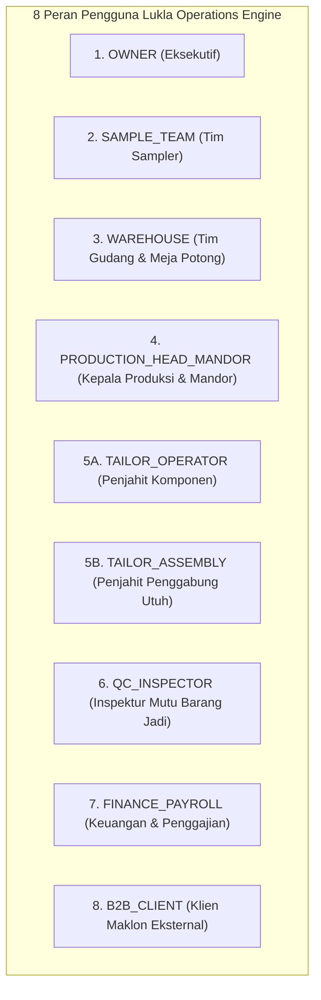

# Product Requirements Document (PRD) — Versi 2.0 Final
## Lukla Operations Engine

| Atribut Dokumen | Rincian |
|---|---|
| **Nama Produk** | Lukla Operations Engine |
| **Versi Dokumen** | **2.0 Final (Diselaraskan Penuh dengan Arsitektur Produksi & Master BRD v2.0)** |
| **Target Platform** | Web Responsif & Progressive Web App (PWA) Offline-Capable |
| **Dukungan Perangkat** | Desktop PC (`1440x900`), Tablet Touch Lini (`768x1024`), Mobile Kiosk (`390x844`) |
| **Backend & Database** | Next.js 14 App Router, Supabase PostgreSQL 17 (`pgvector`, RLS, RPC) |
| **Layanan AI** | Pure Manual RAG: AWS Bedrock Titan Text Embeddings v2 + Nova Lite |
| **Tanggal Efektif** | 15 Oktober 2026 |
| **Status Dokumen** | **Disetujui & Terkunci (Locked Master PRD)** |

---

## 1. Visi Produk & Sasaran Arsitektur

**Lukla Operations Engine** adalah sistem operasi manufaktur garmen modern yang dibangun khusus untuk fasilitas produksi garmen Ciwidey dengan kapasitas dinamis **±70 mesin jahit aktif**. Produk ini menyediakan visibilitas menyeluruh (*end-to-end visibility*) mulai dari pembuatan sampel, validasi gudang anti-kontaminasi, lantai jahit beritme 30 menit, inspeksi mutu QC barang jadi, hingga otomatisasi slip gaji borongan mingguan.

### 5 Pilar Kualitas Rekayasa ("Vibe Code")
1. **Design System Kepatuhan Mutlak**: Mengimplementasikan filosofi visual *"Lembar Kerja Pabrik, Bukan Dashboard SaaS"* sesuai `DESIGN_SYSTEM.md` dengan palet 6 warna bernama (**Kabut**, **Lembar**, **Celup Indigo**, **Tinta**, **Kapur**, **Benang Abu**), font **Archivo** dengan angka tabular (`tnum`), jahitan status (*StitchBorder*), dan warna benang klien (*ThreadEdge*).
2. **Context7 Framework Modern**: Next.js 14 App Router, TypeScript murni, Tailwind CSS kustom, dan Supabase JS Client v2.
3. **Supabase Engine**: PostgreSQL 17 dengan fungsi RPC `validate_cutting_issue` untuk validasi anti-kontaminasi di level basis data, `pgvector` untuk pencarian semantik dokumen, dan Row Level Security (RLS) untuk isolasi multi-tenant.
4. **Playwright E2E Automation**: Menjamin keandalan 100% pada 42 skenario pengujian di seluruh form dan tombol lintas 3 profil viewport (Desktop, Tablet, Mobile).
5. **Strix Security Hardening**: Proteksi agresif terhadap IDOR multi-tenant, bypass API pengeluaran bahan, manipulasi upah borongan, dan prompt injection pada AI.

---

## 2. Matriks 8 Peran RBAC & Dukungan Perangkat

Aplikasi menyediakan antarmuka teradaptasi untuk 8 peran pengguna dengan pembagian hak akses:



| Role Code | Nama Peran | Persona Default | Viewport Utama | Menu Akses Utama |
|---|---|---|---|---|
| `OWNER` | Owner / Eksekutif | Pak Budi (Pemilik) | Desktop PC & Mobile | Dashboard Lengkap, Pengaturan Rate Card & Variabel Bonus, Tanya AI, Semua Modul |
| `SAMPLE_TEAM` | Tim Sampler | Mbak Lina (Sampler) | Mobile/Tablet & PC | Sample Tracker, Digital Stopwatch SMV, BOM, Penerbitan Order Massal |
| `WAREHOUSE` | Gudang & Potong | Kang Asep (Kepala Gudang) | Mobile Scanner & PC | Inventaris Multi-Tenant, Validasi Pengeluaran Bahan, Stasiun Meja Potong, Ekspor CSV |
| `PRODUCTION_HEAD_MANDOR` | Kepala Produksi & Mandor | Kang Dadang & Kang Yayan | Tablet Lini & PC | Peta ±70 Mesin Jahit, Terminal Input 30 Menit (Langsung Verified), 1-Tap Approve |
| `TAILOR_OPERATOR` | Penjahit Komponen | Bi Entin (Operator) | Touch Kiosk / Mobile | Input Output 30 Menit Numpad (Status Pending Verification), Riwayat Komponen |
| `TAILOR_ASSEMBLY` | Penjahit Assembly | Mang Ujang (Assembly) | Touch Kiosk / Tablet | Terminal Penggabungan Komponen menjadi Pakaian Utuh -> `Menunggu QC` |
| `QC_INSPECTOR` | Inspektur QC | Teh Siti (Inspector) | Tablet Touch QC / Mobile | Terminal 3 Tombol QC (Lolos, Perbaikan, Cacat), Counter Pool Bonus QC |
| `FINANCE_PAYROLL` | Keuangan & Payroll | Ibu Dewi (Finance) | Desktop PC Workspace | Kalkulator Gaji Borongan Sabtu, Uang Makan 10-15% Tunai, Bonus QC 3-Arah, Invoice, Ekspor CSV |
| `B2B_CLIENT` | Klien Maklon Eksternal | Mas Radit (B2B Partner) | Desktop & Mobile Portal | Portal Klien B2B (Terisolasi Ketat per `client_id`), Saldo Kain Titipan, Progres Order |

---

## 3. Spesifikasi Arsitektur & Layanan AI

### 3.1 Pure Manual RAG (`lukla-rag-service`)
Sistem tidak menggunakan OpenSearch Serverless Bedrock-managed yang mahal dan lambat sinkronisasi, melainkan arsitektur **Pure Manual RAG** berkontrol penuh:
- **Embedding**: `amazon.titan-embed-text-v2:0` di Region **`us-east-1`** (North Virginia) — vektor ter-normalisasi 1024 dimensi.
- **LLM Generator**: `amazon.nova-lite-v1:0` di Region **`ap-southeast-1`** (Singapore) — model reasoning berkecepatan tinggi dengan biaya rendah.
- **Vector Store**: Supabase PostgreSQL dengan ekstensi `pgvector` pada tabel `knowledge_chunks_vector` dan fungsi pencarian semantik `match_knowledge_chunks(query_embedding, match_threshold, match_count)`.
- **Kontrak Endpoint**:
  - `POST /ask`: Request `{"question": "string", "role": "optional", "client_id": "optional"}` -> Response `{"answer": "string", "citations": [{"source": "...", "text": "...", "similarity": 0.85}]}`.
  - `GET /health`: Health status Titan (us-east-1), Nova Lite (ap-southeast-1), dan Supabase vector store.
  - `POST /ingest`: Endpoint ingest dokumen Markdown ke vector database.
- **Gaya Bahasa**: Bahasa Indonesia sentence case lugas tanpa kata-kata AI slop.

---

## 4. Spesifikasi Halaman & Komponen Antarmuka (UI/UX Views)

### 4.1 Filter Universal Terpadu (`UniversalFilterBar.tsx`)
Komponen filter universal yang terintegrasi pada Dashboard, Gudang, Meja Potong, dan Terminal Produksi:
- **Date Range Picker**: Input tanggal awal (`startDate`) dan tanggal akhir (`endDate`).
- **Quick Presets**: Tombol cepat **`Hari Ini`**, **`7 Hari Terakhir`**, **`Bulan Ini`**, dan **`Semua`**.
- **Hierarchical Specific Client Filter**: Dropdown yang menampilkan langsung entitas bisnis riil beserta *ThreadEdge* dan monogram:
  - `SH — Snøhund` (Merek Internal)
  - `KB — PT Bintang Tekstil Mandiri` (Klien Maklon A)
  - `CB — CV Bandung Garment Lestari` (Klien Maklon B)
  - `CS — PT Cipta Busana Sejahtera` (Klien Maklon C)
- **Live Search Input**: Kotak pencarian instan dengan tombol clear (`X`).

### 4.2 Dashboard Operasional Pabrik (`/dashboard`)
- **4 Kartu KPI Dinamis**:
  1. *Mesin Jahit Aktif*: Kapasitas dinamis hingga ±70 mesin.
  2. *Output Terverifikasi*: Dihitung dinamis mengikuti filter rentang tanggal dan klien yang dipilih.
  3. *Tingkat Lolos QC Utuh*: Persentase kelulusan unit produk utuh berdasarkan filter aktif.
  4. *Pencegahan Bahan Tertukar*: Counter insiden validasi anti-kontaminasi (FR-6.2).
- **Grafik Kecepatan Produksi 30 Menit**: Grafik garis tren ritme jahit per interval 30 menit.
- **Daftar Pesanan Terkini**: Tabel pesanan aktif dengan badge status, thread border klien, dan indikator skema maklon (`CMT`, `SEMI_CMT`, `FULL_PACKAGE`).
- **Akses Cepat Asisten AI**: Tombol melayang *Tanya Lukla AI* untuk membuka drawer panduan operasional.

### 4.3 Pelacak Sampel & Studi Waktu (`/samples`)
- **Versioning Revisi**: Tampilan komparasi versi `v1`, `v2`, hingga `vN`.
- **Digital Stopwatch Terintegrasi**: Stopwatch sentuh besar (Start, Lap, Reset, Rekam ke Komponen) untuk mengukur SMV di ruang sampel.
- **Pencatatan Sample BOM**: Daftar kebutuhan kain, benang, dan aksesori per potong pakaian.
- **Tombol Konversi Pesanan Massal**: Tombol *Jadikan Pesanan Massal* yang mengunci spesifikasi versi sampel yang disetujui (`Approved v2`) ke Order Produksi Massal.

### 4.4 Gudang Multi-Tenant & Meja Potong (`/warehouse`)
- **2 Tab Kerja**:
  1. *Inventaris Bahan Baku*: Tabel stok kain roll dengan mandatory tag klien & order (FR-6.1).
  2. *Stasiun Meja Potong (Cutting Station)*: Pelacakan sisa panjang roll kain, nomor batch potong, jumlah set komponen, dan tombol **Ekspor CSV**.
- **Modal Blokir Merah Anti-Kontaminasi (`AntiContaminationModal.tsx`)**:
  - Muncul seketika saat terdeteksi ketidakcocokan antara tag bahan dengan ID pesanan tujuan saat pengeluaran ke meja potong.
  - Memuat judul resmi: **"Pengeluaran Dibatalkan! Pencegahan Bahan Tertukar • Validasi Anti-Kontaminasi FR-6.2"**.
  - Menampilkan tag benturan dua klien dengan badge kontras `TIDAK COCOK`.

### 4.5 Terminal Input 30 Menit & Stasiun Assembly (`/production/terminal`)
- **Peta Visual ±70 Mesin Jahit**: Grid visual mesin jahit aktif dengan indikator warna status.
- **Touch Numpad 30 Menit**: Tombol input sentuh besar berjarak lega (target $\ge 48\text{px}$) untuk kenyamanan di lantai pabrik.
- **Dual-Mode Verification**:
  - Operator: Input tercatat sebagai `Pending Verification`.
  - Mandor: Input tercatat sebagai `Verified` atau klik *1-Tap Approve* untuk memverifikasi inputan operator.
- **Mode Stasiun Assembly**: Terminal khusus penjahit perakitan untuk menggabungkan komponen potongan menjadi 1 pakaian utuh berstatus **`Menunggu QC`**.
- **Ekspor CSV Log 30 Menit**: Mengunduh rekaman ritme output per 30 menit untuk arsip produksi.

### 4.6 Terminal Inspeksi QC Barang Jadi (`/qc/terminal`)
- **Fokus Objek**: Hanya menginspeksi **1 produk pakaian utuh** (hasil dari stasiun assembly).
- **3 Tombol Raksasa Khas Pabrik**:
  1. **🟢 LOLOS (PASS)**: Menambah saldo Pool Bonus QC (+Rp 300) dan memindahkan pakaian ke stok Barang Jadi.
  2. **🟡 PERBAIKAN (REPAIR)**: Mengembalikan pakaian ke lini produksi untuk diperbaiki tanpa penalti gaji borongan.
  3. **🔴 CACAT (REJECT)**: Mengalihkan rute barang cacat dan mencatat kode cacat (jahitan melenceng, kain robek, noda minyak, kancing lepas).
- **Counter Pool Bonus QC**: Display saldo kas pool bonus QC yang terakumulasi secara real-time.

### 4.7 Workspace Payroll & Rekap Biaya (`/payroll`)
- **Kalkulator Borongan Sabtu**: Akumulasi output 30 menit berstatus `Verified` dikalikan tarif Rate Card komponen.
- **Input Fleksibel Uang Makan (10–15%)**: Slider/input persentase uang makan yang langsung dihitung sebagai uang tunai di slip gaji.
- **Kartu Pembagian Bonus QC 3-Arah**:
  - Menampilkan pembagian saldo kas pool bonus QC secara merata ($\frac{1}{3}$) kepada 2 Mandor dan 1 Kepala Operasional.
  - Menyediakan konfigurasi dinamis jika jumlah mandor $> 2$.
- **Alokasi Overhead Bulanan per Unit**: Input beban utilitas bulanan pabrik dibagi total unit garmen yang diproduksi.
- **Cetak Slip Gaji & Ekspor CSV**: Fasilitas unduh Slip Gaji bergaris putus-putus (*perforated edge*) dan ekspor rekapitulasi gaji ke spreadsheet CSV.

### 4.8 Portal Klien Maklon B2B (`/b2b-portal`)
- **Isolasi Mutlak Klien (Multi-Tenant)**: Klien B2B hanya dapat melihat data miliknya sendiri (`client_id`).
- **Timeline Progres Pesanan**: Tahapan interaktif mulai dari Pemotongan Kain, Penjahitan Komponen, Perakitan Assembly, Inspeksi QC, hingga Siap Kirim.
- **Saldo Kain Titipan**: Informasi transparan sisa stok kain titipan klien di gudang Lukla.
- **Surat Jalan & PO Komitmen**: Pelacakan dokumen pengiriman bahan titipan skema CMT.

---

## 5. Skema Basis Data & Kontrak RPC Supabase

### Tabel-Tabel Inti:
1. `clients`: Data identitas klien, kode klien, jenis (Internal/B2B), dan `thread_color_hex`.
2. `user_profiles`: Profil pengguna dengan 8 role RBAC dan foreign key `client_id`.
3. `samples` & `sample_versions`: Data versi sampel, riwayat BOM, SMV, dan status approval.
4. `sample_components`: Rincian komponen pakaian, tarif potong, tarif jahit, dan target SMV.
5. `production_orders`: Pesanan massal, skema maklon, kuantitas target, dan tanggal pengiriman.
6. `inventory_items`: Stok kain dan aksesori dengan mandatory tag `client_id` dan `order_id` (FR-6.1).
7. `cutting_logs`: Riwayat pemotongan kain roll menjadi set bundle komponen di meja potong.
8. `production_logs_30min`: Catatan output interval 30 menit dengan status `Pending` atau `Verified`.
9. `qc_inspections`: Rekaman hasil inspeksi 1 produk utuh (`PASS`, `REPAIR`, `REJECT`) dan kode cacat.
10. `qc_bonus_pool`: Akumulasi saldo bonus QC per pesanan dan histori pencairan.
11. `payroll_periods` & `payroll_items`: Rekapitulasi gaji borongan Sabtu, tunjangan uang makan tunai, dan take home pay.

### Fungsi RPC Kritis: `validate_cutting_issue`
```sql
CREATE OR REPLACE FUNCTION public.validate_cutting_issue(
    p_inventory_item_id UUID,
    p_target_order_id UUID
) RETURNS JSONB AS $$
DECLARE
    v_item_client_id UUID;
    v_order_client_id UUID;
    v_item_client_name VARCHAR;
    v_order_client_name VARCHAR;
    v_order_number VARCHAR;
BEGIN
    SELECT client_id INTO v_item_client_id FROM inventory_items WHERE id = p_inventory_item_id;
    SELECT client_id, order_number INTO v_order_client_id, v_order_number FROM production_orders WHERE id = p_target_order_id;
    
    IF v_item_client_id <> v_order_client_id THEN
        SELECT name INTO v_item_client_name FROM clients WHERE id = v_item_client_id;
        SELECT name INTO v_order_client_name FROM clients WHERE id = v_order_client_id;
        
        -- Catat ke contamination audit log
        INSERT INTO contamination_audit_logs(item_id, target_order_id, attempted_by, reason)
        VALUES (p_inventory_item_id, p_target_order_id, auth.uid(), 'Cross-client fabric issue attempt blocked by FR-6.2');
        
        RETURN jsonb_build_object(
            'allowed', false,
            'reason', 'BLOKIR ANTI-KONTAMINASI [FR-6.2]: Bahan baku milik klien lain tidak boleh dikeluarkan untuk pesanan ini!',
            'source_client_name', v_item_client_name,
            'target_client_name', v_order_client_name,
            'order_number', v_order_number
        );
    END IF;
    
    RETURN jsonb_build_object('allowed', true);
END;
$$ LANGUAGE plpgsql SECURITY DEFINER;
```

---

## 6. Kriteria Penerimaan E2E (UAT Scenarios)

Seluruh implementasi diuji dan dinyatakan lulus oleh Playwright E2E Suite:
1. **UAT-01: Validasi Blokir Anti-Kontaminasi (FR-6.1 & FR-6.2)**: Menguji pencegahan pengeluaran bahan Taslan Milky Klien A ke pesanan ORD-2026-003 Klien B. Memastikan dialog alert muncul dengan pesan `Pengeluaran Dibatalkan!`, `TIDAK COCOK`, dan `Anti-Kontaminasi`.
2. **UAT-02: Dinamika Penjahit & Penggajian Borongan Sabtu (FR-7.1, FR-7.3, FR-10.1)**: Menambah 5 penjahit baru di tengah minggu pada mesin #61–#65, mencatat output, dan menghitung slip gaji hari Sabtu lengkap dengan uang makan tunai.
3. **UAT-03: Pembagian Pool Bonus QC 3-Arah (FR-10.3)**: Simulasi 3.000 unit lolos QC mengakumulasi Rp 900.000 dan membaginya rata menjadi Rp 300.000 untuk 2 Mandor dan 1 Kepala Operasional.
4. **UAT-04: Konversi Revisi Sampel v1 -> v2 ke Pesanan Massal Semi-CMT**: Menguji pewarisan spesifikasi BOM dan SMV dari sampel versi 2 yang disetujui ke pesanan massal.
5. **UAT-05: Asisten Tanya Lukla AI & Sitasi Dokumen**: Menguji interaksi tanya-jawab aturan operasional dan kutipan dokumen rujukan dengan format sitasi Markdown.
