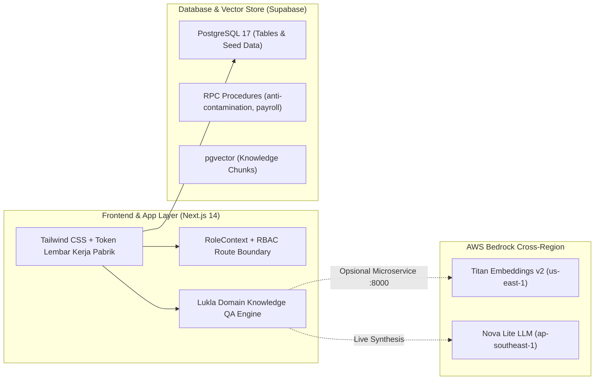

# 🏔️ Lukla Operations Engine — Platform Manajemen Pabrik Garmen Ciwidey (Kelompok 6)

[-black?style=for-the-badge&logo=next.js)](https://nextjs.org/)
[](https://supabase.com/)
[](https://aws.amazon.com/bedrock/)
[-brightgreen?style=for-the-badge&logo=playwright)](https://playwright.dev/)
[](https://tailwindcss.com/)

Platform operasional terintegrasi untuk pabrik garmen **Lukla Manufacturing** di Ciwidey, Kabupaten Bandung dengan kapasitas **±70 mesin jahit aktif**. Sistem ini mengelola produksi merek internal **Snøhund** (*made-to-order*) dan melayani berbagai **Klien Maklon B2B eksternal** secara simultan melalui arsitektur multi-tenant dengan proteksi anti-kontaminasi ketat.

---

## 📑 Daftar Isi
1. [Konteks Bisnis & 3 Skema Maklon](#1-konteks-bisnis--3-skema-maklon)
2. [10 Asumsi & Aturan Bisnis Resmi (Bahan Presentasi)](#2-10-asumsi--aturan-bisnis-resmi-bahan-presentasi)
3. [6 Fase Operasional BPMN 2.0](#3-6-fase-operasional-bpmn-20)
4. [Matriks 8 Role & Hak Akses (RBAC)](#4-matriks-8-role--hak-akses-rbac)
5. [Arsitektur Teknis & Pure Manual RAG](#5-arsitektur-teknis--pure-manual-rag)
6. [Panduan Menjalankan Proyek (Quick Start)](#6-panduan-menjalankan-proyek-quick-start)
7. [Pengujian Otomatis (E2E & Security Pentest)](#7-pengujian-otomatis-e2e--security-pentest)
8. [Struktur Folder Repositori](#8-struktur-folder-repositori)

---

## 1. Konteks Bisnis & 3 Skema Maklon
Lukla melayani dua model bisnis secara berdampingan tanpa kebocoran data (*zero data leak*) atau kontaminasi bahan:
* **Merek Internal (`Snøhund`)**: Pakaian outdoor/alpine *made-to-order* standar kualitas tinggi.
* **Klien Maklon B2B Eksternal**: Memproduksi pesanan klien dengan 3 skema kerja sama:
  1. **`CMT` (Cut, Make, Trim)**: 100% bahan baku utama merupakan titipan klien. Lukla menyediakan jasa potong, jahit, dan finishing. *(Lukla tetap menerbitkan PO ke klien sebagai reminder komitmen pengiriman bahan)*.
  2. **`SEMI_CMT`**: Kain utama titipan klien; benang, kancing, resleting, dan aksesoris diadakan oleh Lukla via PO pengadaan.
  3. **`FULL_PACKAGE`**: 100% bahan baku dan proses produksi disediakan oleh Lukla (standar default Snøhund).

---

## 2. 10 Asumsi & Aturan Bisnis Resmi (Bahan Presentasi)
Berdasarkan dokumen resmi proyek ([`docs/Catatan_Asumsi_dan_Aturan_Bisnis_Presentasi.md`](./docs/Catatan_Asumsi_dan_Aturan_Bisnis_Presentasi.md)):
1. **Gaji Borongan TIDAK Terpengaruh Hasil QC**: Gaji penjahit dihitung murni dari output 30 menit yang telah `Verified` oleh Mandor. Status `Repair` atau `Reject` di QC tidak memotong upah penjahit (*no clawback*).
2. **Hasil QC HANYA Berpengaruh terhadap Pool Bonus QC**: Setiap 1 unit pakaian utuh berstatus `LOLOS` menambah Rp 300 ke saldo Pool Bonus QC.
3. **Uang Makan (10–15%) Masuk Slip Gaji sebagai Uang Tunai**: Dihitung dari persentase variabel terhadap total borongan dan langsung masuk sebagai tunjangan tunai di slip gaji (`THP = Upah Borongan + Uang Makan`).
4. **QC Memeriksa HANYA 1 Produk Utuh (Barang Jadi)**: Terminal QC hanya menginspeksi barang jadi pakaian utuh hasil stasiun *Assembly/Finishing*, bukan komponen lepas.
5. **Skema CMT Murni Tetap Menerbitkan PO ke Client**: Berfungsi sebagai surat komitmen resmi, pelacakan (*tracking*), dan pengingat (*reminder*) pengiriman kain agar ±70 mesin tidak menganggur.
6. **RBAC & Struktur Mandor vs Kepala Operasional**: Hak akses setara, namun struktural Kepala Operasional di atas Mandor. Default bonus QC dibagi rata ($\frac{1}{3}$) untuk **2 Mandor + 1 Kepala Operasional**, dengan opsi pengaturan dinamis jika mandor $> 2$.
7. **Dual-Mode Input 30 Menit**:
   * Input oleh **Mandor** $\rightarrow$ Status langsung `Verified` (garis penuh).
   * Input oleh **Penjahit** $\rightarrow$ Status `Pending Verification` (garis putus-putus, wajib diverifikasi mandor).
8. **Operasional Cutting Dilakukan oleh Tim Gudang**: Proses pemotongan pola kain (*Cutting*) dilakukan langsung oleh personil Tim Gudang setelah bahan baku lolos validasi anti-kontaminasi FR-6.2 sebelum diserahkan ke penjahit lini.
9. **Diasumsikan TIDAK ADA Sisa Bahan**: Bahan yang dikeluarkan ke cutting diasumsikan terkonversi pas sesuai kuantitas pesanan massal (*zero remnant/shortage*).
10. **Wewenang Tim Sampler & Dukungan Multi-Role**: Sampler adalah personel yang mendaftarkan klaim/spesifikasi artikel klien ke sistem dan menerbitkan order produksi massal. Seluruh 8 antarmuka role adaptif dan bebas dari overflow di layar HP Kios (`390x844`), Tablet (`768x1024`), maupun PC (`1440x900`).

---

## 3. 6 Fase Operasional BPMN 2.0
| Fase | Modul Halaman | Fitur Utama |
| :--- | :--- | :--- |
| **Fase 1** | `/samples` | Pendaftaran klaim sampel klien oleh Sampler, Digital Stopwatch sentuh (SMV), BOM kain, dan *non-destructive versioning* (`v1 -> v2`). |
| **Fase 2** | `/samples` | Penerbitan order produksi massal oleh Tim Sampler dari versi disetujui (`v2`) ke pesanan massal (`CMT`/`SEMI_CMT`/`FULL_PACKAGE`). |
| **Fase 3** | `/warehouse` | Tagging Klien (`FR-6.1`), operasional pemotongan kain (Cutting) oleh Gudang, dan **Modal Merah Blokir Anti-Kontaminasi Seketika (HTTP 403)** (`FR-6.2`). |
| **Fase 4** | `/production/terminal` | Peta denah ±70 mesin, interval 30 menit, Touch Numpad ($\ge 72\text{px}$), dan *1-Tap Verifikasi Mandor*. |
| **Fase 5** | `/qc/terminal` | Inspeksi HANYA pada 1 produk jadi utuh, 3 Tombol Raksasa (Lolos, Perbaikan, Cacat), dan Odometer Pool Bonus QC (+Rp 300). |
| **Fase 6** | `/payroll` | Rekapitulasi borongan Sabtu, slider uang makan 10–15%, pembagian bonus QC 3-arah, alokasi overhead (`FR-10.4`), dan cetak slip 360px. |

---

## 4. Matriks 8 Role & Hak Akses (RBAC)
Dropdown pemilih peran di header atas secara otomatis mengarahkan ke workspace utama dan memfilter menu navigasi:

| No | Role | Persona Default | Rute Utama | Menu yang Diizinkan |
| :-: | :--- | :--- | :--- | :--- |
| 1 | `OWNER` | Pak Dedi | `/dashboard` | Akses penuh ke 7 menu |
| 2 | `SAMPLE_TEAM` | Mbak Lina | `/samples` | `/samples`, `/dashboard` |
| 3 | `WAREHOUSE` | Kang Asep | `/warehouse` | `/warehouse`, `/dashboard` |
| 4 | `PRODUCTION_HEAD_MANDOR` | Pak Jajang / Ujang | `/production/terminal` | `/production/terminal`, `/warehouse`, `/qc/terminal`, `/dashboard` |
| 5 | `TAILOR_OPERATOR` | Siti Rahma / Tim Cutting | `/production/terminal` | Hanya `/production/terminal` (Mode Penjahit) |
| 6 | `QC_INSPECTOR` | Teh Reni | `/qc/terminal` | `/qc/terminal`, `/dashboard` |
| 7 | `FINANCE_PAYROLL` | Bu Sari | `/payroll` | `/payroll`, `/dashboard` |
| 8 | `B2B_CLIENT` | Pak Hendra | `/b2b-portal` | **Hanya `/b2b-portal` (Terisolasi RLS)** |

---

## 5. Arsitektur Teknis & Pure Manual RAG



* **Frontend**: Next.js 14 App Router, Lucide React, Font Archivo (`tnum` tabular numbers).
* **Desain Visual**: Mengikuti prinsip *"Lembar kerja pabrik, bukan dashboard SaaS"* ([`DESIGN_SYSTEM.md`](./DESIGN_SYSTEM.md)) dengan palet 6 warna: Kabut (`#E6ECEE`), Lembar (`#F8FAFA`), Celup Indigo (`#26325B`), Tinta (`#151A24`), Kapur (`#E8E36B`), dan Benang Abu (`#9AA5AE`).
* **Database**: Supabase PostgreSQL 17 project `Kelompok_6` (`wrugjojtvgkuwjqopete`).
* **AI Engine & Agentic Workflow**:
  * **In-App Knowledge Engine** ([`lib/knowledgeEngine.ts`](./lib/knowledgeEngine.ts)): Menyediakan jawaban cerdas, terperinci, non-template dengan rujukan dokumen `.md` resmi secara instan.
  * **Endpoint `/ask` (Pure Manual RAG)**: Endpoint RAG standar berbasis embedding dokumen dan similarity search.
  * **Endpoint `/ask-agent` & `rag-agent.py` (Agentic Workflow Engine)**:
    * **3 Specialized Tools**:
      1. `lookup_database`: Eksekusi kueri `SELECT` aman ke Supabase.
      2. `process_llm_query_result`: Analisis & rangkuman data database oleh LLM Nova Lite ke metrik operasional.
      3. `answer_knowledge_question`: RAG rujukan SOP, 10 aturan bisnis resmi, dan parameter penggajian.
    * **QueryDecomposer**: Memecah query pengguna menjadi langkah-langkah terstruktur (*Step Plan JSON*).
    * **Iteration Loop**: Loop perulangan ReAct yang mengevaluasi hasil LLM dan memproses eksekusi multi-step.
    * **SQL Security Guardrail**: Memvalidasi ketat agar kueri **HANYA `SELECT`** dan **HANYA pada 3 tabel yang diizinkan**: `orders`, `products`, dan `production_lines` (semua kueri mutasi data atau tabel sensitif diblokir seketika).
    * **Response Contract Identik**: Mengembalikan format respons yang sama persis dengan `/ask` (`{"answer": "...", "citations": [...]}`) dengan metadata audit tambahan `agent_trace`.

---

## 6. Panduan Menjalankan Proyek (Quick Start)

### Prasyarat:
* **Node.js**: Versi `18.x` atau lebih baru (`v24.x` teruji)
* **Git**: Terpasang di laptop

### Langkah 1: Clone Repositori
```bash
git clone https://github.com/muhammadicun05/Kelompok_6.git
cd Kelompok_6
```

### Langkah 2: Install Dependensi
```bash
npm install
```

### Langkah 3: Setup Environment Variables
Salin file `.env.example` menjadi `.env.local`:
```bash
cp .env.example .env.local
```
*(File `.env.local` sudah memiliki URL default Supabase project Kelompok_6).*

### Langkah 4: Jalankan Server Pengembangan
```bash
npm run dev
```
Buka browser di: **`http://localhost:3000`** 🎉

---

## 7. Pengujian Otomatis (E2E & Security Pentest)
Seluruh fungsionalitas dan celah keamanan telah diverifikasi secara ketat menggunakan Playwright di 3 ukuran layar:

```bash
# Menjalankan seluruh 39 pengujian
npx playwright test
```

### Rincian 39 Skenario Pengujian:
* **`operational.spec.ts` (18 Tes)**: Verifikasi Dashboard, UAT-01 Blokir Merah Gudang Anti-Kontaminasi, UAT-02 Penggajian Penjahit Baru Mesin #61–#65, UAT-03 Pembagian Pool Bonus QC 3-Arah, UAT-04 Konversi Sampel v1 $\rightarrow$ v2, dan UAT-05 Tanya Lukla AI.
* **`role_switching.spec.ts` (12 Tes)**: Pergantian 8 peran otomatis berpindah rute URL, banner persona aktif, dan filter menu sidebar.
* **`security_strix.spec.ts` (9 Tes)**: Uji penetrasi injeksi API anti-kontaminasi, tamper slider uang makan di luar 10–15%, dan audit integritas *no clawback* gaji penjahit.

---

## 8. Struktur Folder Repositori
```text
Kelompok_6/
├── app/
│   ├── dashboard/page.tsx             # Dashboard Eksekutif Pabrik
│   ├── samples/page.tsx               # Fase 1: Stopwatch & Versioning Sampel
│   ├── warehouse/page.tsx             # Fase 3: Gudang & Anti-Kontaminasi
│   ├── production/terminal/page.tsx   # Fase 4: Terminal Input 30 Menit (±70 Mesin)
│   ├── qc/terminal/page.tsx           # Fase 5: Terminal Inspeksi QC Produk Utuh
│   ├── payroll/page.tsx               # Fase 6: Workspace Rekap Gaji & Slip 360px
│   ├── b2b-portal/page.tsx            # Portal Mandiri Klien Maklon (RLS)
│   └── api/                           # Endpoint API Next.js (Anti-kontaminasi, AI ask, dll)
├── components/
│   ├── Layout/                        # AppHeader, SidebarNav, ClientLayout, RoleContext
│   ├── Design/                        # StitchBorder, ThreadEdge (Indikator Benang Klien)
│   ├── Warehouse/                     # AntiContaminationModal (Layar Blokir Merah)
│   └── AiAssistantDrawer.tsx          # Drawer "Tanya Lukla AI"
├── lib/
│   ├── knowledgeEngine.ts             # Lukla Domain Knowledge Retrieval QA Engine
│   ├── supabase.ts                    # Supabase Client Browser
│   └── types.ts                       # TypeScript Definitions
├── tests/                             # Playwright Test Suite (39 Skenario Lolos)
├── docs/                              # Catatan Asumsi & Aturan Bisnis Presentasi
├── lukla-rag-service/                 # Microservice Pure Manual RAG Bedrock (FastAPI)
├── AGENTS.md                          # Master Steering Rules Operasional
├── DESIGN_SYSTEM.md                   # Spesifikasi Token Visual Pabrik
└── README.md                          # Dokumentasi Utama Proyek
```

---
**Dikembangkan oleh Kelompok 6 — Program Alkademi Phase 3 Offline (Lukla Operations Engine)**
