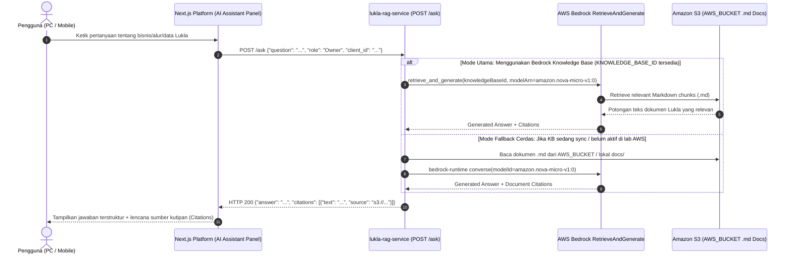
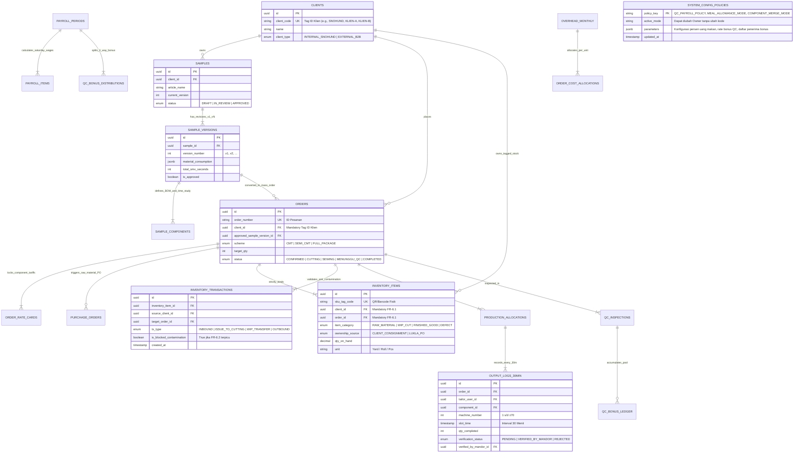

# Arsitektur Sistem Terpadu: Lukla Operations Engine

**Versi Dokumen:** 2.0 (Terintegrasi dengan `lukla-rag-service` AWS Bedrock & Standar Vibe Code)  
**Proyek:** Lukla Operations Engine (Lukla Manufacturing & Snøhund)  
**Target Platform:** Multi-Device Compatible (PC/Desktop Web & Mobile/Tablet Touch Terminal PWA)  
**Stack Utama:** Next.js (TypeScript/Tailwind) + Supabase PostgreSQL + Python FastAPI (`lukla-rag-service`) + AWS Bedrock (`Amazon Nova Micro` & `Knowledge Base S3`)  

---

## 1. Visi Arsitektur & Keselarasan Tim

Arsitektur **Lukla Operations Engine** dirancang agar rapi, modular, dan **100% menyambung (kompatibel)** dengan microservice RAG Python yang dikerjakan rekan tim Anda pada folder **`lukla-rag-service/`**, sekaligus memenuhi seluruh spesifikasi bisnis di [Business Requirement Document (BRD)_V3.md](file:///c:/Workspace/06_Courses_and_Training/Alkademi_Phase3_Offline/Lukla/Business%20Requirement%20Document%20(BRD)_V3.md) dan alur **BPMN 2.0**.

### 4 Pilar Utama Arsitektur:
1. **Modular Separation of Concerns**:
   - **Main Platform (`Next.js + Supabase PostgreSQL`)**: Menangani seluruh 6 Fase Operasional BPMN, 8 Role RBAC, validasi Anti-Kontaminasi Stok (`FR-6.1/6.2`), Terminal Touch 30 Menit (`FR-7.3/7.4`), Terminal QC, dan Mesin Payroll Fleksibel (`FR-10.1 s/d 10.4`) di layar **PC maupun Mobile**.
   - **AI RAG Microservice (`lukla-rag-service/` — Python 3.12 + FastAPI + `boto3`)**: Menyediakan endpoint **`POST /ask`** dan **`GET /health`** yang menghubungkan platform ke **Amazon Bedrock Knowledge Base** (berbasis dokumen Markdown `.md` di **Amazon S3 `AWS_BUCKET`**) menggunakan model paling efisien **`Amazon Nova Micro` (`amazon.nova-micro-v1:0`)**.
2. **Multi-Device Adaptive UI (PC + Mobile + Touch Terminal)**:
   - Tampilan otomatis beradaptasi antara mode **Desktop/PC** (tabel analitik, manajemen PO, kalkulator Payroll, portal B2B) dan mode **Mobile/Tablet Lantai Pabrik** (Stopwatch Sampel, Scanner QR Gudang, Touch Numpad 30 Menit ±70 Mesin, dan Terminal Inspeksi QC).
3. **Strict Multi-Tenant Isolation & Anti-Contamination Gate**:
   - Setiap item stok dan transaksi diikat secara mutlak pada `Tag ID Klien` + `ID Pesanan` (`FR-6.1`) dan memblokir otomatis percobaan lintas-klien (`FR-6.2`).
4. **Configurable Business Rules Engine**:
   - Menyediakan parameter dinamis yang bisa diubah oleh Owner tanpa modifikasi kode untuk mengakomodasi poin-poin aturan bisnis yang masih dalam tahap klarifikasi klien.

---

## 2. Diagram Arsitektur Sistem End-to-End

```mermaid
flowchart TD
    subgraph Client_Layer["1. Client Presentation Layer (PC & Mobile Compatible)"]
        PC_View["💻 PC / Desktop Workspace<br/>(Owner Dashboard, Finance Payroll, Admin Gudang, B2B Portal)"]
        Touch_View["📱 Mobile & Tablet Touch Terminal<br/>(Terminal Output 30 Menit, Terminal QC, Stopwatch Sample, QR Scanner Gudang)"]
        AI_Widget["💬 Lukla AI Knowledge Assistant Widget<br/>(Tersedia di PC & Mobile untuk Tanya-Jawab Knowledge & Operasional)"]
    end

    subgraph Next_Platform["2. Core Web Platform (Next.js App Router + TypeScript)"]
        Auth_RBAC["RBAC & Multi-Tenant Guard<br/>(8 Roles + Isolasi Tag ID Klien)"]
        Mod_Sample["Modul 1: Sample & Time Study<br/>(Revisi v1 -> v2 & Stopwatch)"]
        Mod_Order["Modul 2: Pesanan Massal<br/>(Skema CMT / Semi-CMT / Full Package)"]
        Mod_WMS["Modul 3: Gudang & Anti-Kontaminasi<br/>(Tagging FR-6.1, Blokir FR-6.2 & Cutting)"]
        Mod_Prod["Modul 4: Lini Produksi ±70 Mesin<br/>(Alokasi Dinamis & Output 30 Menit)"]
        Mod_QC["Modul 5: Inspeksi QC & Barang Jadi<br/>(Lolos / Repair / Cacat & Pool Bonus)"]
        Mod_Payroll["Modul 6: Mesin Payroll & Overhead<br/>(Borongan Sabtu, Uang Makan, Bonus 3-Arah)"]
    end

    subgraph Python_RAG_Service["3. AI RAG Microservice (lukla-rag-service/ — Python 3.12 + FastAPI)"]
        FastAPI_Ask["POST /ask & GET /health<br/>(main.py — FastAPI + Pydantic)"]
        Setup_KB["setup_kb.py & sync_docs_to_s3.py<br/>(Provisioning via boto3 + BEDROCK_ROLE_ARN)"]
        Hybrid_Context["Context Enricher & Fallback Handler<br/>(Gabung Citations S3 KB + Data Operasional Aktif)"]
    end

    subgraph AWS_Cloud["4. AWS Cloud & Amazon Bedrock (Region: ap-southeast-1)"]
        S3_Bucket[("Amazon S3 (AWS_BUCKET)<br/>(Dokumen .md Knowledge Base Lukla:<br/>BRD, PRD, SOP 6 Fase, Aturan Payroll)")]
        Bedrock_KB["Amazon Bedrock Knowledge Base<br/>(RetrieveAndGenerate API + Titan Embeddings V2)"]
        Nova_Micro["Amazon Nova Micro / Lite<br/>(amazon.nova-micro-v1:0 — Fast & Cost-Efficient Generation)"]
        IAM_Role["IAM Role: BedrockClassKBRole<br/>(arn:aws:iam::820242904049:role/BedrockClassKBRole)"]
    end

    subgraph Supabase_Layer["5. Transactional Database & Realtime (Supabase PostgreSQL)"]
        Supa_DB[("Supabase PostgreSQL<br/>(Tabel 6 Fase Operasional + RLS Multi-Tenant)")]
        Supa_RT["Supabase Realtime<br/>(Live Update Output 30 Menit & Progres B2B)"]
    end

    PC_View --> Auth_RBAC
    Touch_View --> Auth_RBAC
    AI_Widget --> FastAPI_Ask
    Auth_RBAC --> Mod_Sample & Mod_Order & Mod_WMS & Mod_Prod & Mod_QC & Mod_Payroll

    Mod_Sample & Mod_Order & Mod_WMS & Mod_Prod & Mod_QC & Mod_Payroll --> Supa_DB
    Mod_Prod & Mod_QC --> Supa_RT
    Supa_RT --> PC_View & Touch_View

    FastAPI_Ask --> Hybrid_Context
    Hybrid_Context --> Bedrock_KB
    Hybrid_Context <--> Supa_DB
    Setup_KB --> IAM_Role
    Setup_KB --> S3_Bucket
    Setup_KB --> Bedrock_KB
    Bedrock_KB <--> S3_Bucket
    Bedrock_KB --> Nova_Micro
```



---

## 3. Arsitektur Detail `lukla-rag-service/` (Menyambung dengan Hasil Kerja Rekan Tim)

Berdasarkan [History Chat temanku dengan Kiro.md](file:///c:/Workspace/06_Courses_and_Training/Alkademi_Phase3_Offline/Lukla/History%20Chat%20temanku%20dengan%20Kiro.md), rekan Anda telah merancang *microservice* Python di dalam subfolder **`lukla-rag-service/`**. Agar arsitektur kita 100% kompatibel sekaligus lebih tangguh (*production-ready*), berikut adalah spesifikasi teknisnya:

### 3.1 Struktur Folder Terintegrasi
```text
Lukla/
├── docs/                                # Pusat dokumentasi proyek & sumber Knowledge Base (.md)
│   ├── Business Requirement Document (BRD)_V3.md
│   ├── PRD_Lukla_Operations_Engine.md
│   ├── System_Architecture_Lukla.md
│   └── knowledge-base/                  # File .md terstruktur siap upload ke S3 AWS_BUCKET
│       ├── 01_SOP_Fase_Sampel_dan_Skema_Maklon.md
│       ├── 02_SOP_Gudang_Anti_Kontaminasi.md
│       ├── 03_SOP_Lini_Produksi_70_Mesin_dan_QC.md
│       └── 04_Kebijakan_Payroll_Uang_Makan_dan_Bonus_QC.md
├── lukla-rag-service/                   # Microservice Python 3.12 + FastAPI + boto3
│   ├── .env.example                     # Template konfigurasi AWS & Bedrock KB
│   ├── requirements.txt                 # fastapi, uvicorn, boto3, python-dotenv, pydantic
│   ├── setup_kb.py                      # Provisioning Bedrock KB dengan BEDROCK_ROLE_ARN (tanpa iam:CreateRole)
│   ├── sync_s3_docs.py                  # Helper upload/sync file .md dari docs/ ke AWS_BUCKET S3
│   ├── main.py                          # FastAPI: POST /ask & GET /health (RetrieveAndGenerate + Fallback)
│   └── README.md                        # Panduan eksekusi cepat Python 3.12 venv
├── src/ (Next.js App)                   # Aplikasi utama PC & Mobile (6 Fase BPMN + Integrasi Widget /ask)
└── tests/                               # Playwright CLI E2E Tests & Security Validation
```

### 3.2 Konfigurasi `.env` yang Diselaraskan
Mengakomodasi batasan akun AWS Lab (`student_6` pada akun `820242904049` di region `ap-southeast-1` yang tidak memiliki izin `iam:CreateRole`), konfigurasi `.env` distandarisasi menjadi:
```env
AWS_ACCESS_KEY=your_aws_access_key
AWS_SECRET_ACCESS=your_aws_secret_key
AWS_BUCKET=your_s3_bucket_name
AWS_REGION=ap-southeast-1
BEDROCK_ROLE_ARN=arn:aws:iam::820242904049:role/BedrockClassKBRole
KNOWLEDGE_BASE_ID=your_kb_id_after_setup
BEDROCK_MODEL_ID=amazon.nova-micro-v1:0
```

### 3.3 Alur Kerja `POST /ask` (Sequence Diagram)



> [!TIP]
> **Keunggulan Desain Dual-Mode (Managed KB + Direct S3 Fallback) di `main.py`:**
> Pada akun AWS Lab/Course, terkadang pembuatan *OpenSearch Serverless* di dalam `setup_kb.py` memakan waktu beberapa menit atau terkena batasan kuota lab. Dengan menyertakan *Fallback Handler* otomatis di `main.py` (yang langsung mengambil file `.md` dari `AWS_BUCKET` S3 dan memanggil `amazon.nova-micro-v1:0` jika `KNOWLEDGE_BASE_ID` belum siap), endpoint `POST /ask` dijamin **100% selalu berhasil menjawab pertanyaan tanpa pernah crash** saat demo maupun pengujian!

---

## 4. Strategi Kompatibilitas Mobile & PC (Multi-Device Matrix Seluruh 8 Role)

Sesuai aturan bahwa **SEMUA 8 Role wajib bisa diakses dan nyaman di MOBILE maupun PC/DESKTOP**, arsitektur antarmuka dibangun adaptif:

| Peran Pengguna (Role) | Dukungan Perangkat | Penggunaan di PC / Desktop | Penggunaan di Mobile / Smartphone / Tablet |
| :--- | :---: | :--- | :--- |
| **1. Owner / Eksekutif** | 💻 PC & 📲 Mobile | Dashboard KPI multi-kolom, konfigurasi Rate Card & kebijakan sistem (% Uang Makan, Rate Bonus QC, setting jumlah Mandor >2), Tanya Lukla AI. | Ringkasan eksekutif, grafik laju pabrik, notifikasi persetujuan instan, dan Tanya Lukla AI di HP. |
| **2. Tim Sample** | 💻 PC & 📲 Mobile | Input tabel BOM konsumsi bahan sampel, perbandingan *diff* revisi `v1 -> v2`, penguncian spesifikasi ke pesanan massal. | **Digital Stopwatch** ramah sentuh di samping mesin sampel untuk catat SMV per komponen & upload foto sampel. |
| **3. Gudang (Warehouse)** | 💻 PC & 📲 Mobile | Grid inventaris multi-tenant, tabel Stok Opname, cetak label QR Tag Klien (`FR-6.1`), audit log anti-kontaminasi. | **Kamera QR Scanner** untuk *Receiving* & validasi bahan ke Cutting + **Layar Peringatan Merah Penuh Anti-Kontaminasi (`FR-6.2`)**. |
| **4. Kepala Produksi / Mandor** | 💻 PC & 📲 Mobile | Pengajuan PO bahan baku (PO Supplier atau PO Reminder Klien CMT), perencanaan lini ±70 mesin, rekapitulasi output lini. | Pengaturan alokasi penjahit di lantai pabrik, **Input Langsung (Otomatis `Verified`)**, dan **1-Tap Verifikasi** input penjahit. |
| **5. Penjahit & Tim Cutting** | 💻 PC & 📲 Mobile | Terminal laporan kerja berbasis PC kiosk di area pemotongan/jahit untuk melihat penugasan dan riwayat output terverifikasi. | **Touch Terminal Numpad** berukuran besar di HP/tablet lini untuk lapor output 30 menit (berstatus **`Pending Verification`**). |
| **6. QC Inspector** | 💻 PC & 📲 Mobile | Rekap histori cacat produk utuh, filter tren cacat, dan monitoring saldo Pool Bonus QC. | **Touch QC Terminal** dengan 3 tombol raksasa (`LOLOS`, `REPAIR`, `CACAT`) untuk memeriksa 1 produk utuh & memicu Pool Bonus QC. |
| **7. Finance & Payroll** | 💻 PC & 📲 Mobile | Kalkulator borongan Sabtu (mencakup penjahit & cutting), simulasi Uang Makan 10–15% ke slip gaji, pembagian bonus QC (2 Mandor + 1 Kepala Ops / dinamis >2), alokasi overhead, export PDF Invoice & Slip Gaji. | Review cepat total payroll mingguan, persetujuan PO, dan pemantauan biaya overhead berjalan dari HP. |
| **8. Klien Maklon (B2B)** | 💻 PC & 📲 Mobile | Portal B2B desktop untuk kirim spesifikasi sampel, terima pengingat PO CMT, konfirmasi pesanan massal, pantau sisa kain titipan. | *Live Order Tracker* di HP untuk memantau progres pesanan secara real-time dan bertanya ke Tanya Lukla AI tentang order miliknya. |

---

## 5. Desain Database & Isolasi Multi-Tenant (ERD Supabase PostgreSQL)

Untuk memenuhi persyaratan **FR-6.1 (Mandatory Client Tagging)** dan **FR-6.2 (Aturan Anti-Kontaminasi)**, seluruh tabel inventaris dan produksi mengikat `client_id` dan `order_id` secara ketat:



---

## 6. Pipeline Pengembangan, Pengujian Otomatis & Keamanan (Standar 5 Pilar Vibe Code)

Sesuai panduan pada [Tips untuk Vibe Code.md](file:///c:/Workspace/06_Courses_and_Training/Alkademi_Phase3_Offline/Lukla/Tips%20untuk%20Vibe%20Code.md), proses pembangunan dan verifikasi kualitas menggunakan 5 pilar berikut:

| No | Pilar Vibe Code | Implementasi Konkret pada Proyek Lukla |
| :-: | :--- | :--- |
| **1** | **Context7** *(Up-to-Date Docs)* | Menggunakan sintaks terbaru untuk **Next.js App Router**, **Supabase**, **FastAPI (Python 3.12)**, dan **`boto3` Bedrock Agent Runtime (`retrieve_and_generate`)** agar bebas dari error versi paket. |
| **2** | **Skill UI for Front-End** *(Design System)* | Menggunakan dokumen sistem desain `DESIGN_SYSTEM.md` untuk memastikan konsistensi visual antara tampilan *Desktop Industrial Dashboard* dan *Factory Touch Terminal* (Mobile/Tablet). |
| **3** | **Supabase Plugin (MCP)** *(Database Engine)* | Membangun skema PostgreSQL, kebijakan Row-Level Security (RLS) multi-tenant, serta fungsi validasi Anti-Kontaminasi (`FR-6.1/6.2`). |
| **4** | **Playwright CLI** *(Automated E2E Test)* | Menguji seluruh tombol, form, endpoint `/ask`, dan **4 Skenario UAT Wajib BRD** secara otomatis di browser (viewport PC & Mobile). |
| **5** | **Strix / Security Red-Team** *(Pentest)* | Menguji ketahanan aplikasi terhadap percobaan pencurian data lintas-klien (IDOR Klien A ke Klien B), *bypass* blokir Anti-Kontaminasi gudang, dan manipulasi hak akses RBAC. |
