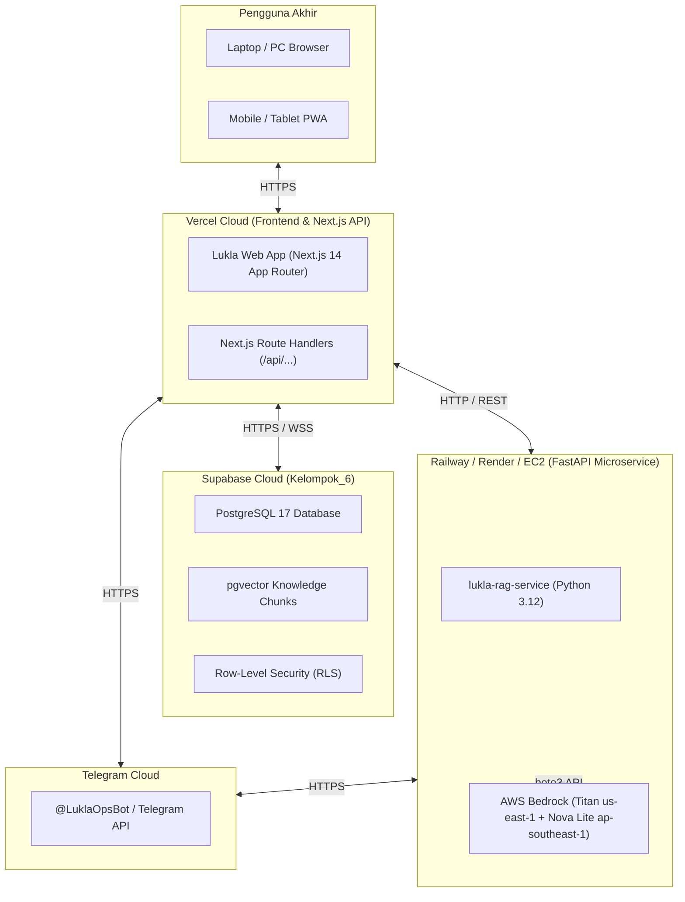

# Panduan Deployment Cloud Publik — Lukla Operations Engine
*(Panduan Resmi Deploy ke Vercel & Railway / Render)*

Dokumen ini memandu langkah-langkah mempublikasikan **Lukla Operations Engine** ke internet agar dapat diakses oleh juri, mentor, klien, dan pengguna melalui tautan publik (misal: `https://lukla-operations.vercel.app`) dan diinstal sebagai Progressive Web App (PWA) di HP/Tablet/Desktop.

---

## 1. Arsitektur Deployment Cloud

---

## 2. Deploy Frontend ke Vercel (1-Click via GitHub)

### Langkah 1: Hubungkan Repositori GitHub ke Vercel
1. Buka [https://vercel.com](https://vercel.com) dan login menggunakan akun GitHub Anda.
2. Klik tombol **"Add New..."** $\rightarrow$ **"Project"**.
3. Pilih repositori **`muhammadicun05/Kelompok_6`**.

### Langkah 2: Konfigurasi Project Settings
- **Framework Preset**: `Next.js`
- **Root Directory**: `./` (Root direktori)
- **Build Command**: `next build` (otomatis)
- **Output Directory**: `.next` (otomatis)
- **Install Command**: `npm install` (otomatis)

### Langkah 3: Masukkan Environment Variables di Vercel
Pada bagian **Environment Variables**, tambahkan variabel berikut:

| Nama Variabel | Nilai Contoh | Keterangan |
|---|---|---|
| `NEXT_PUBLIC_SUPABASE_URL` | `https://wrugjojtvgkuwjqopete.supabase.co` | URL project Supabase Kelompok_6 |
| `NEXT_PUBLIC_SUPABASE_ANON_KEY` | *(Salin dari file `.env.local` Anda)* | Kunci publik Supabase anon |
| `SUPABASE_SERVICE_ROLE_KEY` | *(Salin dari dashboard Supabase Settings $\rightarrow$ API)* | Kunci service role admin (opsional untuk backend) |
| `NEXT_PUBLIC_RAG_SERVICE_URL` | `https://lukla-rag-service.up.railway.app` | URL microservice RAG (atau kosongkan untuk fallback lokal) |
| `TELEGRAM_BOT_TOKEN` | *(Token dari @BotFather, contoh: `7123456789:AA...`)* | Token Bot Telegram pabrik |
| `TELEGRAM_DEFAULT_CHAT_ID` | *(ID Chat/Group Telegram Anda)* | Chat ID tujuan notifikasi |

### Langkah 4: Klik "Deploy"
Vercel akan secara otomatis membangun aplikasi, menjalankan lint & type check, dan memberikan domain langsung seperti:
👉 `https://lukla-operations.vercel.app`

---

## 3. Fitur PWA (Install Langsung di HP & Tablet)
Setelah web aktif di domain publik Vercel:
1. **Di HP Android / Tablet (Chrome / Edge)**: Buka tautan $\rightarrow$ Tekan ikon titik tiga $\rightarrow$ Pilih **"Install app"** atau **"Tambahkan ke Layar Utama"**.
2. **Di iPhone / iPad (Safari)**: Buka tautan $\rightarrow$ Tekan tombol Share (panah ke atas) $\rightarrow$ Pilih **"Add to Home Screen"**.
3. **Di PC Windows / Mac (Chrome / Edge)**: Klik ikon install komputer di bilah URL (sebelah kanan bintang bookmark).

Aplikasi akan berjalan dalam jendela mandiri (*standalone window*) tanpa address bar browser, dengan ikon logo Lukla berlatar putih bersih, dan siap digunakan di lantai pabrik.
