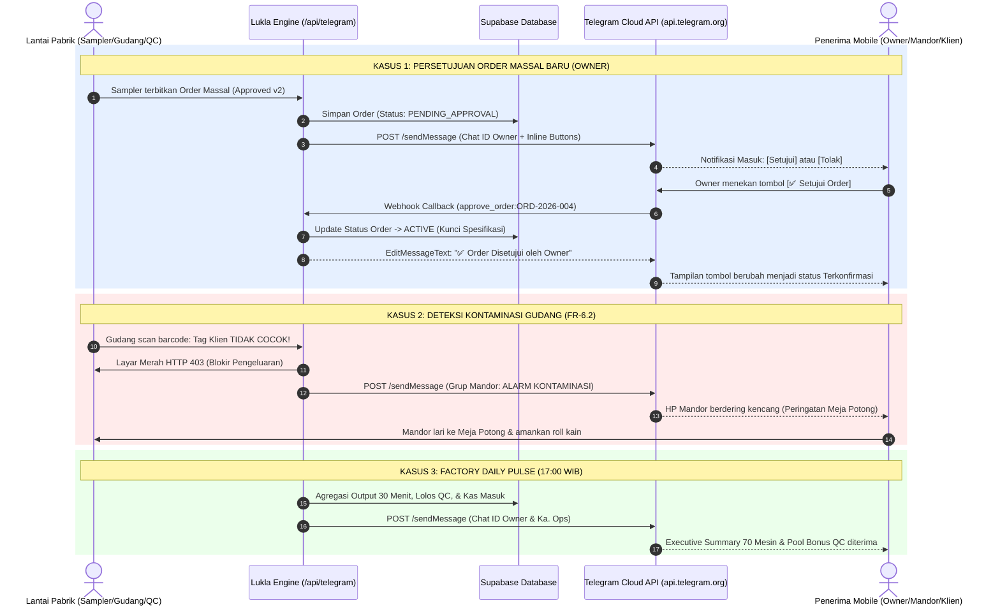

# Spesifikasi Teknis & Alur BPMN 2.0: Integrasi Telegram Bot Pabrik
## Lukla Operations Engine — Pocket Bridge untuk Pimpinan, Mandor, dan Klien B2B

---

## 1. Latar Belakang & Urgensi Bisnis di Pabrik Ciwidey

Pabrik garmen **Lukla Manufacturing di Ciwidey** mengoperasikan **±70 mesin jahit aktif** dengan ritme kerja lantai pabrik yang cepat, dinamis, dan berisik (*high-noise industrial environment*). 

Dalam kondisi riil di pabrik:
1. **Operator Jahit & QC Tidak Memegang Smartphone**:  
   Operator dan penjahit di mesin dilarang bermain HP saat bekerja agar fokus pada keselamatan kerja dan target output per 30 menit. Mereka berinteraksi dengan sistem menggunakan **Touch Terminal Numpad** di ujung meja dan **Tablet Stasiun QC**.
2. **Pimpinan (Owner) Memiliki Mobilitas Tinggi**:  
   Owner jarang berada di belakang meja komputer seharian. Owner sering melakukan perjalanan dinas, bernegosiasi dengan suplier kain di Bandung/Jakarta, atau bertemu prospek klien maklon baru.
3. **Mandor & Kepala Operasional Bergerak Dinamis (*Mobile on Floor*)**:  
   Mandor tidak duduk di kantor; mereka berjalan mengawasi ±70 mesin, menengahi kendala teknis benang putus, dan mengawasi meja potong.
4. **Klien Maklon B2B Berada di Luar Kota**:  
   Klien maklon (misal brand pakaian di Jakarta/luar pulau) sering cemas dan terus-menerus menanyakan: *"Kain titipan saya sudah dipotong belum? Jahit sudah berapa persen?"*.

### Solusi Strategis: Telegram Bot API sebagai "Pocket Bridge"
Alih-alih membangun aplikasi mobile native yang mahal dan membebani memori HP pekerja, sistem mengadopsi **Telegram Bot API** sebagai jembatan saku (*pocket bridge*) berbiaya operasional **Rp 0 (Gratis)**. Telegram dipilih karena:
- Bobot aplikasi ringan dan ramah ponsel berspesifikasi rendah (*entry-level smartphone*).
- Mendukung pengiriman pesan instan kaya format (teks tebal, emoji status, progress bar visual).
- Mendukung **Interactive Inline Keyboard** (tombol aksi cepat seperti `[✅ Setujui Order]` dan `[❌ Tolak Order]`) yang memungkinkan pengambilan keputusan seketika tanpa membuka browser atau login ke komputer.

---

## 2. Matriks Pengguna & Pemisahan Hak Akses (RBAC Telegram)

Telegram Bot **TIDAK** digunakan oleh semua orang. Sistem secara cerdas membedakan hak akses dan jenis notifikasi berdasarkan **`Chat ID`** atau **`Grup Telegram Resmi`**:

```
                              ┌───────────────────────────────────┐
                              │     LUKLA TELEGRAM BOT ENGINE     │
                              │      (@LuklaManufactur_Bot)       │
                              └─────────────────┬─────────────────┘
                                                │
         ┌──────────────────────────────────────┼──────────────────────────────────────┐
         ▼                                      ▼                                      ▼
┌─────────────────────────┐            ┌─────────────────────────┐            ┌─────────────────────────┐
│       ROLE: OWNER       │            │  ROLE: MANDOR & KA OPS  │            │    ROLE: KLIEN B2B      │
│     (Chat ID Owner)     │            │    (Grup Lini Pabrik)   │            │   (Chat ID Per Klien)   │
├─────────────────────────┤            ├─────────────────────────┤            ├─────────────────────────┤
│ • 1-Click Order Approval│            │ • Alarm Anti-Kontaminasi│            │ • Progress Bar Produksi │
│ • Factory Daily Pulse   │            │ • Info Pool Bonus QC    │            │ • Milestone QC Lolos    │
│ • Rekap Finansial & DP  │            │ • Peringatan Mesin Macet│            │ • Info Resi Pengiriman  │
│ • Akses Data Multi-Klien│            │ • Terbatas Lini Produksi│            │ • Terisolasi Milik Klien│
└─────────────────────────┘            └─────────────────────────┘            └─────────────────────────┘
```

### Tabel Rincian Hak Akses & Matriks Notifikasi:

| Role Penerima | Identifikasi Sistem | Jenis Notifikasi yang Diterima | Hak Interaksi / Tindakan |
| :--- | :--- | :--- | :--- |
| **OWNER** | `Chat ID` Pimpinan Pabrik | 1. Permintaan Persetujuan Order Massal Baru (`ORDER_APPROVAL`)<br>2. Rekap Harian Pabrik Pukul 17:00 WIB (`FACTORY_PULSE`)<br>3. Konfirmasi Penerimaan DP Klien 50% | Menekan tombol inline `[✅ Setujui]` atau `[❌ Tolak]` yang langsung mengubah status database menjadi `ACTIVE`. |
| **KEPALA OPERASIONAL & MANDOR** | `Chat ID` / Grup Telegram Supervisi Pabrik | 1. Alarm Kritis Anti-Kontaminasi FR-6.2 (`CONTAMINATION_ALERT`)<br>2. Update Saldo Pool Bonus QC Harian (Hak 2 Mandor + 1 Ka Ops)<br>3. Peringatan Penjahit Lupa Input Output 30 Menit | Menerima peringatan dini (*early warning*) untuk segera mendatangi meja potong atau mesin jahit yang bermasalah. |
| **KLIEN MAKLON B2B** | `Chat ID` Klien (Terikat `client_id`) | 1. Milestone Penerimaan Bahan Titipan di Gudang<br>2. Progres Meja Potong & Perakitan (`CLIENT_STATUS`)<br>3. Notifikasi Unit Siap Kirim & Resi Ekspedisi | Hanya membaca status (*read-only*), terisolasi ketat hanya untuk pesanan miliknya (Anti-IDOR). |

---

## 3. 4 Skenario Operasional Nyata (End-to-End Use Cases)

### Skenario 1: Quick Action Approval Order (Persetujuan Cepat 1-Ketuk)
1. **Pemicu**: Tim Sampler selesai menguji waktu standar (SMV) dan konsumsi bahan (BOM) pada sampel Approved v2, lalu menerbitkan pesanan massal baru (`ORD-2026-004`, Snøhund, 500 pcs, Skema SEMI_CMT).
2. **Aksi Bot**: Sistem memicu endpoint `POST /api/telegram` dengan event `ORDER_APPROVAL` ke Chat ID Owner.
3. **Pesan di Telegram**:
   ```text
   🚨 PERSETUJUAN PESANAN MASSAL BARU (OWNER)

   No. Order: ORD-2026-004
   Klien: Snøhund
   Artikel: Winter Parka V2
   Volume: 500 pcs
   Skema Maklon: SEMI_CMT

   Apakah Anda menyetujui penerbitan order produksi massal ini?
   [✅ Setujui Order Produksi]   [❌ Tolak Order]
   ```
4. **Hasil Tindakan**: Owner cukup menekan tombol `[✅ Setujui]`. Bot mengirim webhook balik ke server Lukla, status pesanan otomatis berubah dari `PENDING_APPROVAL` menjadi `ACTIVE`, dan Meja Potong Gudang langsung dapat memulai pemotongan kain.

---

### Skenario 2: Emergency Alert Blokir Anti-Kontaminasi (FR-6.2)
1. **Pemicu**: Petugas gudang hendak memotong kain untuk pesanan Klien B, namun secara tidak sengaja memindai roll kain titipan Klien A.
2. **Aksi Sistem**: Layar scanner gudang seketika **menyala merah dan berkedip** (Blokir HTTP 403 Anti-Kontaminasi).
3. **Aksi Bot**: Dalam waktu $< 1$ detik, bot memancarkan pesan darurat ke grup Telegram Mandor & Kepala Produksi:
   ```text
   ⚠️ EMERGENCY ALERT: BLOKIR ANTI-KONTAMINASI (FR-6.2)!

   Lokasi: Meja Potong Gudang (Cutting Station)
   Order Dituju: ORD-2026-005 (Klien B - Urban Casual)
   Bahan Dipindai: ROLL-SNOHUND-088 (KLIEN LAIN: Snøhund)
   Status: TRANSAKSI DIBLOKIR OTOMATIS!

   Mandor harap segera merapat ke Meja Potong untuk verifikasi fisik.
   ```
4. **Hasil Tindakan**: Mandor langsung menegur petugas gudang dan mengembalikan roll kain ke rak yang benar sebelum sehelai benang pun terpotong. Pabrik terhindar dari sanksi penalti ganti rugi kain titipan klien.

---

### Skenario 3: Factory Daily Pulse (Laporan Harian Tutup Shift)
1. **Pemicu**: Pukul 17:00 WIB, shift kerja lantai pabrik selesai.
2. **Aksi Bot**: Sistem mengagregasi data output 30 menit seluruh lini, hasil inspeksi QC, dan saldo kas masuk, lalu mengirim pesan ke Owner & Ka. Ops:
   ```text
   🏭 LUKLA OPERATIONS — FACTORY PULSE
   📅 15 Oktober 2026

   ⚡ Kapasitas & Alokasi Mesin:
   • 68 / 70 Mesin Aktif (97.1% Utilisasi)
   • Lini A: 25 mesin | Lini B: 25 mesin | Lini C: 18 mesin

   ✂️ Meja Potong (Cutting Station):
   • Status: 500 pcs (Winter Parka V2) selesai potong
   • Diserahkan ke: Penjahit Operator Lini A & B

   🧵 Lini Jahit & Stasiun Assembly:
   • Penjahit Operator: 320 pcs komponen terverifikasi (30 menit)
   • Penjahit Assembly: 3 bundle siap rakit (Antrean FIFO)

   🔍 Inspeksi QC Produk Utuh:
   • Tingkat Lolos: 98.2%
   • Unit Lolos: 2.946 pcs | Perbaikan: 42 pcs | Cacat: 12 pcs
   • Pool Bonus QC Terkumpul: Rp 883.800
     └ Dibagi 3-Arah: Rp 294.600 per Mandor (2x) & Ka. Ops (1x)

   💰 Penagihan & Invoice B2B:
   • ORD-2026-004 (Snøhund): DP 50% Diterima (Rp 4.550.000)
   ```

---

### Skenario 4: Milestone Tracking untuk Klien Maklon B2B
1. **Pemicu**: Stasiun Assembly menyelesaikan perakitan dan Stasiun QC menyatakan 200 unit jaket lolos inspeksi kualitas.
2. **Aksi Bot**: Bot mengirim pembaruan status ke akun Telegram perwakilan Klien Snøhund:
   ```text
   📦 STATUS PESANAN B2B: ORD-2026-004
   Artikel: Winter Parka V2 (Heavyweight)
   Klien: Snøhund | Skema: SEMI_CMT | Jumlah: 500 pcs

   Progres Produksi: [▓▓▓▓▓▓▓▓░░] 80%

   1. ✅ Intake Spesifikasi & Sampel Disetujui (Approved v2)
   2. ✅ Penerimaan Bahan & Meja Potong (Cutting Station)
   3. ✅ Jahit Komponen Lepas (Operator 30-Menit)
   4. 🔄 Perakitan Produk Utuh (Penjahit Assembly FIFO)
   5. ⏳ Inspeksi Kualitas (Terminal QC Produk Utuh)
   6. ⏳ Pelunasan Tagihan & Pengiriman Ekspedisi

   Estimasi Selesai: 18 Oktober 2026
   ```

---

## 4. Diagram Alur BPMN 2.0: Khusus Integrasi Telegram Bot

Di bawah ini adalah diagram proses bisnis standar **BPMN 2.0** yang memetakan interaksi 4 *Pool/Swimlane*: **Lantai Pabrik**, **Backend Lukla**, **Telegram Cloud API**, dan **Penerima Mobile**.



---

## 5. Arsitektur Teknis & Mekanisme Pengiriman Pesan

### Arsitektur Aliran Data:
1. **Frontend / Terminal Lantai Pabrik**:
   - Memanggil `fetch('/api/telegram', { method: 'POST', body: JSON.stringify({...}) })`.
2. **Next.js Serverless Route (`app/api/telegram/route.ts`)**:
   - Membaca `TELEGRAM_BOT_TOKEN` dan `TELEGRAM_DEFAULT_CHAT_ID` dari environment variables yang terenkripsi.
   - Melakukan validasi *null safety* pada `targetChatId`. Jika kosong, sistem memberikan respons instruksi ramah.
   - Menyusun struktur pesan menggunakan format teks resmi, emoji indikator status pabrik, dan *Inline Keyboard Markup*.
3. **Telegram HTTPS Gateway (`https://api.telegram.org/bot<TOKEN>/sendMessage`)**:
   - Menerima request payload JSON melalui koneksi aman TLS 1.3.
   - Meneruskan push notification ke aplikasi Telegram client penerima dalam hitungan milidetik ($< 500\text{ms}$).

### Kode Penanganan Error Cerdas (*Self-Healing Error Handler*):
Sistem mengantisipasi aturan privasi Telegram secara otomatis:
- **Error 403 (*Bot can't initiate conversation*)**:  
  Jika penerima belum mengklik `START`, sistem menampilkan pesan: *"Buka @LuklaManufactur_Bot di aplikasi Telegram kamu, lalu klik tombol START terlebih dahulu."*
- **Error 400 (*Chat not found*)**:  
  Jika Chat ID salah, sistem menginstruksikan pengguna untuk memeriksa Chat ID lewat `@userinfobot`.

---

## 6. Aspek Keamanan & Kepatuhan Multi-Tenant

1. **Anti-IDOR (Insecure Direct Object Reference)**:
   - Data notifikasi klien maklon disaring ketat berdasarkan `client_id` di database Supabase.
   - Klien maklon eksternal **tidak akan pernah menerima pesan** yang berisi omzet pabrik, tarif borongan penjahit, maupun progres pesanan milik klien maklon lain.
2. **Token Protection**:
   - `TELEGRAM_BOT_TOKEN` disimpan secara aman di *Server-Side Environment Variables* (Vercel / `.env.local`).
   - Token **tidak pernah diekspos** ke browser sisi klien (*Client-Side DOM*).
3. **No Message Logging of Sensitive PII**:
   - Sistem hanya mengirim ringkasan nomor order (`ORD-xxxx`), jumlah unit, dan nama artikel produk tanpa membocorkan rahasia pola potongan atau data sensitif perbankan pekerja.

---

## 7. Skrip Presentasi Sidang: Menjelaskan Modul Telegram (1 Menit)

Gunakan skrip berikut saat mendemokan fitur Telegram di hadapan Dewan Juri:

> *"Bapak dan Ibu Dewan Juri, keunggulan utama dari Lukla Operations Engine adalah kemampuannya menghubungkan lantai produksi fisik di Ciwidey dengan saku pimpinan secara seketika melalui integrasi Telegram Bot API.*  
> 
> *Di pabrik garmen, penjahit dan operator fokus bekerja tanpa smartphone di meja jahit. Namun, pimpinan pabrik dan mandor sering berada dalam posisi mobile. Melalui bot `@LuklaManufactur_Bot`, kami menghadirkan 3 fungsi revolusioner berbiaya nol rupiah:*  
> 1. *Pertama, **Quick Action Approval**: Owner dapat menyetujui pesanan massal baru langsung dari chat Telegram cukup dengan satu sentuhan tombol inline tanpa harus membuka laptop.*  
> 2. *Kedua, **Emergency Contamination Alert**: Jika terjadi insiden salah ambil kain titipan klien di gudang, alarm langsung berdering di HP Mandor sebelum kain sempat dipotong.*  
> 3. *Ketiga, **Factory Daily Pulse**: Setiap pergantian shift, rekapitulasi utilisasi 70 mesin jahit dan akumulasi pool bonus QC langsung dilaporkan secara transparan.*  
> 
> *Inilah bukti nyata bahwa sistem yang kami bangun tidak hanya canggih di atas kertas, tetapi benar-benar menjawab dinamika operasional pabrik garmen di lapangan."*
